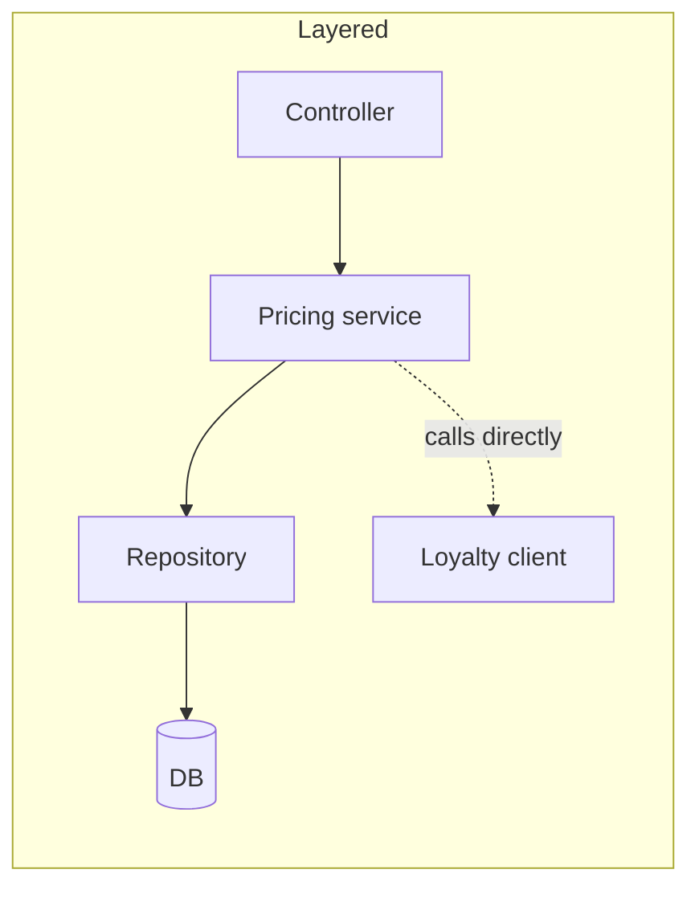
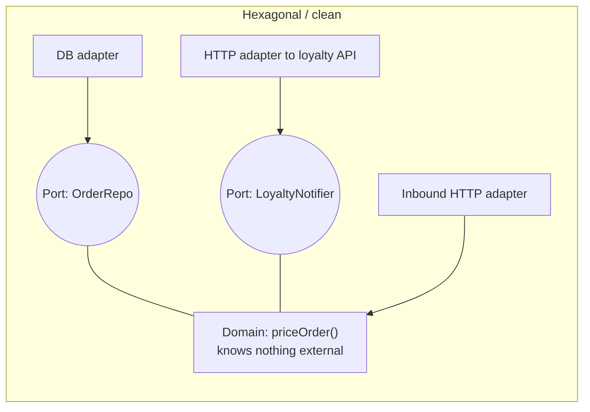
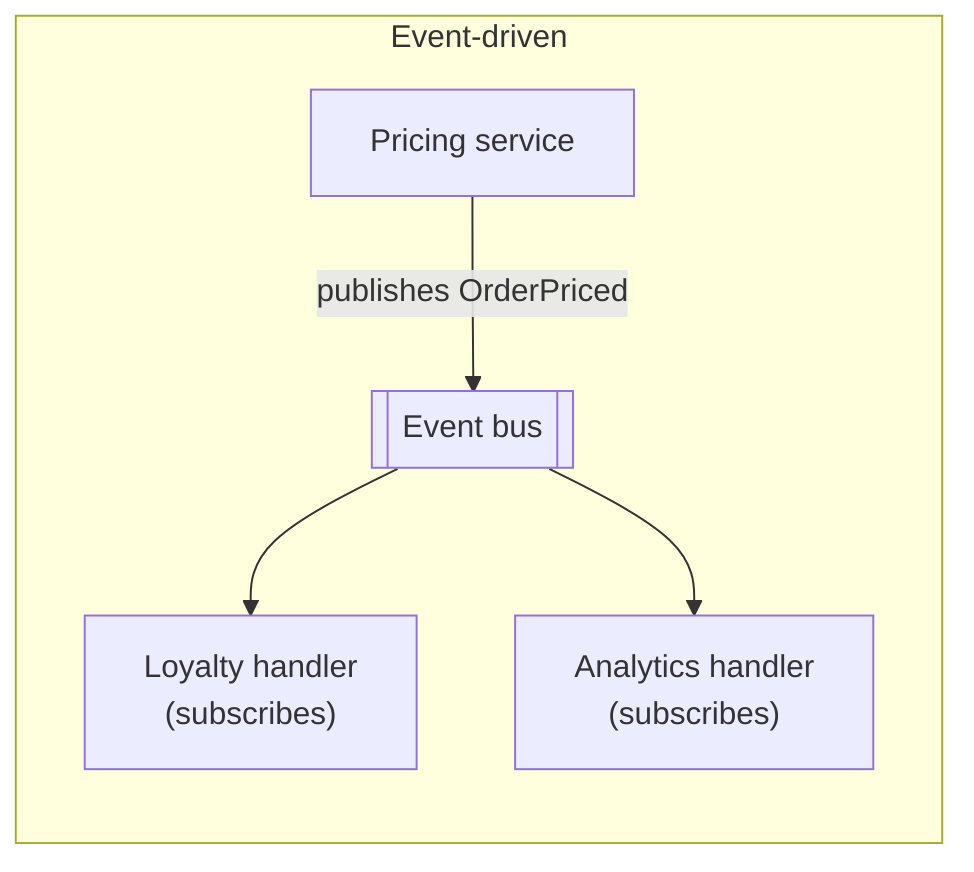
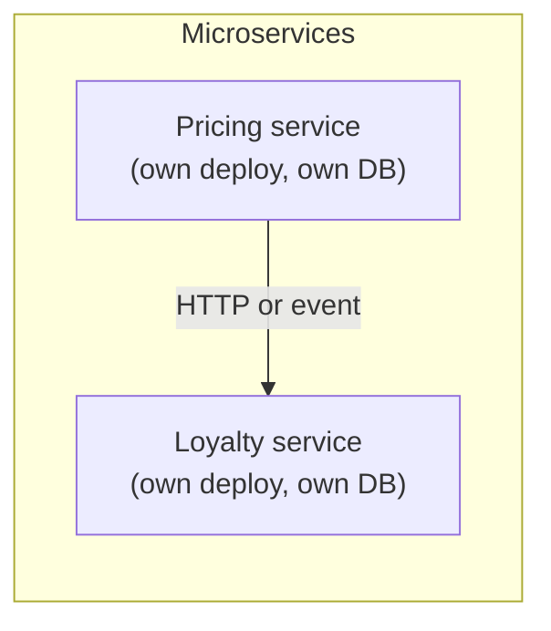
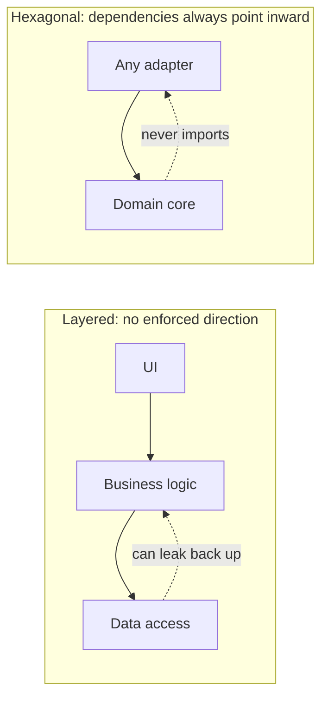
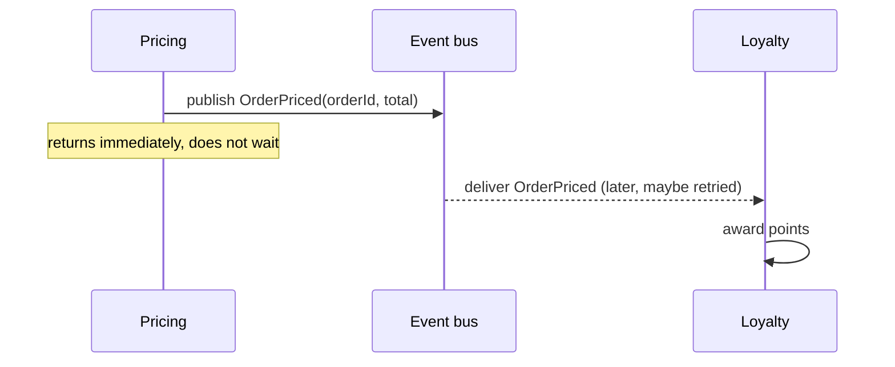
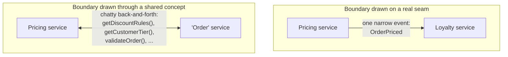
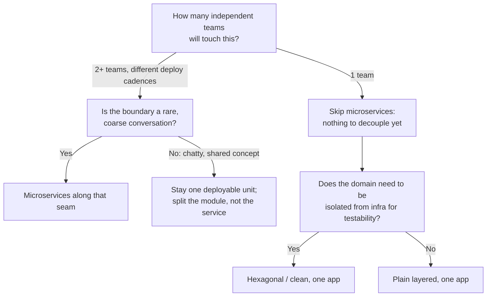

import LevelIntro from "../../../components/LevelIntro.astro";
import Checkpoint from "../../../components/Checkpoint.astro";
import PracticeCheck from "../../../components/PracticeCheck.astro";

export const unit = {
  track: "architecture",
  unitSlug: "architecture-styles",
};

L1 named four styles and the pressures behind them. Here the same checkout
feature (price an order, apply discounts, notify a loyalty partner) is drawn
all four ways, so the difference between "layered" and "hexagonal", or
"event-driven" and "microservices", is something you can see fail differently.

<LevelIntro
  items={[
    "The same feature drawn four ways",
    "What really separates look-alike styles",
    "The one question that dominates the choice",
  ]}
/>

## If the loyalty partner is down for ten minutes, which shape breaks checkout?

**Before reading the diagrams: which shapes would keep pricing orders, and
which would stall?** Each box below is one running piece of the feature.

In the layered drawing, pricing calls the loyalty client directly. If that call
waits for the partner and the partner is down, `priceOrder()` does not return
and checkout is broken by something unrelated to pricing. In the event-driven
drawing, pricing publishes `OrderPriced` and returns; the loyalty handler picks
the event up whenever it can. Same feature, opposite failure behavior. That is
not a coincidence; it is what each shape is for.

## Layered and hexagonal both live in one app, so what separates them?

**On a whiteboard they look almost the same. What is actually different?**
Not the folder listing. It is the direction an import is allowed to point. An
import means one file depends on another file's code, and a dependency is a
kind of power line: if the domain imports a database adapter, the domain now
knows database details.

| Style             | Unit of deployment             | Where the domain rules live                         | What it optimizes                         | What it accepts                                    |
| ----------------- | ------------------------------ | --------------------------------------------------- | ----------------------------------------- | -------------------------------------------------- |
| Layered           | One app                        | Spread across layers, easy to leak into any of them | Simple call graph                         | Framework and DB details can leak into the rules   |
| Hexagonal / clean | One app                        | Isolated in the center, behind ports                | Domain independent of infrastructure      | More files, more indirection, a learning curve     |
| Event-driven      | One app or many                | Wherever the handlers live                          | Coupling in time between sender and taker | Eventual consistency, harder-to-trace bugs         |
| Microservices     | Many, independently deployable | Split per service; each owns its rules              | Team and deploy independence              | Network calls, partial failure, operational weight |

The check you can run over a real codebase is a small table, not a feeling:

| File kind       | Allowed to import            | Violation if it imports              |
| --------------- | ---------------------------- | ------------------------------------ |
| Domain          | Other domain code only       | A framework, a DB client, an adapter |
| Adapter         | The domain's port interfaces | The domain importing it back         |
| Everything else | Whatever it needs            | No rule applies                      |

If that check would fail on your `domain/` folder today, the codebase is not
hexagonal no matter what the folder is called.

<Checkpoint question="A codebase has a folder named domain/, but that folder imports a concrete database client directly. Is this codebase hexagonal?">

No. The folder name does not matter; the enforced import direction does. The
domain imports an infrastructure piece, so the arrow points the wrong way and
the table's check fails it. "Hexagonal" describes a structural rule, not a
naming convention.

</Checkpoint>

<PracticeCheck
  track={unit.track}
  unitSlug={unit.unitSlug}
  topicId="layered-vs-hexagonal"
/>

## What does event-driven's "loose coupling" buy, and what does it cost?

**If two parts never call each other by name, what trade did the team make?**

`Pricing` never learns whether `Loyalty` succeeded, retried, or is three
minutes behind. That is the point: the sender's correctness no longer depends
on the receiver's uptime. The price is that "did the customer get their
points?" is no longer answered by one call stack. Debugging moves from reading
a call stack to reading an event log and rebuilding the timeline, which is a
different skill and a real tooling investment.

<PracticeCheck
  track={unit.track}
  unitSlug={unit.unitSlug}
  topicId="event-coupling"
/>

## Where does a service boundary go, and how many teams justify one?

**Splitting a monolith into two services is easy to draw. What property does a
good boundary have that a bad one lacks?**

A good boundary sits where the conversation between two parts is already rare
and coarse: pricing tells loyalty "an order was priced," once, and moves on. A
bad boundary cuts through a concept both parts need constantly. Splitting it
does not remove the coupling; it turns free function calls into network calls
carrying the same coupling, plus latency and a new way to fail.

Conway's Law is the blunt version: a system tends to mirror the communication
structure of the people who build it. If pricing and loyalty are the same two
people who talk daily, two services buy two deploy pipelines and almost no
independence.

Team count is also what makes splitting pay at all. In one shared codebase every
pair of people may need to coordinate, which is `n × (n - 1) / 2` pairs. Grouping
people into teams of about four and counting only team-to-team pairs gives a
much smaller number. This is a counting illustration under that assumption, not
a measured meeting cost.

| Engineers | Person-to-person pairs, one codebase | Teams of about 4 | Team-to-team pairs |
| --------- | ------------------------------------ | ---------------- | ------------------ |
| 3         | 3                                    | 1                | 0                  |
| 6         | 15                                   | 2                | 1                  |
| 12        | 66                                   | 3                | 3                  |
| 20        | 190                                  | 5                | 10                 |
| 40        | 780                                  | 10               | 45                 |

<Checkpoint question="Pricing and loyalty are built and owned by the same two engineers, who talk constantly. Does splitting them into two microservices buy this team independence?">

Barely any. Independence comes from decoupling the deploy schedules of
different owners. Here the boundary runs through a pair that already
coordinates every day, so the split adds two pipelines and a network hop
without removing any real coordination cost.

</Checkpoint>

<PracticeCheck
  track={unit.track}
  unitSlug={unit.unitSlug}
  topicId="boundary-and-teams"
/>

## Which question comes first?

**Of the four questions, which one should be asked before "which style sounds
most rigorous"?** Team count, because it changes the cost of being wrong by an
order of magnitude: a bad layer boundary is a refactor inside one repository; a
bad service boundary is a multi-team, multi-deploy migration.

The "Try it" demo below plots exactly the table above: drag the team size and
watch the two lines diverge.
