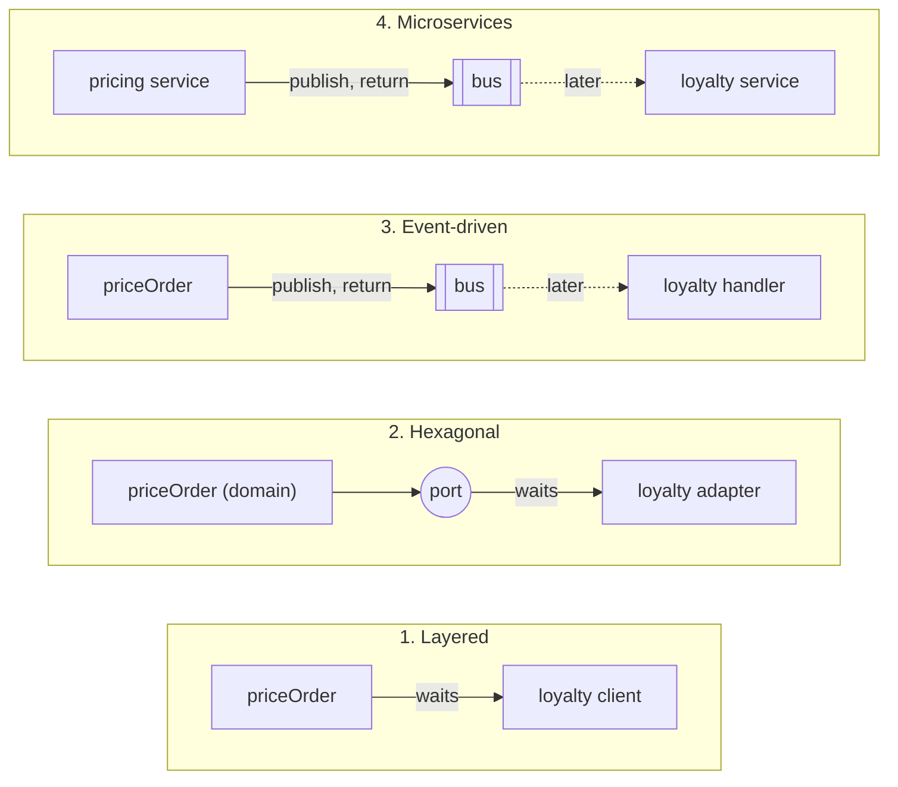
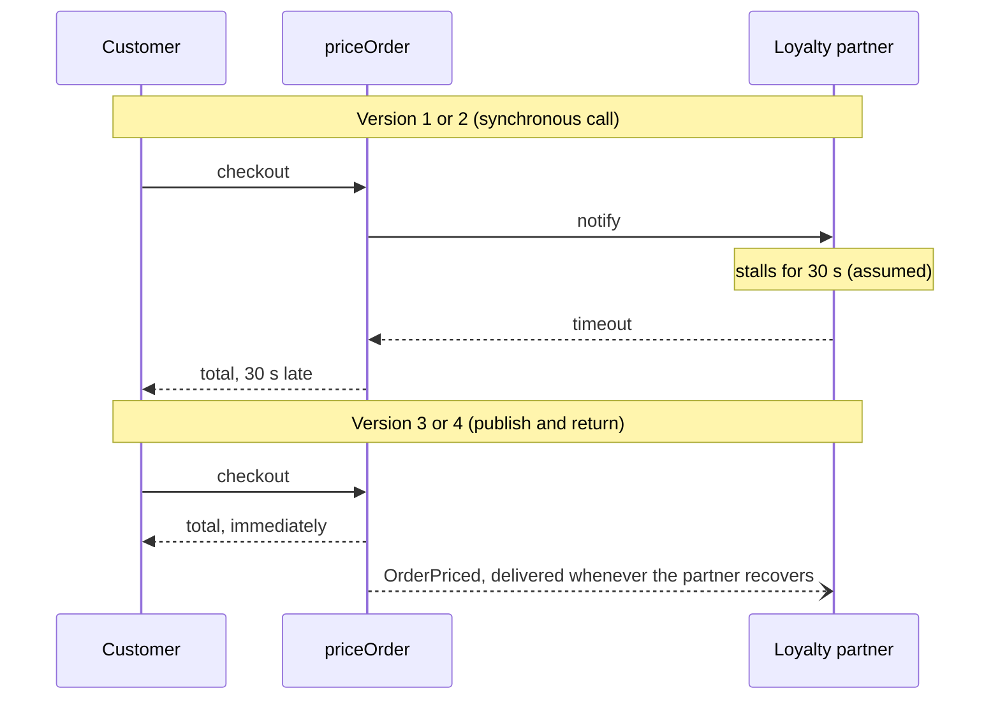

import Scenario from "../../../components/Scenario.astro";
import LevelIntro from "../../../components/LevelIntro.astro";
import Checkpoint from "../../../components/Checkpoint.astro";
import PracticeCheck from "../../../components/PracticeCheck.astro";

export const unit = {
  track: "architecture",
  unitSlug: "architecture-styles",
};

<Scenario label="The loyalty partner stops answering. Which of your four designs is still taking orders?">
  <Fragment slot="facts">
    <p class="not-prose mb-1 text-xs font-semibold tracking-wide text-slate-400 uppercase">Requirement</p>
    <div class="not-prose flex flex-col gap-1 text-sm text-slate-700 dark:text-slate-300">
      <div class="flex items-center gap-1.5"><span>💵</span> priceOrder(order) returns the total after discounts</div>
      <div class="flex items-center gap-1.5"><span>🎯</span> Tell the loyalty partner after every priced order</div>
      <div class="flex items-center gap-1.5"><span>🐢</span> The partner's API is slow and sometimes down</div>
    </div>

    <p class="not-prose mt-3 mb-1 text-xs font-semibold tracking-wide text-slate-400 uppercase">Constraint</p>
    <div class="not-prose flex flex-col gap-1 text-sm text-slate-700 dark:text-slate-300">
      <div class="flex items-center gap-1.5"><span>🚫</span> Checkout must never fail because loyalty is down</div>
    </div>

  </Fragment>

You need `priceOrder(order)`: apply the customer's tier discount, apply any
active promotion, return the total, and tell a loyalty-points partner that an
order was priced. The partner's API is occasionally slow or down, and checkout
must never fail because of it. You could build this in any of the four shapes
from L2. **Which of them already satisfy the constraint, and which only look
as if they do?**

</Scenario>

<LevelIntro
  items={[
    "Where the loyalty call lives in each version",
    "Which versions violate the checkout constraint",
    "Delivery, duplicates and the distributed monolith",
  ]}
/>

## Which versions put the loyalty call on checkout's critical path?

**What matters when the partner stalls: how much code a version has, or where
the waiting happens?** Where the waiting happens. Follow the one call that
could stall in each version.



The whole difference between Versions 1 and 3 fits in two lines. The rest of
each file is plumbing around them:

```js
// Version 1: checkout waits for the partner before it can return
loyaltyClient.notify(order.customerId, total);
return total;

// Version 3: checkout announces the fact and returns
bus.publish("OrderPriced", {
  orderId: order.id,
  customerId: order.customerId,
  total,
});
return total;
```

Version 2 moves the call behind a port. That puts the failure-handling decision
(a timeout, swallowing errors) in one adapter instead of scattered through the
rules, and it lets `priceOrder` be tested with plain objects and no database.
It does not make the call asynchronous. Unless the use case chooses not to
wait, a slow partner still adds its delay to checkout.

Assume, for illustration only, that the partner takes 30 seconds to time out:



| Version       | Blocks checkout if loyalty is down? | Moving parts to run     | New failure mode introduced                          |
| ------------- | ----------------------------------- | ----------------------- | ---------------------------------------------------- |
| Layered       | **Yes**, violates the constraint    | 1 app                   | Synchronous coupling to a partner's uptime           |
| Hexagonal     | **Yes**, same call, better isolated | 1 app, more files       | Same as layered, just easier to test in isolation    |
| Event-driven  | No                                  | 1 app, a bus            | Debugging spans an event log, not one call stack     |
| Microservices | No                                  | 2 services, 2 pipelines | Event-driven's failure mode plus deployment overhead |

The requirement, not a general preference, rules out two of the four. And the
fix for Versions 1 and 2 is Version 3's idea grafted on, a reminder that these
styles combine rather than compete.

<Checkpoint question="Version 4 moves the loyalty handler into its own service. Does that change whether checkout blocks when the partner is down, compared with Version 3?">

No. Version 3 already took the call off checkout's path by publishing and
returning, and Version 4 is the same message flow at the deployment level.
What changes is who can deploy it, on what schedule, and the cost of running a
second service, not whether checkout is protected from a slow partner.

</Checkpoint>

<PracticeCheck
  track={unit.track}
  unitSlug={unit.unitSlug}
  topicId="requirement-decides"
/>

## What can go wrong once the call is off the critical path?

**If the bus can deliver an event more than once, what happens to a customer's
points?** Most buses promise at-least-once delivery: they prefer a duplicate to
a lost event. The consumer then has to make a repeat harmless, which is called
idempotency. The simplest way is to remember which order ids were already
handled. Assume, for illustration, an order worth 40 and one point per unit:

| Delivery  | Event            | Handler without a check | Handler that remembers `orderId` |
| --------- | ---------------- | ----------------------- | -------------------------------- |
| 1st       | `OrderPriced` #7 | awards 40 (total 40)    | awards 40 (total 40)             |
| 2nd (dup) | `OrderPriced` #7 | awards 40 (total 80)    | sees #7 already handled, skips   |

The event must therefore carry enough to dedupe, such as the order id. Two
costs travel with this style: the customer may see the order complete before
the points appear (eventual consistency), and a failure leaves no single stack
trace linking "order priced" to "points never awarded". Those two facts are
reconstructed from separate logs.

<Checkpoint question="A consumer receives the same OrderPriced event twice and awards points both times. Is the bug in the bus, the producer, or the consumer?">

The consumer. At-least-once delivery is the bus's documented behavior, and the
producer published correctly. Handling a repeat safely is the consumer's job,
which is why the event has to carry an identifier it can check.

</Checkpoint>

<PracticeCheck
  track={unit.track}
  unitSlug={unit.unitSlug}
  topicId="delivery-and-idempotency"
/>

## When does a split stop helping?

**Two services exist. What would show that the split gave the cost of
microservices without the benefit?** If the two must always be deployed
together, or one cannot run without a chatty conversation with the other, the
team has built a distributed monolith: every operational cost of services and
none of the independence.

| Symptom                                           | What it says about the seam                               |
| ------------------------------------------------- | --------------------------------------------------------- |
| Every change to A needs a same-day change to B    | The boundary cuts through one concept                     |
| A cannot answer a request without calling B       | A runs on B's uptime, as if it were still a function call |
| One engineer owns both and releases both together | No second owner exists to be independent of               |
| A and B release on separate days without incident | The seam is real                                          |

The same pressure applies inside one app: hexagonal without enforced import
direction decays into layered, and a folder called `domain/` proves nothing
without the check from L2.

<Checkpoint question="Two services must always be deployed together or the system breaks. What did the team build, and what did it get for its operational cost?">

A distributed monolith. It pays for two pipelines, two sets of monitoring and a
network hop, and receives none of the deployment independence that was the
reason to split, because the two halves still move as one.

</Checkpoint>

<PracticeCheck
  track={unit.track}
  unitSlug={unit.unitSlug}
  topicId="distributed-monolith"
/>

## Beyond this example

The pricing and loyalty pair is one case, not the whole territory. It is one
seam, in one direction, with one kind of partner. Questions that test whether
the reasoning transfers:

- What changes if loyalty points **must** be correct the instant checkout
  completes, for example a "redeem points during this same checkout" feature?
  Which version stops being viable, and does the layered version suddenly look
  better instead of worse?
- If a fifth engineer starts working only on loyalty logic, at what point (if
  any) does a separate loyalty service pay for itself, and what would you want
  to measure to know rather than guess?
- The event's shape (`orderId`, `customerId`, `total`) is the one thing pricing
  and loyalty still share. If loyalty needs a field pricing lacks, who owns
  changing that contract, and what does your answer say about whether the seam
  was drawn in the right place?
