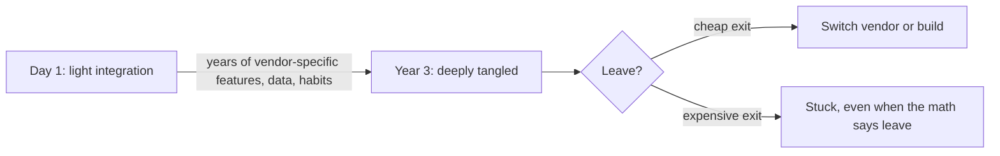

import Scenario from "../../../components/Scenario.astro";
import LevelIntro from "../../../components/LevelIntro.astro";
import PracticeCheck from "../../../components/PracticeCheck.astro";

export const unit = {
  track: "architecture",
  unitSlug: "build-vs-buy",
};

<Scenario label="The payment-fee invoice">
  <Fragment slot="facts">
    

      
💳 <strong>Volume</strong> — $12M/year of customer payments

      
🧾 <strong>Fee</strong> — 3.3% blended (an assumed, illustrative rate) = $396,000/year

      
🧑‍💻 <strong>The pitch</strong> — "two engineers, six months, and we own it"

      

        
Visible fee vs. the cost of owning it

        

        
One year of fee ($396,000) is about 19% of the 3-year build cost modelled in L3 ($2,050,000)

      

    

  </Fragment>

At the end-of-year review, someone points at one line: **$396,000 paid in
payment fees**. An engineer says, "We could build this ourselves. Two of us,
six months, and we stop paying rent on our own checkout." The room nods,
because six months of two salaries looks smaller than a yearly invoice.
**Is the engineer right?**

</Scenario>

The invoice is real, but it is not the whole comparison. It is one visible
number next to several invisible ones, and the invisible side is usually
bigger. The rate and the costs in this unit are illustrative assumptions, not
quotes from any real provider.

<LevelIntro
  items={[
    "Total cost of ownership vs. sticker price",
    "The core-vs-context test",
    "What vendor lock-in costs",
  ]}
/>

## Why does the fee not tell you the real cost?

**If building "costs six months", what is missing from that number?** A fee is
a visible recurring cost. Building swaps it for costs nobody sees on an
invoice: salaries for as long as the system lives, audits, on-call nights,
and what those engineers would have built instead. **Total cost of ownership
(TCO)** prices all of it, for both options.

| Cost             | Build                                   | Buy                                            |
| ---------------- | --------------------------------------- | ---------------------------------------------- |
| Upfront          | Engineering time to build it            | Integration time, usually much smaller         |
| Ongoing          | Salaries, on-call, patches, audits      | The vendor's fee, usually usage-based          |
| Compliance       | You carry the certification burden      | The vendor carries most of it                  |
| Opportunity cost | Those engineers are not on your product | Those engineers stay on your product           |
| Exit cost        | Low, since it is already yours          | Can be high if you are tangled into the vendor |

<PracticeCheck track={unit.track} unitSlug={unit.unitSlug} topicId="tco" />

## Is this capability the reason customers pick you?

**Two companies both need password-reset emails. Why might one build and the
other buy?** Only one question matters first: is this capability **core**
(customers choose you because of it) or **context** (every company needs it,
nobody picks you for it)?

- **Core**: lean towards build. Owning it and getting it exactly right is the
  point of the company.
- **Context**: lean towards buy, if a mature vendor exists. Let a specialist
  carry it.
- A vendor's own core can be your context: processing payments is the whole
  business of a payment company, and plumbing for almost everyone else.
- The label can change over time as the product and market change.

<PracticeCheck
  track={unit.track}
  unitSlug={unit.unitSlug}
  topicId="core-context"
/>

## What if we want to leave the vendor later?

**You have bought, and three years later the math flips. What does leaving
cost?** **Vendor lock-in** is the risk that switching is slow or expensive
because your data, workflows, or team knowledge grew around that vendor's
specific way of doing things.

- Lock-in is not "using a vendor". It is how costly the way out is.
- It grows with how deeply the product depends on the vendor's specifics, not
  only with how long you have used them.
- The exit cost belongs in the buy column from day one.

<PracticeCheck track={unit.track} unitSlug={unit.unitSlug} topicId="lock-in" />

Key terms: total cost of ownership (TCO), core vs. context, opportunity cost,
vendor lock-in, exit cost.
