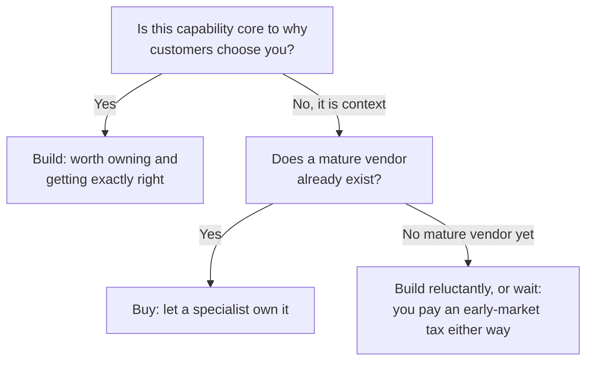
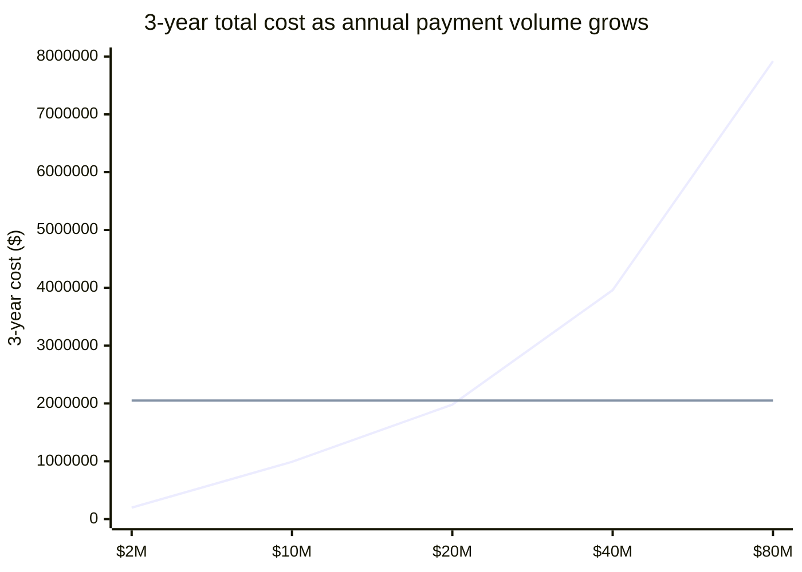

import LevelIntro from "../../../components/LevelIntro.astro";
import Checkpoint from "../../../components/Checkpoint.astro";
import PracticeCheck from "../../../components/PracticeCheck.astro";

export const unit = {
  track: "architecture",
  unitSlug: "build-vs-buy",
};

L1 named two costs: build's mostly fixed cost and buy's usually growing fee.
L2 asks how to actually decide between them, and why "which is cheaper" has a
different answer at different points in a company's growth. All figures are
illustrative assumptions, and the 3-year build model (a $700,000 one-time
setup plus $450,000 a year) is priced line by line in L3.

<LevelIntro
  items={[
    "The two-question decision test",
    "What core precisely means",
    "Why build and buy cost curves cross",
  ]}
/>

## What do you ask first, and what second?

**Before touching any price, what two things do you need to know?** Not the
cost of either option. You need to know (1) whether the capability is core to
why customers choose you, and (2) whether a mature vendor already exists.

Payment processing is context for almost every company except a payment
company. Nobody picks a shop because of what happens after they click "pay".
That routes to "buy" regardless of the fee. The price then answers a different
question: how much buying will cost, and when that changes.

<Checkpoint question="A company's entire product is a tool that detects plagiarism in essays. Does the test say build or buy the detection engine, and why does that differ from payments?">

Build. For this company the detection engine is not plumbing behind the
product, it is the product, and it is why a customer picks it over a
competitor. The same question, "is this why customers choose you", gives
opposite answers because the two capabilities play opposite roles in their
companies. The test depends on what the company sells, not on how hard the
capability is to build.

</Checkpoint>

## What does "core" mean, so the test cannot be gamed?

**Every team can argue its favorite system is core. What stops the test from
justifying building everything?** Core does not mean important or hard. Payment
processing is both, and still context. Core means: **if you built this better
than everyone else, would customers switch to you because of it?**

| Capability                      | Important? | Hard?  | Customers switch for it? | Verdict |
| ------------------------------- | ---------- | ------ | ------------------------ | ------- |
| Checkout payment plumbing       | Yes        | Yes    | Rarely                   | Context |
| Login page for a logistics firm | Yes        | Medium | No                       | Context |
| Its own truck-routing algorithm | Yes        | Yes    | Yes, it is the pitch     | Core    |

<Checkpoint question="A logistics startup's pitch is 'our routing is 20% more efficient than anyone's'. Is its login system also core, just because the whole company depends on it?">

No. Depending on something and it being core are different claims. Nearly
every system depends on login working, but no customer picks this company for
an excellent login page. Routing passes the test, because customers switch
specifically for it. Critical and core are different axes, and something can
be mission-critical and still firmly context.

</Checkpoint>

<PracticeCheck
  track={unit.track}
  unitSlug={unit.unitSlug}
  topicId="decision-test"
/>

## Why does the cheaper option change as you grow?

**If buy is cheaper today, does a single "we would save X" number settle it?**
No, because build's cost is nearly fixed (salaries and audits grow slowly)
while a usage-based fee scales with volume, which is what a healthy company
grows fastest. In the model used here, 3-year build is $2,050,000 at any volume
and 3-year buy is 3.3% of the annual volume times 3 years.

The rising line is buy, the flat line is build. They cross a little above
$20M a year (about $20.7M). Below it buy is cheaper; above it, build's fixed
cost starts winning. The demo on this unit's page lets you drag the volume and
years and watch the crossing move.

<PracticeCheck
  track={unit.track}
  unitSlug={unit.unitSlug}
  topicId="crossover"
/>
