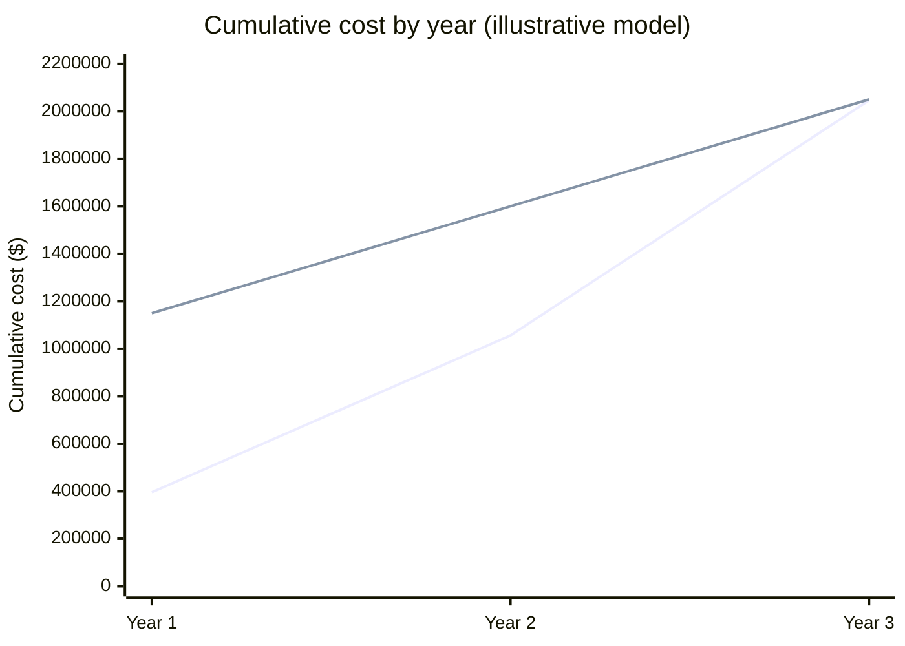
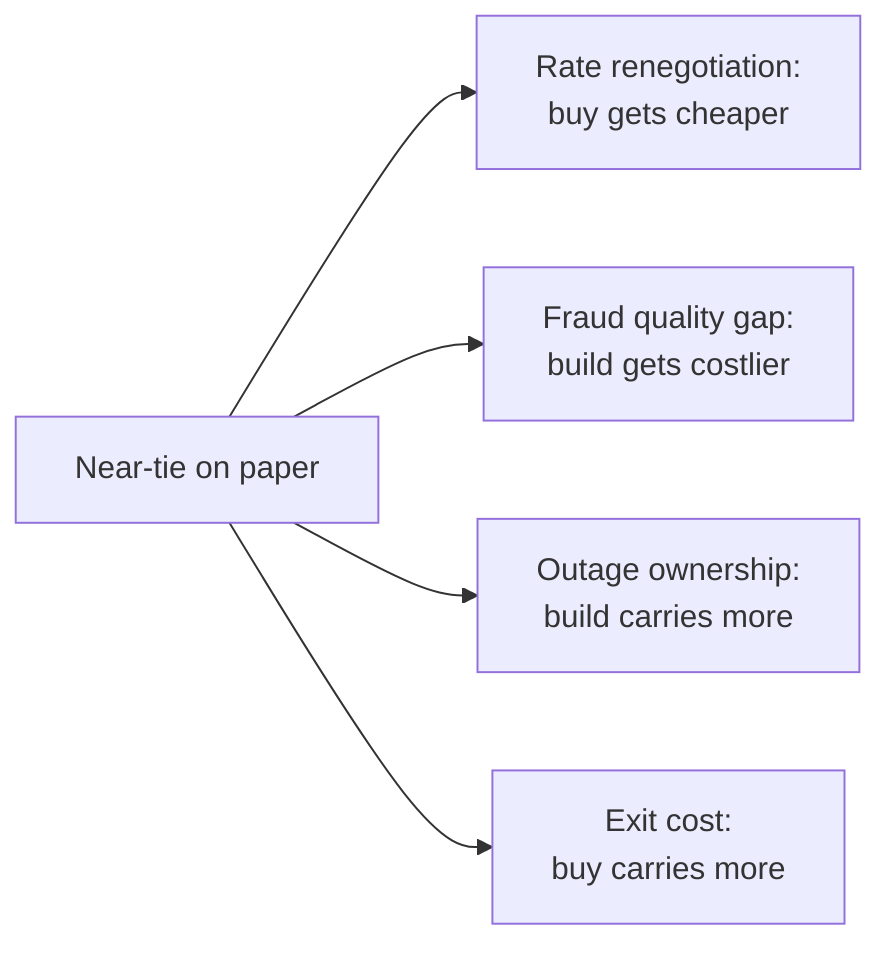

import Scenario from "../../../components/Scenario.astro";
import LevelIntro from "../../../components/LevelIntro.astro";
import Checkpoint from "../../../components/Checkpoint.astro";
import PracticeCheck from "../../../components/PracticeCheck.astro";

export const unit = {
  track: "architecture",
  unitSlug: "build-vs-buy",
};

<Scenario label="Finance asks for real numbers">
  <Fragment slot="facts">
    

      
📈 <strong>Volume path</strong> — $12M, then $20M, then $30M a year

      
🔨 <strong>Build</strong> — $700,000 once, then $450,000 a year (assumed)

      
💳 <strong>Buy</strong> — 3.3% of volume (assumed blended rate)

      
⚖️ <strong>3-year totals</strong> — $2,050,000 vs. $2,046,000

    

  </Fragment>

Finance is not satisfied with "$396,000 feels like a lot". They want a
3-year model using the growth already in this year's plan: volume of $12M,
$20M, then $30M. **On those numbers, which option wins, and how much should
you trust the answer?**

</Scenario>

<LevelIntro
  items={[
    "Pricing build line by line",
    "Pricing buy on a growth path",
    "What a near-tie leaves out",
  ]}
/>

## What does build really cost, year by year?

**"Two engineers, six months" prices the first six months. Where is the rest?**
The model below splits build into a one-time setup and a yearly run cost. Every
figure is an assumption for illustration, not a market quote.

| One-time setup (year 1)        | Amount       |
| ------------------------------ | ------------ |
| Initial build engineering      | $400,000     |
| First compliance certification | $200,000     |
| Initial fraud tooling          | $100,000     |
| **Setup total**                | **$700,000** |

| Yearly run cost                  | Amount       |
| -------------------------------- | ------------ |
| Engineers maintaining it         | $250,000     |
| Annual audit and recertification | $120,000     |
| On-call and incident allowance   | $50,000      |
| Fraud tooling upkeep             | $30,000      |
| **Run total**                    | **$450,000** |

Year 1 is $700,000 + $450,000 = $1,150,000; years 2 and 3 are $450,000 each.
Three-year build: **$2,050,000**, the same figure the L2 chart and the demo use.

<Checkpoint question="Year 1 costs $1,150,000 and year 3 costs $450,000, with the same team. What explains the gap, and should year 4 keep shrinking?">

The gap is the one-time setup: building the system and passing the first
certification happen once. After that the run cost is flat at $450,000, so year
4 should look like year 3, not keep falling. The "first year is expensive"
effect is a fixed entry fee, not a downward trend.

</Checkpoint>

<PracticeCheck
  track={unit.track}
  unitSlug={unit.unitSlug}
  topicId="build-model"
/>

## What does buy cost on this company's actual path?

**Does one flat fee number work when volume grows 2.5x in two years?** No, the
fee follows volume, so each year is priced separately and then summed against
build's running total.

| Year | Volume | Buy (3.3%) | Buy, cumulative | Build, cumulative |
| ---- | ------ | ---------- | --------------- | ----------------- |
| 1    | $12M   | $396,000   | $396,000        | $1,150,000        |
| 2    | $20M   | $660,000   | $1,056,000      | $1,600,000        |
| 3    | $30M   | $990,000   | $2,046,000      | $2,050,000        |

Buy is cheaper at the end of years 1 and 2, then the lines meet in year 3: a
$4,000 difference on about $2M. This company sits on top of the crossover,
which is the common real case. If volume stays at $30M, buy's yearly fee
($990,000) is $540,000 above build's run cost, so build pulls ahead after
year 3. Verdicts depend on the horizon you pick.

## What does the near-tie leave out?

**When two totals differ by 0.2%, what decides?** The things neither column
prices well:

- **Rate changes.** Large volume often renegotiates a rate down. At 2.8%
  instead of 3.3%, buy over the same $62M falls to $1,736,000, which is $310,000
  lower and clearly ahead.
- **Quality gaps.** A fraud model fed one company's data may be worse than a
  vendor's for years, so build's real cost may exceed the model.
- **Who owns the failure.** A homegrown outage is your 2am incident with
  engineers who also have other jobs; a vendor's outage is the vendor's
  on-call.
- **Exit cost.** Buying defers the question. If volume reaches a level where
  build clearly wins, leaving means bringing compliance in-house from zero,
  rebuilding checkout logic tuned to the vendor, and migrating live traffic
  without an outage. It grows with how deeply you are tangled in, and it
  belongs in the buy column from day one.

<Checkpoint question="Renegotiated rate and weaker in-house fraud detection: which way do those two adjustments push the near-tie, and what pushes back?">

Both push towards buy: a lower rate shrinks buy's total, and a weaker fraud
model raises build's real cost above the modelled figure. The exit cost pushes
back, because it is a cost buy carries that the totals do not show. So the
near-tie is not decided by the arithmetic: it is decided by how much each
unpriced item is worth to this company.

</Checkpoint>

<PracticeCheck
  track={unit.track}
  unitSlug={unit.unitSlug}
  topicId="blind-spots"
/>

**Extend it:** this is a case, not the whole territory. Every number here was
an assumption for one ordinary company. What changes if the company is in a
regulated industry with extra compliance on top (does the crossover volume move
up or down, and why)? What if it were at $500,000 of volume instead of $12M: is
the same framework still right, or does the first question change? What if the
vendor raised its rate sharply: where would your exit cost show up?
