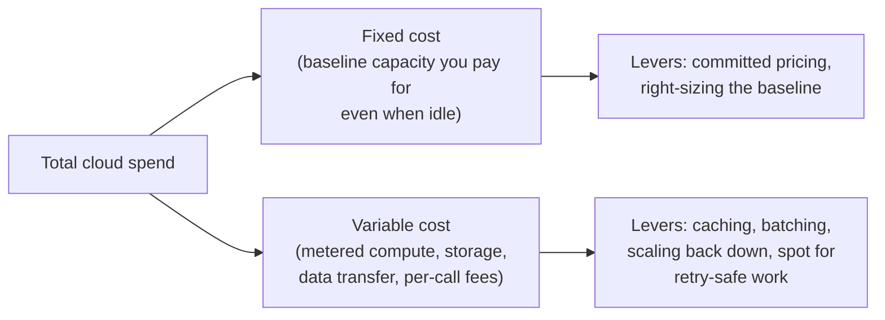

import Scenario from "../../../components/Scenario.astro";
import LevelIntro from "../../../components/LevelIntro.astro";
import PracticeCheck from "../../../components/PracticeCheck.astro";

export const unit = {
  track: "architecture",
  unitSlug: "cost-aware-architecture",
};

<Scenario label="The flash-sale invoice">
  <Fragment slot="facts">
    

      

        

          <strong>Before</strong> — cost per order
          $0.04
        

        

          

        

      

      

        

          <strong>Sale month</strong> — cost per order
          $0.11
        

        

          

        

      

      
🛒 Orders: <strong>6x</strong> (revenue tracks orders)

      
💸 Cloud bill: <strong>16.5x</strong>

      
🗄️ Why: a database write on every request, no cache, on-demand only

    

  </Fragment>

GreenCart's checkout handled a flash sale without a single error. Every order
was processed correctly. Then the cloud invoice arrived: orders had grown 6x,
but the bill had grown 16.5x. **The system was correct the whole time, so why
did finance treat this as an incident?**

| Metric         | Before  | Sale month | Multiplier |
| -------------- | ------- | ---------- | ---------- |
| Orders/month   | 1M      | 6M         | 6x         |
| Cloud bill     | $40,000 | $660,000   | 16.5x      |
| Cost per order | $0.04   | $0.11      | 2.75x      |

All figures in this unit are illustrative assumptions, not measurements from a
real company.

</Scenario>

Because correct was never the only requirement. A system that answers every
request right but costs more per order as it grows does not scale. It just
fails later, on a different dashboard.

<LevelIntro
  items={[
    "Cost as a requirement, like latency",
    "Cost per unit of value, not total spend",
    "Fixed vs. variable cost and the main levers",
  ]}
/>

## Is cost a design concern or a finance concern?

**If nothing broke, who owns the problem?** The architecture does. Cost is a
**non-functional requirement**, in the same family as latency and availability:
a design is judged on whether it does the job _and_ whether it can keep doing it
at a price the business can sustain. The only difference is the clock. An outage
shows up on a monitor in seconds; a cost failure shows up on a monthly invoice.

<PracticeCheck track={unit.track} unitSlug={unit.unitSlug} topicId="cost-nfr" />

## Which number tells you the design is failing?

**Total spend doubled. Is that bad?** Not by itself. If the business grew 6x
and spend grew 2x, that is a healthy system. The signal is **cost per unit of
value**: cost per order, per active user, per GB processed.

| Total spend | Volume | Cost per unit | Reading                                     |
| ----------- | ------ | ------------- | ------------------------------------------- |
| Up 2x       | Up 6x  | Falling       | Healthy: growth made each unit cheaper      |
| Up 16.5x    | Up 6x  | Rising        | Warning: the design does not scale in money |
| Flat        | Flat   | Flat          | Nothing to learn yet                        |

GreenCart sits on the second row. Rising cost per unit while volume grows means
the architecture scales technically but not economically.

<PracticeCheck
  track={unit.track}
  unitSlug={unit.unitSlug}
  topicId="unit-cost"
/>

## Where does the money actually go, and what can you pull?

**"The bill went up" is not actionable. What would make it actionable?**
Splitting it. Part of a bill is **fixed** (capacity you pay for even at 3 a.m.
with no traffic) and part is **variable** (metered compute, storage, data
transfer, per-call third-party fees). Which lever helps depends on which part is
out of control.

Four pricing models cover most choices, and the right one depends on how
predictable and how interruptible the load is:

| Model                       | You commit to                    | Best for                             |
| --------------------------- | -------------------------------- | ------------------------------------ |
| On-demand                   | Nothing                          | Unpredictable or early-stage load    |
| Reserved / committed-use    | Baseline capacity for a term     | Steady, predictable load             |
| Spot / preemptible          | Nothing, but it can be reclaimed | Interruptible, retry-safe batch work |
| Serverless (pay per invoke) | Nothing                          | Spiky load with a near-zero baseline |

Two more things are easy to miss on an architecture diagram but never on the
invoice: data transfer between regions, and logging or monitoring ingestion.
And none of it is fixable without **cost attribution** by service and feature:
"checkout's database writes tripled" is a task, "the bill went up" is a mood.

<PracticeCheck
  track={unit.track}
  unitSlug={unit.unitSlug}
  topicId="pricing-mix"
/>
