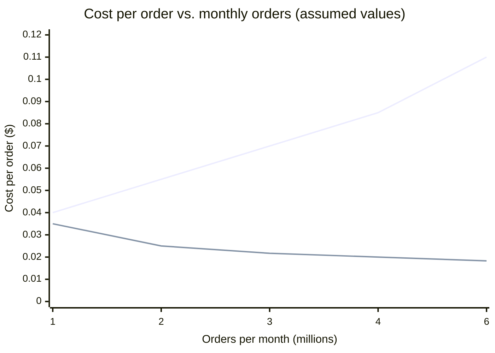
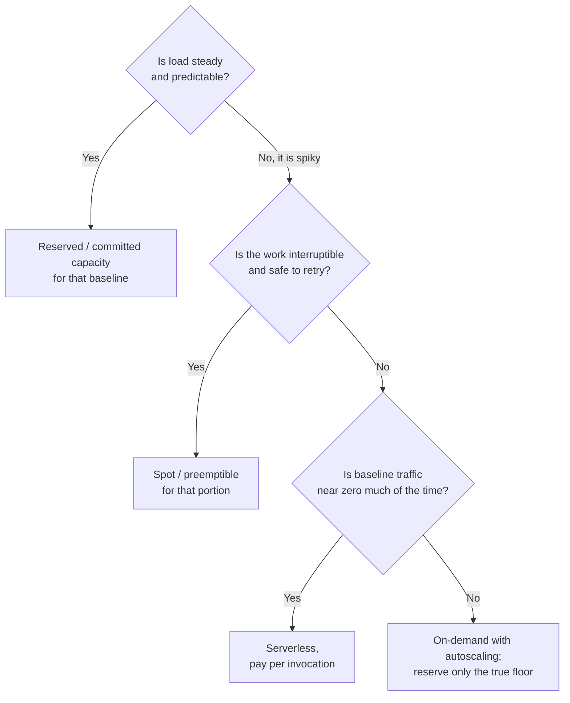

import Scenario from "../../../components/Scenario.astro";
import LevelIntro from "../../../components/LevelIntro.astro";
import Checkpoint from "../../../components/Checkpoint.astro";
import PracticeCheck from "../../../components/PracticeCheck.astro";

export const unit = {
  track: "architecture",
  unitSlug: "cost-aware-architecture",
};

<Scenario label="Two checkout services">
  <Fragment slot="facts">
    <div class="not-prose flex flex-col gap-1.5 text-sm text-slate-700 dark:text-slate-300">
      <div class="flex items-center gap-1.5"><span>🅰️</span> Service A: database write per order, on-demand only</div>
      <div class="flex items-center gap-1.5"><span>🅱️</span> Service B: caching, batched writes, reserved baseline</div>
      <div class="flex items-center gap-1.5"><span>📈</span> A: cost per order rises with volume</div>
      <div class="flex items-center gap-1.5"><span>📉</span> B: cost per order falls with volume</div>
    </div>
  </Fragment>

Service A and Service B both process checkout correctly and both pass every
load test. Roll monthly orders from 1M up to 6M and their costs diverge: one
gets cheaper per order, the other gets more expensive. **Same job, same
correctness, same traffic. What differs in the designs to make the cost curves
point in opposite directions?**

</Scenario>

L1 said the warning sign is cost per unit rising with volume. L2 explains the
mechanism behind that sign, then how to choose a pricing model to bend the
curve.

<LevelIntro
  items={[
    "The cost-per-order formula and its shape",
    "Why one curve falls and the other rises",
    "Choosing a pricing model per workload segment",
  ]}
/>

## What shape should a healthy cost curve have?

**If a service has a fixed monthly cost and a constant cost per order, what
happens to cost per order as volume grows?** Write the model as:

```
total(orders)        = fixed + variablePerOrder * orders
costPerOrder(orders) = fixed / orders + variablePerOrder
```

The `fixed / orders` term shrinks toward zero as orders grow, so cost per order
falls toward `variablePerOrder` from above. That is economies of scale, and it
is the shape a healthy system should have. Using assumed numbers of a $20,000
fixed cost and $0.015 per order, the curve falls with volume:

| Orders/month | Fixed share ($20,000 / orders) | Variable | Cost per order |
| ------------ | ------------------------------ | -------- | -------------- |
| 1M           | $0.0200                        | $0.015   | $0.0350        |
| 2M           | $0.0100                        | $0.015   | $0.0250        |
| 4M           | $0.0050                        | $0.015   | $0.0200        |
| 6M           | $0.0033                        | $0.015   | $0.0183        |

<Checkpoint question="If cost per order should fall as volume grows, why did GreenCart's rise from $0.04 to $0.11?">

Because `variablePerOrder` was not constant. A database write on every request,
with no cache, means each extra order adds load to a database that gets
proportionally more expensive as concurrent load rises: more connections, more
contention, more capacity bought at on-demand rates. The formula's variable term
is only a flat constant when the resource scales cheaply and linearly. When it
does not, the variable term itself grows, and that outweighs the shrinking fixed
share. The system moves from economies of scale to diseconomies of scale.

</Checkpoint>

<PracticeCheck
  track={unit.track}
  unitSlug={unit.unitSlug}
  topicId="scale-curve"
/>

## Why do A and B point in opposite directions?

**What did Service B do that Service A did not?** Service A pays for a database
write on every request and only ever adds on-demand capacity: its per-order
variable cost climbs with volume, and its fixed cost buys no discount. Service
B serves the read-heavy majority of checkout traffic (inventory and price
lookups) from a cache, batches writes, and covers its predictable baseline with
reserved capacity. Its variable cost stays near flat, and its fixed cost is
spread over more orders. The chart plots assumed values, with B computed from
the formula above:



The chart is not two opinions. It is one formula with different values plugged
in, and with different answers to whether the variable term stays constant.
Architecture chose the curve before a single order shipped.

## How do you pick a pricing model without picking only one?

**Reserved is cheaper per hour. Spot is cheaper still. Why not use the cheapest
for everything?** Because each discount is bought with a constraint, and the
right trade depends on two properties of the workload: is it steady, and can it
be interrupted?



Most real systems are a **blend**: a reserved baseline sized to the traffic
floor, autoscaled on-demand for the middle, and spot or serverless for the
bursty or retry-safe edges. GreenCart's failure was not choosing on-demand. It
was choosing _only_ on-demand for a load with a very predictable daily floor.

<Checkpoint question="GreenCart's traffic has a predictable daily floor plus occasional unpredictable sale spikes. One pricing model for everything, or a split?">

A split. The daily floor is exactly what committed capacity is for: it exists
every day, so committing earns a discount with no risk of paying for unused
capacity. The spikes are the opposite case: committing in advance for a spike
that may not come, or may be 3x bigger than planned, either wastes money or
fails to scale. That part stays on-demand with autoscaling, so it grows with
what shows up and shrinks afterward.

</Checkpoint>

<PracticeCheck
  track={unit.track}
  unitSlug={unit.unitSlug}
  topicId="pricing-mix"
/>
