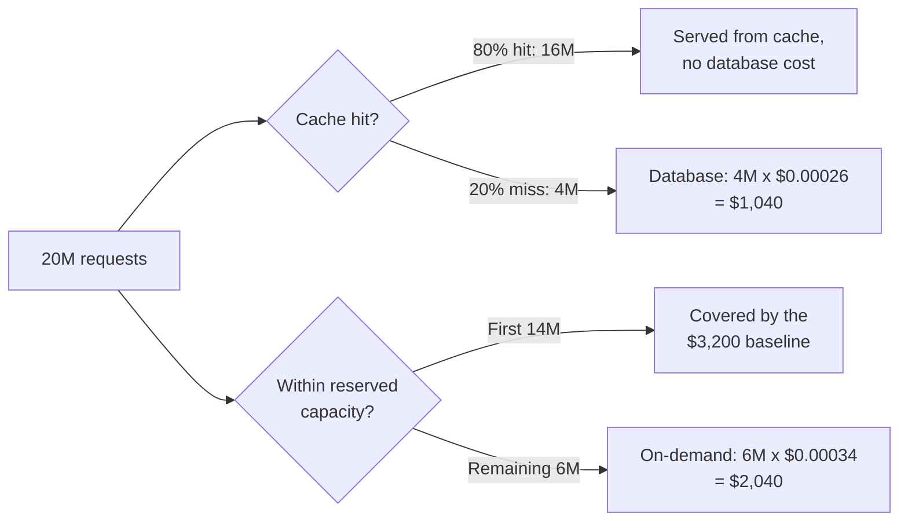
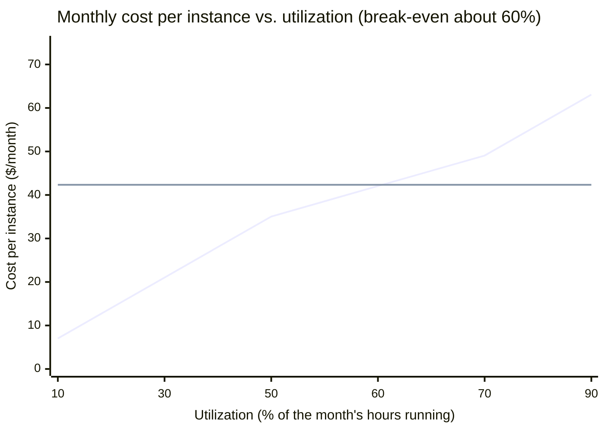

import Scenario from "../../../components/Scenario.astro";
import LevelIntro from "../../../components/LevelIntro.astro";
import Checkpoint from "../../../components/Checkpoint.astro";
import PracticeCheck from "../../../components/PracticeCheck.astro";

export const unit = {
  track: "architecture",
  unitSlug: "cost-aware-architecture",
};

<Scenario label="The fix, in numbers">
  <Fragment slot="facts">
    <div class="not-prose flex flex-col gap-1.5 text-sm text-slate-700 dark:text-slate-300">
      <div class="flex items-center gap-1.5"><span>🖥️</span> On-demand instance: $0.096/hour</div>
      <div class="flex items-center gap-1.5"><span>📦</span> Reserved, same instance: $0.058/hour, billed every hour</div>
      <div class="flex items-center gap-1.5"><span>🗄️</span> Target: 80% of reads served from cache</div>
      <div class="flex items-center gap-1.5"><span>❓</span> At what utilization does reserving win?</div>
    </div>
  </Fragment>

GreenCart has the L2 diagnosis: no cache, on-demand only, and a load with a
predictable floor. Now it must turn that into decisions: how much to cache, what
to reserve, and whether its instances are even the right size. **A reserved
instance costs about 40% less per hour than on-demand. Is reserving therefore
always the right call, or does it depend on something else?**

</Scenario>

It depends on whether the instance would have been running anyway. A discounted
rate on capacity that sits idle can lose to full price on capacity that is
always busy. All prices below are assumed, round-number inputs, not quotes from
any provider.

<LevelIntro
  items={[
    "The three levers worked as arithmetic",
    "Break-even utilization for reserving",
    "Right-sizing to peak, not average",
  ]}
/>

## What does caching plus a reserved baseline do to the whole bill?

**Which two independent things decide a request's cost?** Whether it reached the
database (a cache miss) and which compute tier served it (reserved or
on-demand). They are independent: a request can be a cache hit on on-demand
compute, or a miss on reserved compute. The model below prices each separately,
for the checkout path only, at 20M requests a month.

| Input                                        | Before   | After    |
| -------------------------------------------- | -------- | -------- |
| Requests per month                           | 20M      | 20M      |
| Cache hit ratio                              | 0%       | 80%      |
| Reserved baseline (flat monthly price)       | none     | $3,200   |
| Requests the reserved baseline can absorb    | 0        | 14M      |
| On-demand compute, per overflow request      | $0.00034 | $0.00034 |
| Database cost, per request that misses cache | $0.00026 | $0.00026 |



After the redesign: $3,200 + $2,040 + $1,040 = **$6,280**, or $0.000314 per
request. Before: 20M x ($0.00034 + $0.00026) = **$12,000**, or $0.0006 per
request. The redesign cut this slice of the bill by roughly 48%.

<Checkpoint question="The database term uses the 4M cache misses, not the 6M overflow requests. Aren't both just requests not covered by something?">

They count two independent things, not the same thing twice. The cache hit ratio
decides how many requests ever reach the database, a property of the data being
asked for. The reserved capacity decides which requests land on committed
instances versus on-demand ones, a property of compute. A request can fall in
any of the four combinations. Using one pool for both would double-discount or
double-charge the requests that sit in different combinations.

</Checkpoint>

<PracticeCheck
  track={unit.track}
  unitSlug={unit.unitSlug}
  topicId="cost-model"
/>

## When does a reserved instance really beat on-demand?

**If reserved is billed every hour whether used or not, what question decides
it?** How many of the month's hours the instance would have run anyway. On-demand
cost is rate x hours run. Reserved cost is a flat rate x every hour. They are
equal when the share of hours run equals the ratio of the two rates.

```
break-even utilization = reservedRate / onDemandRate
                       = 0.058 / 0.096 = 0.604   (about 60%)
```

Using 730 hours in a month, a reserved instance costs 0.058 x 730 = **$42.34** no
matter what. On-demand costs depend on how long it runs:



GreenCart's baseline tier runs about 90% of the month, so reserving costs $42.34
against $63.07 on-demand. A sale-spike instance that runs 5% of a month would
cost about $3.50 on-demand, and reserving it would cost $42.34: over 12x more.

<Checkpoint question="The on-demand line keeps climbing and reserved stays flat. Why not reserve every instance, including the ones that only exist for sale spikes?">

Because a flat line only wins when utilization is high, and a spike instance
exists precisely because it runs rarely. Reserving it locks in the flat monthly
cost every month, including the months without a sale, when its real
utilization might be near 5%. The break-even test is not one global answer. It
has to be applied per workload segment, which is why L2 said to split pricing
models inside one system.

</Checkpoint>

<PracticeCheck
  track={unit.track}
  unitSlug={unit.unitSlug}
  topicId="break-even"
/>

## How big should the instance be?

**GreenCart runs a large 8-vCPU instance whose CPU never passes 22%. Does that
mean shrink it to match average use?** No. Size to peak plus headroom, because
average leaves no room for the next spike, the very failure that started the
unit. Assumed inputs: peak CPU 22%, average about 12%, headroom 20%.

| Step                         | Sized to peak                                    | Sized to average                       |
| ---------------------------- | ------------------------------------------------ | -------------------------------------- |
| vCPUs actually used          | 22% of 8 = 1.76                                  | 12% of 8 = 0.96                        |
| With 20% headroom            | 1.76 x 1.2 = 2.11                                | 0.96 x 1.2 = 1.15                      |
| Smallest tier that covers it | medium (4 vCPU), as small (2 vCPU) is below 2.11 | small (2 vCPU)                         |
| Result                       | Safe for the observed peak                       | Fits the average but fails at the peak |

Per instance-month, large is $0.384 x 730 = $280.32 and medium is
$0.192 x 730 = $140.16, so moving to medium saves **$140.16 per instance, half
the cost**, while still covering the load actually seen.

<PracticeCheck
  track={unit.track}
  unitSlug={unit.unitSlug}
  topicId="right-sizing"
/>

**Extend it yourself.** This case assumed one daily peak. What changes if the
real traffic had a lunch rush and a taller evening rush, and the team cared how
_often_ the peak is hit, not only how high it gets once? Would sizing to the
maximum or to a high percentile (such as the 95th) answer a different
question, and which one does GreenCart need? And the model above is one case,
not the whole territory: try 30M requests (the reserved baseline is then
exhausted and cost per request settles at the on-demand rate of $0.00034) or
10M (the baseline is underused, so its fixed price spreads over fewer requests
and cost per request is higher, about $0.00037).

None of these calculations replaces judgment. The cache hit ratio must be
achievable, the utilization forecast honest, and the CPU samples real. What they
replace is deciding by intuition, on a bill that has already arrived, instead of
by a model that is cheap to re-run before it does.
