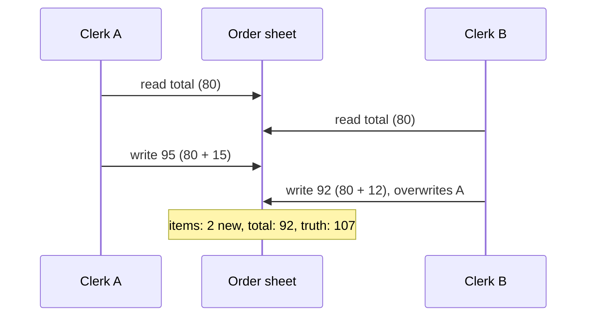
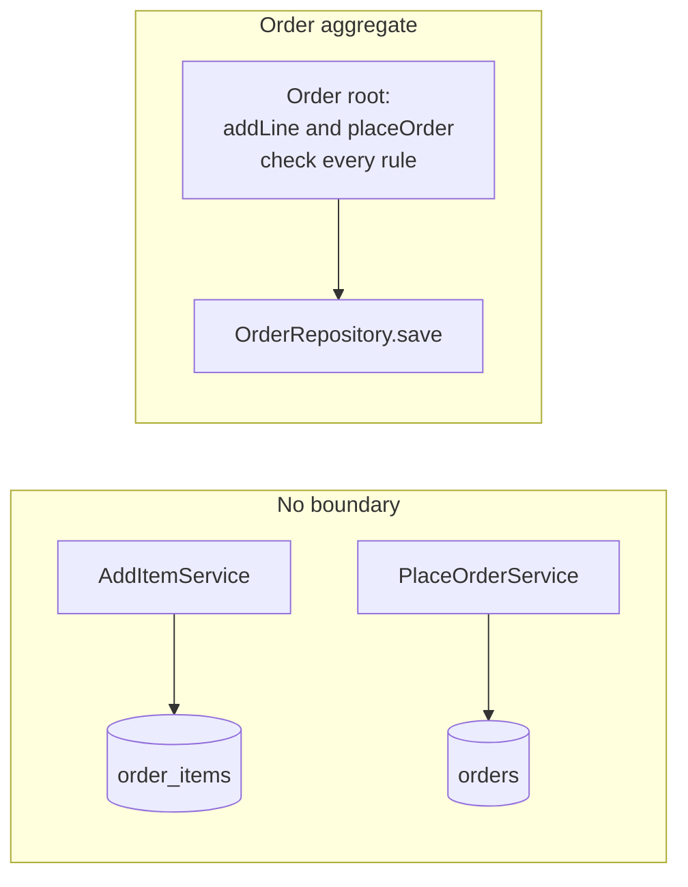

import Scenario from "../../../components/Scenario.astro";
import LevelIntro from "../../../components/LevelIntro.astro";
import PracticeCheck from "../../../components/PracticeCheck.astro";

export const unit = { track: "architecture", unitSlug: "domain-driven-design" };

<Scenario label="Two clerks, one order sheet, one rule: never above $100">
  <Fragment slot="facts">
    

      
🧾 <strong>Order #4471</strong> — total $80, credit limit $100

      
🅰️ Clerk A reads $80, adds a $15 item, writes $95

      
🅱️ Clerk B reads $80 at the same moment, adds a $12 item, writes $92

      
💥 <strong>The later write wins</strong> — both items are on the order, the total says $92, the truth is $107

    

    

      
Total versus the $100 limit

      

        
Recorded

$92

        
Truth

$107

      

    

  </Fragment>

Two clerks share one paper order sheet that says "total: $80". The rule
taped to the desk reads: _an order may never go above $100_. Clerk A
copies the total, adds a $15 item and writes $95. At the same moment,
Clerk B copies the same $80, adds a $12 item and writes $92 over A's
number. Each clerk's own arithmetic is fine and each result is under the
limit.

The sheet now lists two new items but shows $92. The real total is
$107, over the limit, and nobody broke any rule they could see.

**If every single write was valid, what let the order end up wrong?**

</Scenario>

The writes were fine one by one. What nobody guarded was the _group of
facts that has to stay true together_: the items, the total, and the
limit. Software has the same problem when two services write the same
`orders` and `order_items` tables directly. Each database write is a valid
transaction, yet no single place owns the rule "total never exceeds the
limit".

<LevelIntro
  items={[
    "Aggregates, roots, and invariants",
    "Entities versus value objects",
    "Repositories and domain events",
  ]}
/>

This unit assumes you know what a bounded context and a ubiquitous
language are (see `product-domain/bounded-contexts` and
`product-domain/domain-driven-design-basics`). It asks the next question:
inside a context, what stops two writers from corrupting the same cluster
of objects?

## Why a transaction around each write does not fix it

A transaction promises that one write fully happens or fully fails. It
does not know your business rule. The lost update above is two
perfectly atomic writes that disagree about what they started from.

<PracticeCheck
  track={unit.track}
  unitSlug={unit.unitSlug}
  topicId="lost-update"
/>

## The aggregate and its root

An **aggregate** is the small cluster of objects (here: the order and its
line items) that must be consistent with each other after every change.
Its **root** is the one object outside code is allowed to talk to. The
root checks the **invariants**, the rules that must be true after every
change, such as "total is at most the limit" and "no items after the
order is placed".

| Question                              | No aggregate boundary                         | Order is an aggregate with a root                 |
| ------------------------------------- | --------------------------------------------- | ------------------------------------------------- |
| Who may add a line item               | Any code that can insert into the items table | Only `order.addLine(...)`, which checks the rule  |
| Where "total at most the limit" lives | Wherever someone remembered to put it         | Inside the root, on every change                  |
| What a stale concurrent write does    | Silently overwrites the other write           | Is rejected and retried against the current state |
| What "save" means                     | Whichever table a service happened to touch   | One repository call saving the whole aggregate    |

<PracticeCheck
  track={unit.track}
  unitSlug={unit.unitSlug}
  topicId="aggregate-root"
/>

## The rest of the vocabulary, in one table

| Term             | Plain version                                                                                 |
| ---------------- | --------------------------------------------------------------------------------------------- |
| Entity           | Has an identity that survives changes: line 7 is still line 7 after its quantity changes      |
| Value object     | No identity, compared by contents: two `$10` amounts are simply equal                         |
| Repository       | The only door to storage; it loads and saves whole aggregates, never a lone line item         |
| Domain event     | A record that the root decided something happened (`OrderPlaced`), published after the save   |
| Context map edge | How two contexts relate in practice: translate, conform, negotiate, or publish one stable API |

For background pieces see `systems/transactions`, `systems/concurrency`
and `systems/race-conditions`. `architecture/hexagonal-clean-architecture`
shows how a repository later becomes a port that keeps storage outside the
core.

L2 explains why the boundary is a modeling decision rather than a
database feature, and follows contexts into real module and service
boundaries. L3 fixes the race with a version check and works through the
trade-offs of drawing the boundary too big or too small.
