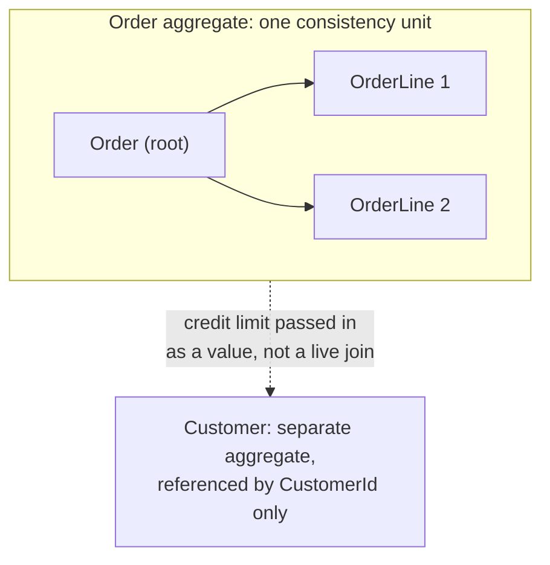
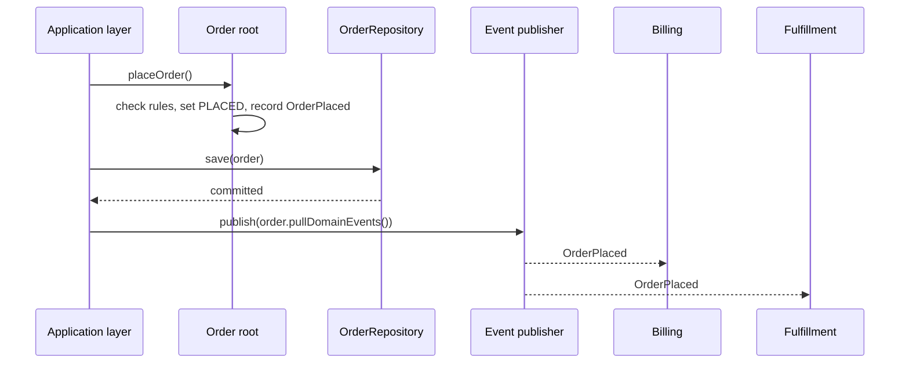
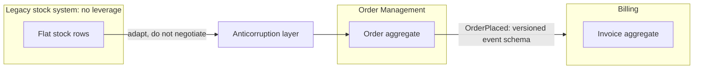

import LevelIntro from "../../../components/LevelIntro.astro";
import Checkpoint from "../../../components/Checkpoint.astro";
import PracticeCheck from "../../../components/PracticeCheck.astro";

export const unit = { track: "architecture", unitSlug: "domain-driven-design" };

L1 left Order #4471 at $107 on a sheet that said $92, and named the
pieces that prevent it. L2 explains why each piece is shaped the way it
is, then follows bounded contexts into real code boundaries.

<LevelIntro
  items={[
    "Entity versus value object, in practice",
    "Domain events and publishing after commit",
    "Context maps as real code boundaries",
  ]}
/>

## Why is the aggregate a modeling decision, not a database feature?

**A database already offers transactions, row locks and constraints. Why
is none of them the aggregate?** Because they enforce _mechanics_
(atomic commit, uniqueness, isolation), while an aggregate answers a
different question: which facts must be checked together, every time?
Only the domain knows that "items, total and limit belong together".
The aggregate is that answer; the repository then uses the database's
tools to persist it safely.

**Why is `Customer` outside, when the check needs its credit limit?**
`Customer` has its own rules and its own write traffic. Putting it inside
`Order` would make every order write contend with every customer edit.
The boundary encloses the _smallest cluster that must be consistent on
every write_, and `Order` only needs the limit as an input value.

<Checkpoint question="A teammate says every order write already runs inside a database transaction, so Order #4471's bug cannot happen. What is missing from that claim?">

A transaction makes one write atomic. It never decides which combined
facts may be true together. Clerk A and Clerk B each wrote atomically,
and the rule "total at most the limit" was still not enforced anywhere.
That rule needs an aggregate root that checks it on every change.

</Checkpoint>

## Does this thing need an identity?

**Line 7 changes quantity from 2 to 3. Is it still line 7?** Yes, so
the line is an **entity**: its identity persists across changes. **Two
separate `$10` amounts: are they the same $10, or merely equal?** Merely
equal, so money is a **value object**: immutable, compared by contents,
replaced rather than edited.

| Question                                    | Entity                | Value object                      |
| ------------------------------------------- | --------------------- | --------------------------------- |
| Does "which one, exactly" matter?           | Yes, tracked by an id | No, only "what does it equal"     |
| Can it change and stay the same thing?      | Yes                   | No, a change produces a new value |
| Identical fields: same thing or just equal? | Different things      | The same, by definition           |

Getting it backwards costs real effort. Modeling `Money` as an entity adds
identity tracking nothing needs. Modeling a line as a value object makes
"update line 7" impossible to say, because every edit yields a different
object.

<PracticeCheck
  track={unit.track}
  unitSlug={unit.unitSlug}
  topicId="entity-value"
/>

## Domain events: who tells Billing, and when?

**`placeOrder()` must tell Billing and Fulfillment. Should it call them
directly?** No. That would make `Order` depend on every downstream
context being up and shaped a certain way. Instead the root _records_ a
fact, `OrderPlaced`, and the application layer publishes it after the
save commits.

**Why after the commit and not the moment the event is recorded?** If the
save then fails, Billing has already been told about an order that does
not exist. Publishing after the commit means the event is only ever true.
One gap remains: a crash between the save and the publish loses the
event. L3 covers the usual fix, an outbox.

<Checkpoint question="The save fails on a constraint violation right after placeOrder() recorded OrderPlaced. Under the publish-after-commit rule, what does Billing receive?">

Nothing. The event was only recorded inside the aggregate; it is
published when `save` has succeeded. If the save fails, the recorded
event is discarded with the failed attempt, so Billing never hears about
an order that was never stored.

</Checkpoint>

<PracticeCheck
  track={unit.track}
  unitSlug={unit.unitSlug}
  topicId="domain-events"
/>

## Where does a context boundary live in code?

**With several contexts, is the boundary a folder, a package, or a
service?** All three at different stages. The context map says which
relationship governs each edge:

| Relationship                             | What it looks like in code                                                          | Fits when                                                           |
| ---------------------------------------- | ----------------------------------------------------------------------------------- | ------------------------------------------------------------------- |
| Anticorruption layer                     | An adapter module at the boundary translating the other model into yours            | The other model carries different meanings you must not absorb      |
| Conformist                               | Downstream uses the upstream shape directly, no translation                         | You have no leverage over the upstream, such as a third-party API   |
| Customer-supplier                        | Upstream accepts downstream needs through a ticket queue or contract tests          | Both teams answer to one organization and can prioritize each other |
| Open host service and published language | Upstream exposes one stable, versioned contract instead of many custom integrations | Many downstream contexts need the same data                         |

**Why name the relationship instead of calling every edge "an API"?**
Each implies a different failure when misjudged. Treating a conformist
edge as customer-supplier means filing requests a vendor will never read.
Treating a customer-supplier edge as conformist means silently absorbing
breaking changes you had standing to negotiate.

<PracticeCheck
  track={unit.track}
  unitSlug={unit.unitSlug}
  topicId="context-mapping"
/>

L3 builds the version check that fixes the race, then asks where the
boundary should be drawn when it is too large or too small.
