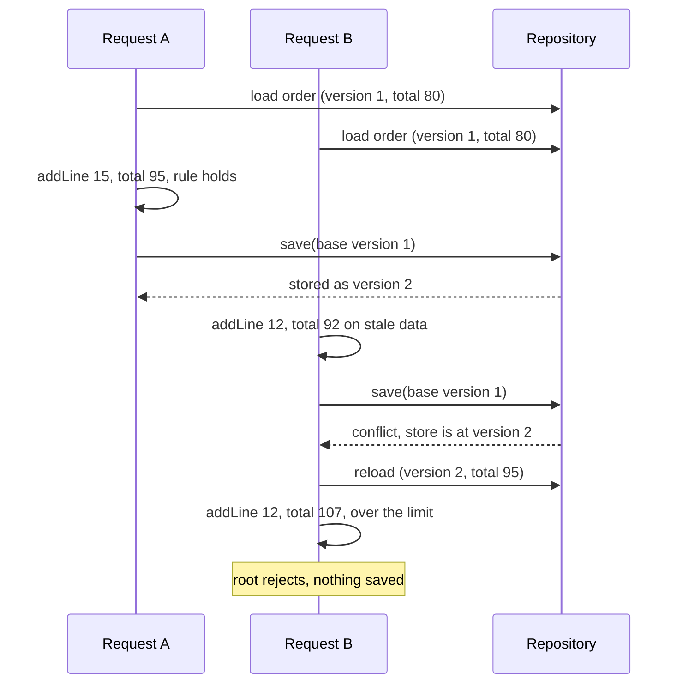
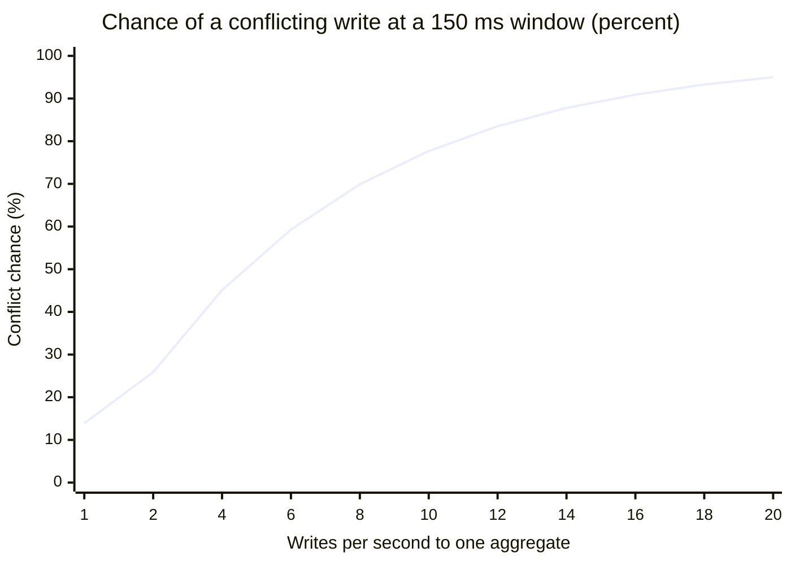

import Scenario from "../../../components/Scenario.astro";
import LevelIntro from "../../../components/LevelIntro.astro";
import Checkpoint from "../../../components/Checkpoint.astro";
import PracticeCheck from "../../../components/PracticeCheck.astro";

export const unit = { track: "architecture", unitSlug: "domain-driven-design" };

<Scenario label="Replaying the race with a version number on the sheet">
  <Fragment slot="facts">
    <div class="not-prose flex flex-col gap-2 text-sm text-slate-700 dark:text-slate-300">
      <div class="flex items-center gap-1.5"><span>🧾</span> Order #4471 stored at <strong>version 1</strong>: total $80, limit $100</div>
      <div class="flex items-center gap-1.5"><span>🅰️</span> A adds $15, saves version 1 as the base: accepted, stored as version 2</div>
      <div class="flex items-center gap-1.5"><span>🅱️</span> B adds $12 against its stale $80, saves with version 1: rejected</div>
      <div class="flex items-center gap-1.5"><span>🔁</span> B reloads ($95), retries: the root rejects $107 over the limit</div>
    </div>
  </Fragment>

If two clerks each carry a number saying _which version of the sheet they
copied_, the filing desk can refuse the second one. **What exactly does the
desk compare, and what must the refused clerk do next for the limit to
finally be enforced?**

</Scenario>

<LevelIntro
  items={[
    "Version checks and safe retries",
    "Drawing the aggregate boundary",
    "Failure modes around events",
  ]}
/>

## How does a version check turn a silent loss into a visible conflict?

The root already rejects an invalid change. What it cannot see is that
its starting snapshot is stale. The repository supplies that missing
piece: every stored aggregate has a version, every load returns it, and
every save must present the version it loaded. This is **optimistic
concurrency**: assume no conflict, detect it at save time.



Only the pieces that carry the idea are worth reading as code. This
TypeScript sketch keeps one rule check and one version check, with
amounts in whole dollars to stay simple:

```ts
class Order {
  private lines: number[] = []; // line amounts in dollars
  constructor(
    readonly version: number,
    private readonly limit: number,
  ) {}

  total(): number {
    return this.lines.reduce((sum, amount) => sum + amount, 0);
  }

  addLine(amount: number): void {
    if (this.total() + amount > this.limit) throw new Error("over limit");
    this.lines.push(amount);
  }
}

// repository.save: the writer must present the version it loaded
if (stored.version !== order.version)
  throw new Error("conflict: reload and retry");
```

The comparison is between the version the writer _loaded_ and the version
_currently stored_, not a check that the new data looks valid. Validity is
the root's job; freshness is the repository's.

<Checkpoint question="Request B gets a conflict and simply retries save() with the same object. Why will it conflict again, and what must the retry do instead?">

The object still carries version 1 and still holds the stale $80
snapshot, so the store, now at version 2, rejects it every time. A useful
retry reloads the current aggregate first and then re-runs `addLine`
against the real total. That second run is where the root finally catches
that $107 breaks the limit.

</Checkpoint>

**How likely is that conflict in the first place?** It depends on how
many writes target the same aggregate and how long each stays in flight.
With a Poisson-style estimate, the chance that at least one competing
write lands inside your write window
is `1 - exp(-rate × window)`, where the rate is writes per second to that one
aggregate and the window is the in-flight time in seconds. This is the exact formula the demo on this page
uses; here it is at a 150 ms window:



At 2 writes per second and 150 ms the chance is 25.9%, so conflicts are
routine, not exotic. At 10 writes per second it reaches 77.7%. The two
ways down are fewer writes per aggregate (a smaller boundary spreads the
traffic) and shorter windows (less work inside each write). These are
modeling estimates, not measurements from a real system.

<PracticeCheck
  track={unit.track}
  unitSlug={unit.unitSlug}
  topicId="optimistic-concurrency"
/>

## What happens when the boundary is drawn wrong?

**If bigger aggregates are safer, why not put everything an order touches
inside it?** Because the same boundary that guarantees consistency also
serializes writers. Every extra object in the aggregate raises the
traffic on one version number.

| Boundary choice                                   | What goes wrong                                                           | The trade-off                                                                            |
| ------------------------------------------------- | ------------------------------------------------------------------------- | ---------------------------------------------------------------------------------------- |
| Too large: `Order` contains `Customer`            | Unrelated customer edits conflict with order placement                    | Smaller aggregates cut contention but push rules into cross-aggregate coordination       |
| Too small: each `OrderLine` is its own aggregate  | The limit rule spans several aggregates and cannot be checked in one save | Needs a saga or a compensating step, trading strict consistency for availability         |
| Event published before the save commits           | Downstream hears about an order that then fails to persist                | Publish only after a successful save                                                     |
| Save succeeds, crash before publish               | Order stored but Billing never hears: a dual-write gap                    | An outbox written in the same transaction, published later, gives at-least-once delivery |
| Misreading a customer-supplier edge as conformist | You absorb breaking changes you could have negotiated                     | Naming the relationship tells you whether to translate or to ask                         |

<Checkpoint question="Splitting every order line into its own aggregate would make saves faster and conflicts rarer. What rule from this unit stops working, and why?">

The limit rule spans all lines of an order. Once each line is its own
aggregate, no single save can see the other lines, so "total at most the
limit" can no longer be checked atomically. You would need a
coordinating process that checks and compensates afterwards, which is
exactly the weaker consistency the original boundary avoided.

</Checkpoint>

<PracticeCheck
  track={unit.track}
  unitSlug={unit.unitSlug}
  topicId="aggregate-sizing"
/>

## Extend it yourself

The worked example is one case, not the whole territory: one order, one
rule, one writer conflict. Try these on your own.

1. The root must also reject a line when live warehouse stock is too low.
   Would the root call the stock system itself, or receive the answer as a
   value? What does a network call inside the root do to the write window
   in the formula above?
2. The rule becomes worse: total at most the limit, and a customer may
   have at most 3 open orders. The second clause needs data from outside
   this aggregate. Do you pass in a count, or does it change which objects
   belong inside the boundary?
3. What changes if the news is worse: 40 writes per second land on one
   hot order? Does a version check still help, or is the boundary wrong?

Different rules and traffic patterns shift which trade-off is the right
call, which is why the demo's two sliders are worth moving before
deciding.
