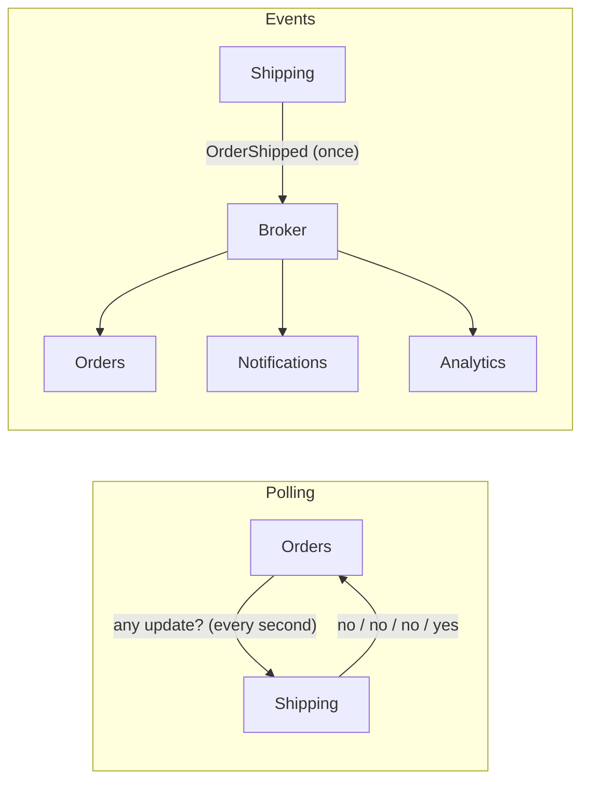
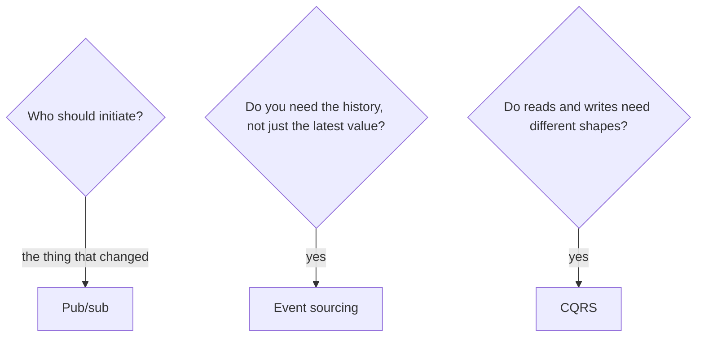

import Scenario from "../../../components/Scenario.astro";
import LevelIntro from "../../../components/LevelIntro.astro";
import PracticeCheck from "../../../components/PracticeCheck.astro";

export const unit = {
  track: "architecture",
  unitSlug: "event-driven-architecture",
};

<Scenario label="You ordered a parcel. How often should you check whether it shipped?">
  <Fragment slot="facts">
    

      

        86,400
        checks per day at one per second
      

      

        

      

      
for an order that ships once, at some unknown moment

    

    

      
🔁 Polling: the asker pays for every answer, even "no change"

      
⏱️ The reaction is late by up to one full interval

      
📣 Events: the thing that changed announces it once

    

  </Fragment>

You ordered a parcel and you want to know the moment it ships. One option:
refresh the tracking page every second, all day. Another: the shop sends
you one message when it ships.

Now make it a system. An `Orders` service wants to know when `Shipping`
dispatches order 4471, so it can email the customer. The first fix is a
loop: every second, `Orders` asks `Shipping` _"is 4471 shipped yet?"_ That
is 86,400 requests per day for that one order, and if it ships six hours
in, the first 21,599 checks find nothing (the demo below lets you
move both numbers). **Faster polling cuts the delay but multiplies the cost;
slower polling cuts the cost but multiplies the delay. Is there a way out
of that trade?**

</Scenario>

Yes: flip who starts the conversation. The thing that changed announces it
once, and everyone who cares reacts.

<LevelIntro
  items={[
    "Why polling pays for answers nobody needed",
    "Pub/sub, event sourcing, and CQRS in one line each",
    "Vocabulary: producer, consumer, broker, topic",
  ]}
/>

## Why does polling stop scaling?

Cost under polling grows with `consumers x checks per second`, not with how
many shipments actually happened. Under events it grows with shipments.

| Model          | Who starts it | Requests while nothing happens | Delay before reacting                        |
| -------------- | ------------- | ------------------------------ | -------------------------------------------- |
| Polling        | The consumer  | One per interval, per consumer | Up to one interval                           |
| Event-driven   | The producer  | None                           | Delivery plus processing time                |
| Direct webhook | The producer  | None                           | Short, but producer must know every consumer |

<PracticeCheck
  track={unit.track}
  unitSlug={unit.unitSlug}
  topicId="polling-cost"
/>

## What are the three patterns, and which problem does each solve?

Three related ideas share one root problem, reacting to change without
asking constantly. You adopt each on its own, depending on which problem you
actually have.

- **Event-driven architecture and pub/sub**: services publish facts about the
  past (`OrderShipped`) to a broker. Consumers subscribe to what they care
  about. The producer does not know who is listening.
- **Event sourcing**: store state as an append-only log of events and derive
  today's state by replaying it. The log is the source of truth.
- **CQRS** (Command Query Responsibility Segregation): use one model for
  writes and a separate, query-shaped model for reads.

| Term        | Plain version                                                 |
| ----------- | ------------------------------------------------------------- |
| Event       | A notice that something already happened, named in past tense |
| Producer    | The service that publishes the notice                         |
| Consumer    | A service that reacts to it                                   |
| Broker      | The middleman that stores and delivers notices                |
| Topic/queue | A mailbox of messages waiting for the right consumer          |

What you gain: producers and consumers need not know each other, and bursts
queue up instead of being dropped. What you give up: **eventual
consistency** (a consumer's view lags by delivery plus processing time) and
harder debugging, because one request's effects spread across several
services.

<PracticeCheck
  track={unit.track}
  unitSlug={unit.unitSlug}
  topicId="pattern-roles"
/>
