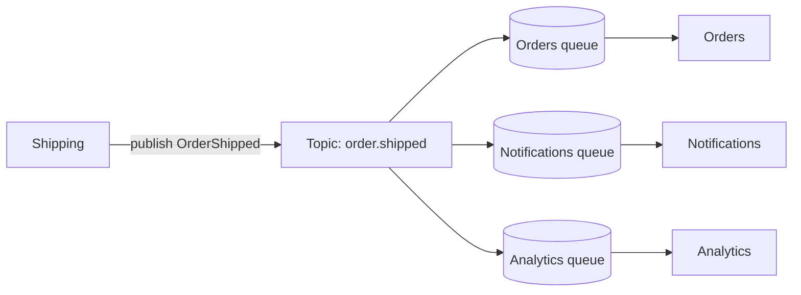
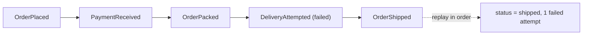
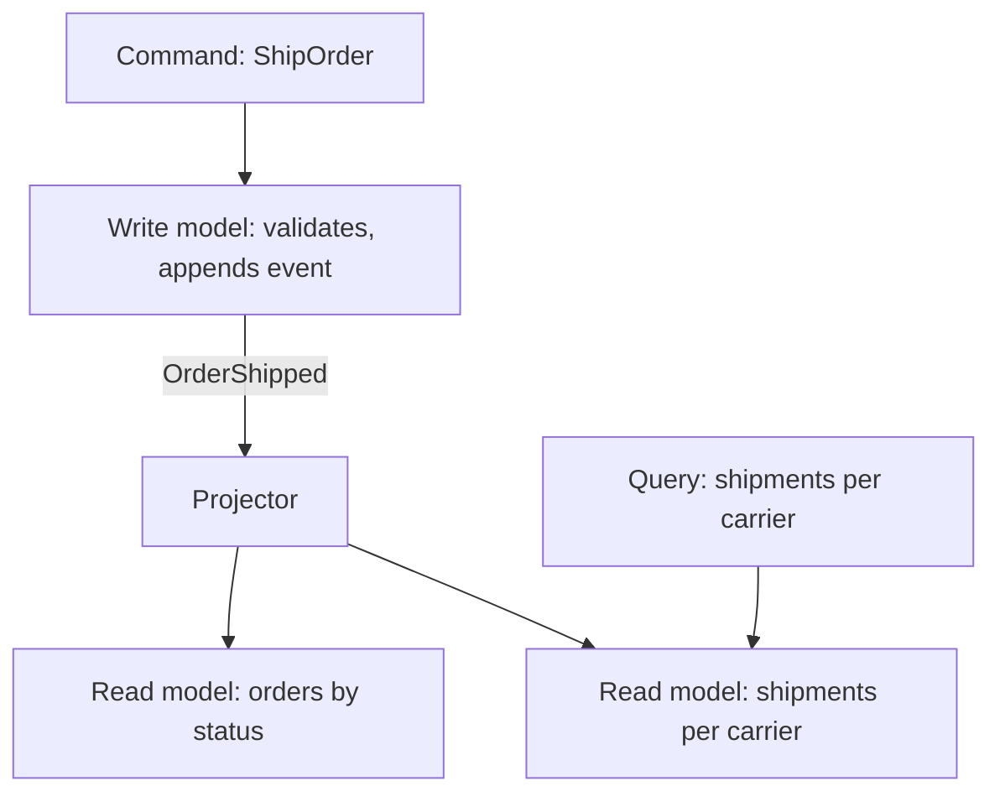

import Scenario from "../../../components/Scenario.astro";
import LevelIntro from "../../../components/LevelIntro.astro";
import Checkpoint from "../../../components/Checkpoint.astro";
import PracticeCheck from "../../../components/PracticeCheck.astro";

export const unit = {
  track: "architecture",
  unitSlug: "event-driven-architecture",
};

<Scenario label="Three services now want to know about one shipment">
  <Fragment slot="facts">
    

      
📬 Orders, Notifications, and Analytics all need OrderShipped

      
🔌 Direct calls: Shipping keeps a list of every caller's address

      
🐌 One slow caller delays Shipping's own work

      
🧩 Broker: Shipping publishes once and knows nobody

    

  </Fragment>

Say the team drops polling and has `Shipping` call `Orders` the moment a
package ships. The delay is fixed. Then `Notifications` needs the news for
the "it's on the way" email, and `Analytics` needs it for a dashboard.

**Does `Shipping` now keep a list of every service that might care, and
call all of them one by one, inside the same request that also updates its
database?**

</Scenario>

Point-to-point calls make the producer responsible for knowing every
consumer, and a slow or down consumer blocks the producer's own work. A
broker in the middle removes both problems.

<LevelIntro
  items={[
    "Pub/sub: a broker between producer and consumers",
    "Event sourcing: state as a replay of an append-only log",
    "CQRS: a write model apart from the read model",
  ]}
/>

## How does a broker let Shipping stay ignorant of its listeners?

The question to answer: if `Notifications` is mid-deploy when the package
ships, how does it still get the news, without `Shipping` waiting for it?

- `Shipping` publishes one message to a **topic**. Adding a fourth consumer
  needs no change to `Shipping`.
- The broker holds a **queue per subscriber**. If `Notifications` is down for
  five minutes, its messages wait. Nothing is lost, and `Shipping` never
  notices.
- `Shipping`'s request finishes when the broker accepts the publish, not
  when every subscriber has processed it. The price is **eventual
  consistency**: consumers are accurate shortly after, not instantly. That is
  fine for "send an email", and wrong for "does this account have enough
  balance right now".

<Checkpoint question="Shipping publishes OrderShipped and its own request returns before Notifications or Analytics have processed anything. Bug, or design working as intended?">

Working as intended. The broker accepting the publish is where `Shipping`'s
job ends, which is exactly what stops a slow `Notifications` from blocking
it. The cost is that every subscriber lags by delivery and processing time,
so the pattern fits consumers that tolerate a short lag and misfits any
caller that must see its own write immediately.

</Checkpoint>

<PracticeCheck
  track={unit.track}
  unitSlug={unit.unitSlug}
  topicId="broker-decoupling"
/>

## What if state were never overwritten, only appended to?

A support agent asks: _"when did this order go from packed to shipped, and
was there a failed delivery in between?"_ A row with `status: shipped` cannot
say, because every earlier value was overwritten.

- The log is **append-only**. A correction is a new event
  (`ShippingAddressCorrected`), never an edit of an old one.
- Current state is **derived**: start from nothing and apply one event at a
  time, in order. Two systems replaying the same log reach the same state.
- Costs: replaying a long history is slow, so a **snapshot** stores the state
  at event number N and replay resumes from N+1. And every event's shape
  becomes a long-term contract, since the log is permanent.

| History line             | Summary after reading it                |
| ------------------------ | --------------------------------------- |
| `OrderPlaced`            | Order exists, status `placed`           |
| `PaymentReceived`        | Same order, now paid                    |
| `DeliveryAttempted` fail | Same order, one failed attempt          |
| `OrderShipped`           | Shipped, failed-attempt count preserved |

<Checkpoint question="Two services replay the same log independently with no communication. Do they necessarily end with the same state?">

Yes, as long as both apply the same rules to the same events in the same
order, the way two people adding the same column of numbers get the same
total. That determinism is why the log can be the source of truth, and it is
the property CQRS relies on next: a projector is just a second replay shaped
for a different question.

</Checkpoint>

<PracticeCheck
  track={unit.track}
  unitSlug={unit.unitSlug}
  topicId="event-log-replay"
/>

## Must the model that accepts writes also answer reads?

With state stored as events, "how many orders shipped last week, per
carrier" would mean replaying millions of events per query. Nobody wants that
at request time.

- The **write side** takes commands, checks business rules, and records the
  result. It knows no dashboards.
- A **projector** consumes the events (the same pub/sub mechanism) and keeps
  one or more **read models** current: plain tables shaped for one query.
- Queries read the table directly, with no replay.
- The cost is visible to readers: a query 50 ms after a command may not show
  it yet. Interfaces that must show the user's own write either read from
  the write side for that case or display the pending change optimistically.

How stale can the read side get? It is a queue problem: lag is roughly
`events waiting / events processed per second`. With 200 waiting and 500
processed per second, about 0.4 s. With 5,000 waiting and 10 per second,
500 s. The second demo lets you drag both.

CQRS does not require event sourcing: a normal `orders` table copied into an
`orders_by_carrier` table is still a write model and a read model.

| Pattern        | Problem it solves                             | What it costs                                      |
| -------------- | --------------------------------------------- | -------------------------------------------------- |
| Pub/sub        | Producer should not know or wait on consumers | Eventual consistency                               |
| Event sourcing | Current state loses the history behind it     | Replay cost, events as a permanent contract        |
| CQRS           | One model cannot suit both writes and reads   | Read models lag writes, more parts to keep in sync |

<PracticeCheck
  track={unit.track}
  unitSlug={unit.unitSlug}
  topicId="cqrs-read-model"
/>
