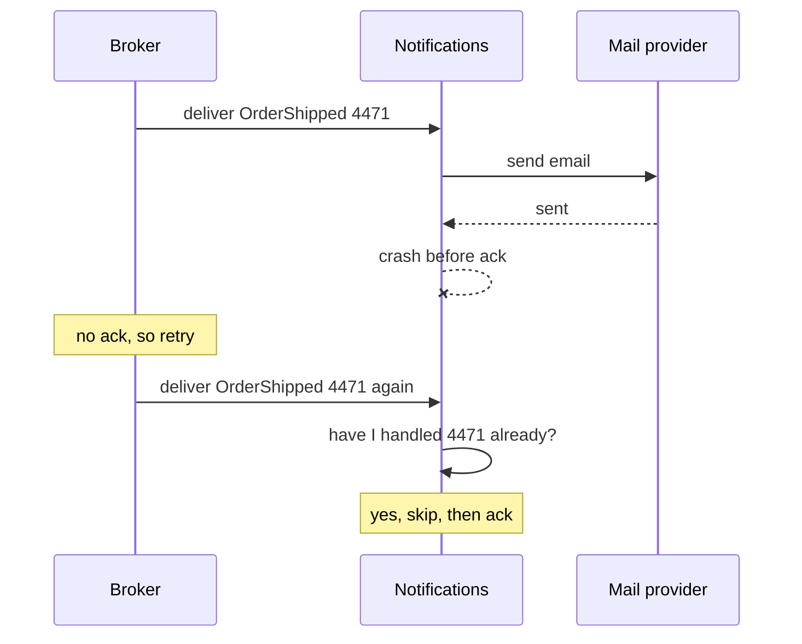
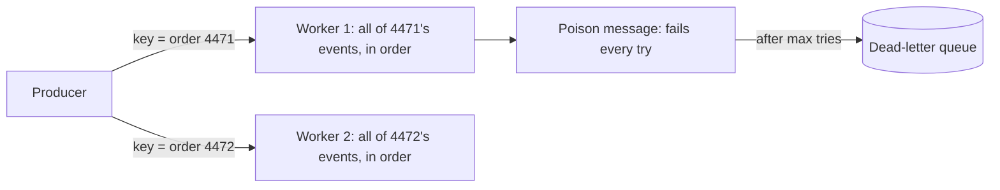

import Scenario from "../../../components/Scenario.astro";
import LevelIntro from "../../../components/LevelIntro.astro";
import Checkpoint from "../../../components/Checkpoint.astro";
import PracticeCheck from "../../../components/PracticeCheck.astro";

export const unit = {
  track: "architecture",
  unitSlug: "event-driven-architecture",
};

<Scenario label="The customer got two 'it's on the way' emails">
  <Fragment slot="facts">
    <div class="not-prose flex flex-col gap-1 text-sm text-slate-700 dark:text-slate-300">
      <div class="flex items-center gap-1.5"><span>📧</span> Notifications sends the email, then crashes before acknowledging</div>
      <div class="flex items-center gap-1.5"><span>🔁</span> The broker cannot tell the email went out, so it redelivers</div>
      <div class="flex items-center gap-1.5"><span>☠️</span> A message that always fails can block everything behind it</div>
      <div class="flex items-center gap-1.5"><span>🧮</span> Fix: consumers tolerate repeats, not "trust the broker"</div>
    </div>
  </Fragment>

L2's diagrams assumed clean delivery: publish once, each subscriber gets one
copy, in order. Real brokers give less. `Notifications` handles
`OrderShipped` for order 4471, sends the email, and crashes before it tells
the broker "done". The broker, unable to know the email already went out,
delivers the message again.

**If you cannot stop the broker from redelivering, where must the fix
live?**

</Scenario>

Not in the broker. Most brokers promise **at-least-once** delivery: they would
rather deliver twice than lose a message. "Exactly once" is only achievable
by making the consumer's effect safe to repeat.

<LevelIntro
  items={[
    "Idempotent consumers under redelivery",
    "Ordering by key, and poison messages",
    "When polling or a direct call is the better answer",
  ]}
/>

## Why does at-least-once force consumers to be idempotent?



The consumer keeps a record of handled event identities (or passes a
unique key to the provider, if the provider supports one) and skips repeats.
An **idempotent** handler is one where handling an event twice leaves the
same result as handling it once.

A small trace makes it concrete. Three deliveries arrive at a dashboard that
counts shipments per carrier. Event ids are `orderId:type`.

| #   | Delivery arriving         | Naive counter | Counter that remembers ids |
| --- | ------------------------- | ------------- | -------------------------- |
| 1   | `4471:OrderShipped`       | 1             | 1                          |
| 2   | `4471:OrderShipped` again | 2             | 1 (already seen, skipped)  |
| 3   | `4472:OrderShipped`       | 3             | 2                          |

The true number of shipments is 2. The naive counter over-reports by one for
every redelivery. The pattern in full is one check before the effect:

```
if id already recorded: acknowledge and stop
else: do the effect, record the id
```

The record and the effect should succeed or fail together, otherwise a crash
between them reopens the gap.

<Checkpoint question="A retry re-runs a handler that had already sent the email. Does the broker's retry promise exactly once?">

No, it promises at-least-once. The broker keeps retrying until the handler
returns normally, and cannot see whether side effects already happened
before the failure. That gap is why the consumer, which alone knows what it
already did, must be the one that makes repeats harmless.

</Checkpoint>

<PracticeCheck
  track={unit.track}
  unitSlug={unit.unitSlug}
  topicId="idempotent-consumers"
/>

## What can go wrong with order, and with a message that never succeeds?

Two failure modes remain even with idempotent consumers.



- **Ordering.** Parallel workers give throughput but no order:
  `OrderShipped` could be handled before `PaymentReceived` for the same order.
  A **partition key** (here the order id) sends every event of one order to
  the same worker, in publish order, while different orders still run in
  parallel. Order is guaranteed only within a key, so a consumer that assumes
  global order across orders is wrong.
- **Poison messages.** An event whose handler always throws (a bug, or a
  payload the current code cannot read) would retry forever and block the
  events behind it. A retry ceiling (for example 3 attempts) moves it to a
  **dead-letter queue** for human replay after the fix. The price: that one
  event waits for manual attention.

Two more edges worth naming. **Schema evolution**: events in the log are
permanent, so adding a required field to `OrderShipped` means old events lack
it, and readers must tolerate old shapes or convert them when read. **A
lagging projector**: the dashboard under-reports until it catches up, which
looks like a bug to anyone who screenshots it at the wrong moment.

<Checkpoint question="A snapshot stores state at event 10,000. If OrderShipped changes shape later, is an old snapshot still safe to resume from?">

Not automatically. A snapshot is a cached result of folding events under the
old rules, so a changed rule can leave it silently wrong, or make later
events fail when folded on top of it. Either discard old snapshots and
rebuild from the log after a shape change, or keep the fold tolerant of every
shape that ever existed.

</Checkpoint>

<PracticeCheck
  track={unit.track}
  unitSlug={unit.unitSlug}
  topicId="ordering-and-poison"
/>

## When is polling, or a plain call, the better design?

| Situation                                                      | Better fit                          |
| -------------------------------------------------------------- | ----------------------------------- |
| Many independent consumers, producer should not know them      | Pub/sub                             |
| Need full history, audit trail, or state at a past time        | Event sourcing                      |
| Reads and writes have very different shape or load             | CQRS                                |
| One producer, one consumer, same team, low volume              | A direct call, a broker is overhead |
| One consumer needs only the current value, checking every 30 s | Polling, simple and cheap           |
| Caller cannot continue without the answer (confirm a charge)   | A synchronous call                  |

Polling is not a mistake by default. It is a mistake when its interval fights
a latency requirement it cannot meet cheaply, or when many consumers each ask
for the same fact. The signal to add a broker is the _number of parties who
need to react_, not the urgency of any one.

<PracticeCheck
  track={unit.track}
  unitSlug={unit.unitSlug}
  topicId="choosing-the-pattern"
/>

## Extending the case

The worked example is one case, not the whole territory: a shipping event,
one carrier counter, one crash. Try changing it.

- `Notifications` needs `OrderShipped` strictly after `PaymentReceived`, while
  `Analytics` does not care about order and wants maximum throughput. Must both
  subscribers use the same key and parallelism off the same topic?
- A brand-new consumer needs everything that ever happened, not just events
  from now on. How is replaying history to it different from delivering new
  events to an existing subscriber?
- What changes if the news were worse: the duplicate is a refund instead of
  an email?
