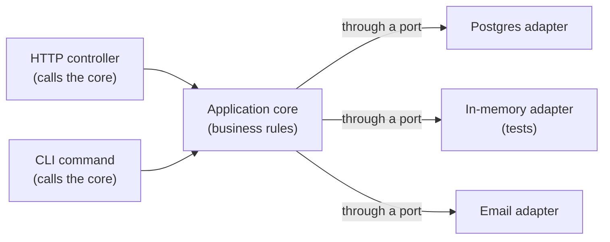

import Scenario from "../../../components/Scenario.astro";
import LevelIntro from "../../../components/LevelIntro.astro";
import PracticeCheck from "../../../components/PracticeCheck.astro";

export const unit = {
  track: "architecture",
  unitSlug: "hexagonal-clean-architecture",
};

<Scenario>
  <Fragment slot="facts">
    

      

        🐘 One test, real database
        45 ms (assumed)
      

      

        

      

      

        ⚡ One test, in-memory stand-in
        0.05 ms (assumed)
      

      

        

      

      
Bar widths are not to scale: the real ratio is 900 to 1, which would make the green bar invisible.

    

    
What the tangle costs

    

      
🧪 A discount rule cannot be tested without a database running

      
🔌 Changing the database means editing the rule's function

      
🕸️ Web-framework objects appear inside pricing code

    

  </Fragment>

A lamp has its cord wired straight into the wall. To check whether the bulb works, you have to take the wall apart. Now picture the same lamp with a plug: you can test it on a bench socket, in a different house, or with a battery pack, and the bulb never notices.

Many programs are built like the hard-wired lamp. A function called `placeOrder` has 15 lines of business rules (check stock, apply the discount, reject an empty cart) and 25 lines that talk to a database and a web framework. To test the discount rule you have to start a real database first.

**Before reading on: the discount rule has nothing to do with which database exists. So why does testing it require one?**

</Scenario>

Because the rule and the database call sit in the same function, with no plug between them. The rule cannot run without dragging the database along, and nothing stops the next feature from tangling them further.

<LevelIntro
  items={[
    "Business rules vs. infrastructure",
    "Ports, adapters, and the inward rule",
    "What the pattern costs",
  ]}
/>

## Why does the tangle hurt?

The two kinds of code change for different reasons and are verified in different ways:

| Kind of code   | Example                                          | Changes when                  | Checked by                         |
| -------------- | ------------------------------------------------ | ----------------------------- | ---------------------------------- |
| Business rules | An order needs at least one line                 | The organization's rules move | Plain unit tests, microseconds     |
| Infrastructure | A database client, a web framework, an email SDK | A vendor or tool changes      | Slow tests against the real system |

Mixed together, every rule test pays the infrastructure price. With the assumed numbers above (45 ms with a real database, 0.05 ms with an in-memory stand-in), 50 tests cost 2.25 seconds against the database and 0.0025 seconds in memory. The interactive demo on this unit lets you slide the test count and see the gap grow.

<PracticeCheck
  track={unit.track}
  unitSlug={unit.unitSlug}
  topicId="core-tangle"
/>

## What is the fix, in one picture?

Put the rules in a **core** that knows nothing about databases or web frameworks, and let the outside world connect through two kinds of sockets.

- A **port** is an interface the core defines and depends on: "something that can save an order". It says what is needed, not how.
- An **adapter** is a concrete implementation that plugs into a port: a Postgres adapter, an in-memory adapter for tests, an email adapter.
- **The one rule: dependencies point inward.** Adapters depend on the core's ports. The core never imports an adapter, a framework, or a driver.

Hexagonal architecture (Alistair Cockburn) and clean architecture (Robert C. Martin) use different vocabularies for this same idea, so this unit treats them as one pattern. It is dependency inversion from `software-design/solid-principles`, applied to the whole system instead of one class.

| Term                 | Plain version                                        |
| -------------------- | ---------------------------------------------------- |
| Application core     | The rules of the business, in plain code             |
| Port                 | An interface the core owns: what it needs            |
| Adapter              | Code that satisfies a port using a real technology   |
| Dependency inversion | The core defines the interface; the outside conforms |

<PracticeCheck
  track={unit.track}
  unitSlug={unit.unitSlug}
  topicId="ports-adapters-direction"
/>

## What does it cost?

More files, an interface for each outside dependency, and one place that wires everything together. For a five-endpoint CRUD app with no real rules, that overhead can cost more than it returns. L3 covers when it earns its keep.
