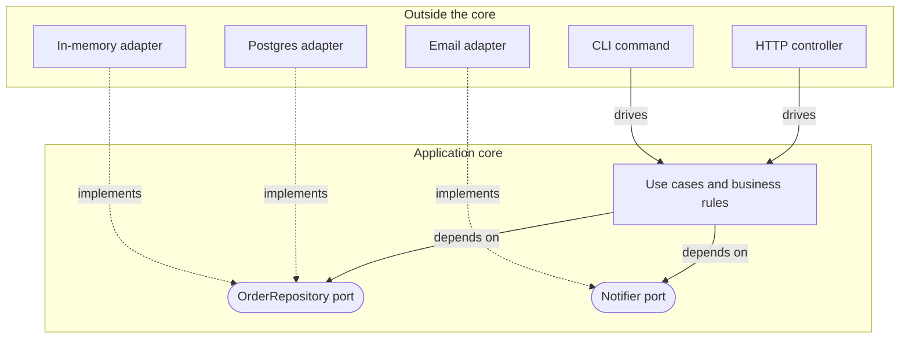
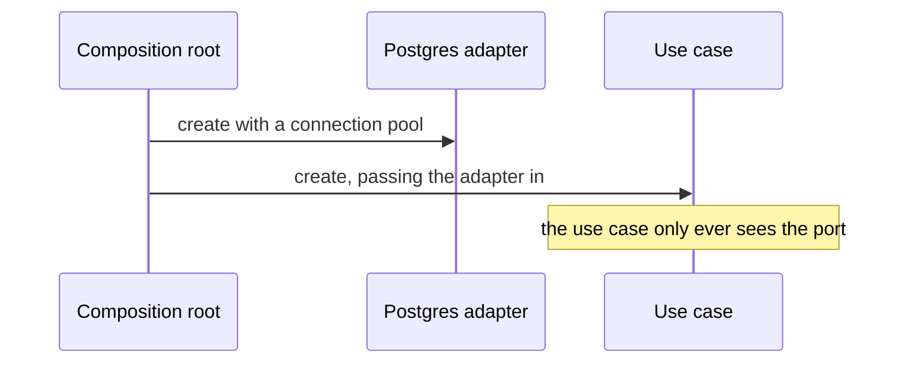

import LevelIntro from "../../../components/LevelIntro.astro";
import Checkpoint from "../../../components/Checkpoint.astro";
import PracticeCheck from "../../../components/PracticeCheck.astro";

export const unit = {
  track: "architecture",
  unitSlug: "hexagonal-clean-architecture",
};

**Where does the boundary go, and who is allowed to depend on whom across it?** L1 named the pieces. This level is about the shape they form and the one rule that stops that shape collapsing back into the tangle.

<LevelIntro
  items={[
    "Primary vs. secondary adapters",
    "Who owns a port's shape",
    "The composition root",
  ]}
/>

## Which way do the arrows point?

The hexagon has six sides only to leave room for several adapters around a core without implying a front and a back. What matters is inside versus outside, and which side names the interface.

The core points only at its own ports. Each adapter points back at a port. The core never draws an arrow to `PGa` or `Mema` by name, so swapping one for the other changes a dotted line and touches nothing solid.

<Checkpoint question="A file inside the core adds an import of the Postgres driver, only to type one local variable. Is it still part of the core?">

No. Once a core file imports anything from a specific technology, the dependency has flipped outward, however small the import. The rule is mechanical, and L3 shows how to check it with a search for imports.

</Checkpoint>

## Primary or secondary: who makes the call?

A team adds a background worker that reads messages from a queue and calls `placeOrder` for each one. One person says it is a secondary adapter because a queue is infrastructure, like the database. Another says primary. **Who is right?**

Primary. The category is decided by the direction of the call, not by how "infrastructure-like" the technology sounds. The worker calls into the core, exactly like an HTTP controller; only the trigger differs.

| Adapter kind       | Direction                          | Examples                                   | Its test asks                                            |
| ------------------ | ---------------------------------- | ------------------------------------------ | -------------------------------------------------------- |
| Primary (driving)  | Calls into the core                | HTTP controller, CLI command, queue worker | Did I translate the outside trigger into the right call? |
| Secondary (driven) | Called by the core, through a port | Database repository, email sender          | Did I honour the port's contract on a real technology?   |

<PracticeCheck
  track={unit.track}
  unitSlug={unit.unitSlug}
  topicId="primary-secondary"
/>

## Who writes a port's signature?

**If the core needs something that can save an order, does the database team design that interface, or does the core?** The core. A port speaks the core's vocabulary (`save(order)`), not the implementer's (no SQL fragments, no connection strings, no vendor client types).

If a port's shape is dictated by what is convenient for Postgres, the dependency has silently flipped: the arrow on the diagram still looks right, but the core is now shaped by the database. The tell is testability. A port whose method takes a raw SQL condition cannot be satisfied by an honest in-memory stand-in without embedding a small SQL interpreter.

<Checkpoint question="A teammate proposes that the repository's save method accept a raw SQL condition string, because it simplifies the Postgres adapter. Should the port change?">

No. That reshapes the port around one adapter's convenience instead of the core's need. Every other adapter, including the in-memory one used for fast tests, would then have to fake understanding SQL just to compile.

</Checkpoint>

<PracticeCheck
  track={unit.track}
  unitSlug={unit.unitSlug}
  topicId="port-ownership"
/>

## Where do adapters actually get plugged in?

The core and the adapters exist as separate code. Something must decide at startup "use the Postgres adapter here, the real mailer there". That wiring lives in one place, the **composition root** (often `main` or `bootstrap`). It is the only file allowed to know the core's ports and every concrete adapter at once, because introducing them is its whole job.

**Why does it matter that the wiring lives in one place?** Because a swap (Postgres to another store, real email to a fake) then touches one file. If adapters were constructed all over the core, swapping would mean hunting down every construction site, and each one would be an import of a concrete technology inside the core.

<PracticeCheck
  track={unit.track}
  unitSlug={unit.unitSlug}
  topicId="composition-root"
/>
