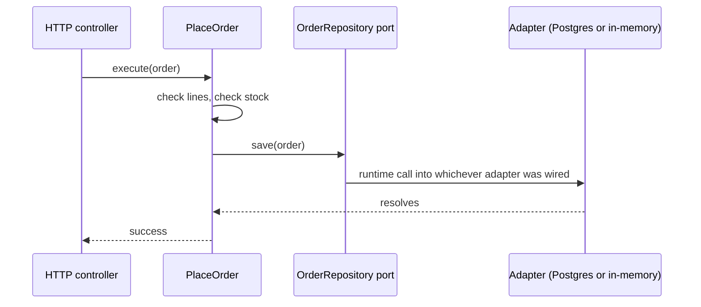
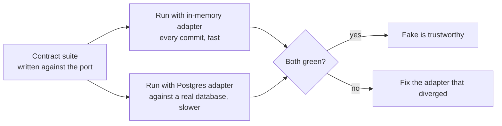

import Scenario from "../../../components/Scenario.astro";
import LevelIntro from "../../../components/LevelIntro.astro";
import Checkpoint from "../../../components/Checkpoint.astro";
import PracticeCheck from "../../../components/PracticeCheck.astro";

export const unit = {
  track: "architecture",
  unitSlug: "hexagonal-clean-architecture",
};

<Scenario label="What we are building">
  <Fragment slot="facts">
    <div class="not-prose flex flex-col gap-1 text-sm text-slate-700 dark:text-slate-300">
      <div class="flex items-center gap-1.5"><span>📦</span> Rule 1: reject an order with no lines</div>
      <div class="flex items-center gap-1.5"><span>📉</span> Rule 2: reject if any line is out of stock</div>
      <div class="flex items-center gap-1.5"><span>💾</span> Need: save the order, somewhere</div>
      <div class="flex items-center gap-1.5"><span>🚫</span> Must not need: a running database to test rules 1 and 2</div>
    </div>
  </Fragment>

A use case called `PlaceOrder` has exactly two rules: an order needs at least one line, and every line needs enough stock. Everything else is "save it somewhere", and "somewhere" is deliberately left open. **If those two rules are the only things that make an order valid, why would testing them ever need a database?**

</Scenario>

It should not, and the port is what makes that true in code instead of only in principle.

<LevelIntro
  items={[
    "A port, a use case, and a fake",
    "Contracts and error translation",
    "Where the pattern pays and where it fails",
  ]}
/>

## What is the smallest code that shows the mechanism?

Only the seam needs code. Everything else in this level is tables and diagrams. TypeScript fits because its structural interfaces make "a port is a contract" cheap to say; Go, Java, Kotlin and Python protocols work the same way.

```typescript
// core/place-order.ts — no import from any driver or framework
export interface Order {
  id: string;
  lines: { sku: string; qty: number }[];
}
export interface OrderRepository {
  save(order: Order): Promise<void>;
}
export interface StockChecker {
  hasStock(sku: string, qty: number): Promise<boolean>;
}

export class PlaceOrder {
  constructor(
    private readonly orders: OrderRepository,
    private readonly stock: StockChecker,
  ) {}

  async execute(order: Order): Promise<void> {
    if (order.lines.length === 0) throw new Error("empty cart");
    for (const line of order.lines) {
      if (!(await this.stock.hasStock(line.sku, line.qty)))
        throw new Error(`out of stock: ${line.sku}`);
    }
    await this.orders.save(order);
  }
}
```

The ports are written in plain types and the use case receives them through its constructor. Search this file for `import` and every hit is a language feature, never a driver. That search is a real, mechanical check you can run on any codebase that claims this pattern.

<Checkpoint question="Someone adds a Postgres-driver import to this file 'just for a debug line' and it merges by accident. Does the search-for-imports check catch it, and why does that matter for the adapters below?">

Yes to both. The check does not care about intent: any driver import in a core file fails it. It matters because the adapters below, and the fast test, depend on the core never having committed to a technology. A single leaked import makes swapping adapters no longer free.

</Checkpoint>

Two adapters plug into `OrderRepository`:

| Adapter                   | Technology                | Used by                | Speed (assumed) |
| ------------------------- | ------------------------- | ---------------------- | --------------- |
| `PostgresOrderRepository` | Real database, SQL upsert | Production wiring      | about 45 ms     |
| `InMemoryOrderRepository` | A plain map keyed by id   | Rule tests, local runs | about 0.05 ms   |

The in-memory one is small enough to read whole, and it is an honest implementation, not a mock that pretends:

```typescript
export class InMemoryOrderRepository implements OrderRepository {
  readonly rows = new Map<string, Order>();
  async save(order: Order): Promise<void> {
    this.rows.set(order.id, structuredClone(order)); // upsert by id
  }
}
```

Production wires the Postgres adapter in the composition root; a test builds `new PlaceOrder(new InMemoryOrderRepository(), alwaysInStock)`. Same class, same rules, and not one line in `PlaceOrder` changes.



<PracticeCheck
  track={unit.track}
  unitSlug={unit.unitSlug}
  topicId="fakes-and-contracts"
/>

## How do you stop the fake from lying?

**If the fast tests only ever see the in-memory adapter, how do you know production behaves the same?** You run the same test suite against both adapters. A **contract test** is written against the port ("saving twice with the same id keeps one order") and parameterised over which adapter to build.



Without it a fake drifts. Suppose the Postgres adapter upserts on a repeated id and someone "simplifies" the in-memory one to always append. Rule tests stay green against a repository that no longer behaves like production.

<Checkpoint question="The in-memory adapter's suite passes. Does that prove the Postgres adapter behaves the same way?">

No. Passing means the fake satisfies the contract you wrote, nothing more. Only running the same contract suite against the Postgres adapter shows that the two agree.

</Checkpoint>

## What should cross the port when something fails?

**If the database rejects a duplicate key, what exception reaches the core?** If the raw driver exception passes through, the core and its tests now have to know the driver's error types, which is exactly the coupling the port was meant to remove.

| Where the failure starts    | What the adapter should do                        | What the core sees                   |
| --------------------------- | ------------------------------------------------- | ------------------------------------ |
| Driver: duplicate key       | Catch it and throw a core-level duplicate error   | `DuplicateOrderError`, a core type   |
| Driver: connection refused  | Catch it and throw the port's "unavailable" error | `RepositoryUnavailableError`         |
| A bug in the adapter itself | Let it propagate as an unexpected failure         | A crash, logged, not a business case |

The port's contract lists the errors it can raise, in the core's vocabulary. Translating at the adapter keeps the contract honest and lets the fake raise the same errors.

<PracticeCheck
  track={unit.track}
  unitSlug={unit.unitSlug}
  topicId="error-translation"
/>

## When is this not worth it?

| Situation                                                  | Worth it?                                                          |
| ---------------------------------------------------------- | ------------------------------------------------------------------ |
| Real business rules (pricing, eligibility, workflow state) | Usually yes: the rules are exactly what you want to test cheaply   |
| Five-endpoint CRUD app with only field validation          | Usually not: files and indirection for rules that do not exist yet |
| A prototype likely to be thrown away                       | Not yet: add the seam when the logic or the pain shows up          |
| A script one person runs twice a year                      | Almost never: nothing to coordinate                                |

A port with exactly one adapter, forever, is an interface that costs a file and a level of indirection and returns nothing. It pays once a second real implementation exists or is genuinely coming, and a test double counts as one.

<PracticeCheck
  track={unit.track}
  unitSlug={unit.unitSlug}
  topicId="when-worth-it"
/>

## Does a port make a multi-step write atomic?

No. A port hides Postgres from the core; it does not make two writes succeed together. If one use case must save an order and charge a payment, the boundary needs an explicit strategy. See `systems/transactions` and `systems/race-conditions`.

| Strategy             | Idea                                                 | Fits when                             |
| -------------------- | ---------------------------------------------------- | ------------------------------------- |
| Unit of work port    | One port wraps several operations in a single commit | Both writes live in the same database |
| One combined adapter | A single adapter owns one transaction for both steps | The two ports always change together  |
| Compensating action  | If step two fails, run an undo for step one          | The steps live in different systems   |

<Checkpoint question="Saving the order and decrementing stock must succeed or fail together, but the stock lives in an external inventory service. Which strategy in the table is available?">

Only the compensating action. A shared transaction needs one database, and the inventory service is a different system. If decrementing stock fails after the order is saved, the system must undo or flag the saved order instead of rolling back.

</Checkpoint>

<PracticeCheck
  track={unit.track}
  unitSlug={unit.unitSlug}
  topicId="transaction-boundary"
/>

## This is a case, not the whole territory

Everything above uses one use case and one repository. **What changes if the second port were a payment gateway whose failures are slow and ambiguous, so "did the charge go through?" is sometimes unknown? What changes if the audience were a team of two instead of twenty?** Decide which contract tests, error types, and strategies from the tables still apply, and which new failure mode the port's contract has to name. There is no single answer here; the exercise is choosing the shape for a case the worked example did not cover.
