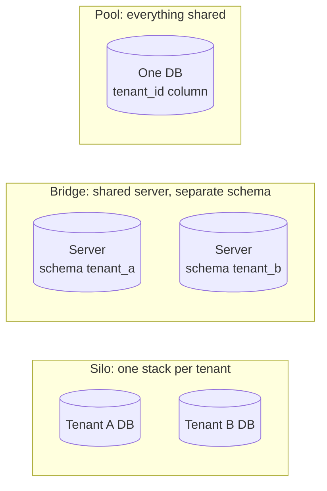

import Scenario from "../../../components/Scenario.astro";
import LevelIntro from "../../../components/LevelIntro.astro";
import PracticeCheck from "../../../components/PracticeCheck.astro";

export const unit = {
  track: "architecture",
  unitSlug: "multi-tenant-architecture",
};

<Scenario label="One apartment building, two complaints">
  <Fragment slot="facts">
    

      
🏢 <strong>The building</strong> — 12 apartments, one shared mail wall, one shared elevator

      
📬 <strong>Complaint 1</strong> — apartment 4 opened a letter addressed to apartment 9

      
🛗 <strong>Complaint 2</strong> — apartment 7 moved furniture all day and nobody else could use the elevator

    

    

      

        
What leaked

        someone else's belongings
      

      

        
What was hogged

        a shared resource
      

    

  </Fragment>

Twelve households share one building. The mail wall has no locks, and the
elevator has no rules. Nothing was stolen, nothing was broken, and for months
everything seemed fine. Then two different things went wrong. **Are these one
problem or two? And what would the building need so neither could happen at
all, rather than just rarely?**

They are two problems. The letter is about _who can see what_. The elevator is
about _who can use how much_. Fixing the mail wall does nothing for the
elevator.

</Scenario>

Software that serves many customers from one system has exactly this shape. The
customers are called **tenants**, and the building is your application and its
database. Multi-tenant architecture is the set of decisions about how much is
shared, and where the walls go.

<LevelIntro
  items={[
    "Two kinds of leak: data and load",
    "Three isolation models: silo, pool, bridge",
    "How a request proves whose it is",
  ]}
/>

## What are the two ways tenants can leak into each other?

**If a tenant never sees another tenant's data, is the system isolated?** Not
necessarily. The same two failures from the building show up in software:

| Incident       | What crossed the boundary | What was missing                          |
| -------------- | ------------------------- | ----------------------------------------- |
| Data leak      | Rows                      | A tenant filter on every query            |
| Noisy neighbor | Nothing, only latency     | A per-tenant limit on shared resource use |

In the data leak, a query missing `WHERE tenant_id = ?` showed Company A's
invoices to Company B. In the noisy-neighbor case, one tenant's overnight
export saturated the shared database and every other tenant's dashboard timed
out. No data crossed the line, but everyone still felt it.

- **Tenant** — one customer organization whose data and usage must stay apart
  from every other customer's.
- **Isolation** — the guarantee that one tenant cannot read, write, or slow
  another tenant.
- **Blast radius** — how many tenants a bug or a misbehaving tenant can hurt.
- **Noisy neighbor** — a tenant whose usage degrades shared infrastructure for
  the others.

<PracticeCheck
  track={unit.track}
  unitSlug={unit.unitSlug}
  topicId="two-leaks"
/>

## How much should tenants share?

**The building could give every household its own building. Why doesn't it?**
Because separate buildings cost far more per household. Software faces the same
trade, with three common answers:

| Model      | What is shared                | What is separate                  | Typical fit                           |
| ---------- | ----------------------------- | --------------------------------- | ------------------------------------- |
| **Silo**   | Nothing, or only the codebase | Database, sometimes a deployment  | Regulated or very large tenants       |
| **Bridge** | App and database server       | One schema (or shard) per tenant  | Middle ground                         |
| **Pool**   | App, database, and tables     | Only a `tenant_id` column per row | Many small tenants at the lowest cost |

Neither incident above came from choosing the wrong model. Pool is often the
right call. The failure was that the model's own duty, scoping every query and
limiting every tenant's use, was a habit and not a mechanism.

<PracticeCheck
  track={unit.track}
  unitSlug={unit.unitSlug}
  topicId="isolation-models"
/>

## How does a request prove whose it is?

Before any query can be scoped or any limit applied, the system has to know the
tenant. The identity can travel in several places:

| Signal      | Example             | Read by                         |
| ----------- | ------------------- | ------------------------------- |
| Subdomain   | `acme.example.test` | Reverse proxy or router         |
| Path prefix | `/t/acme/orders`    | Router                          |
| Header      | `X-Tenant-Id: acme` | Gateway or middleware           |
| Token claim | a `tenant_id` field | Auth middleware after verifying |

Whichever signal is used, it must become a trusted tenant ID before any data
access. A header that any client can set freely is not identity, it is a
suggestion.

- Isolation has two independent dimensions: **data** (who sees which rows) and
  **load** (whose usage affects whose speed). A system can get one right and
  fail the other.
- Silo, bridge, and pool trade cost and simplicity against isolation strength.
  There is no universally right one, only a fit for the tenant mix.
- Tenant identity must come from a trusted source, resolved before it scopes
  anything.
