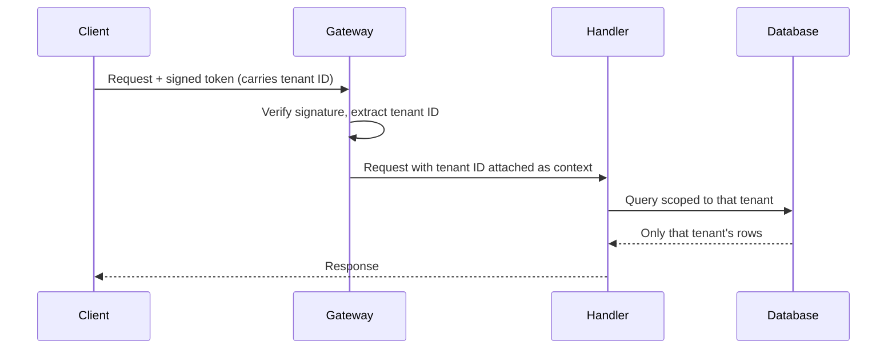
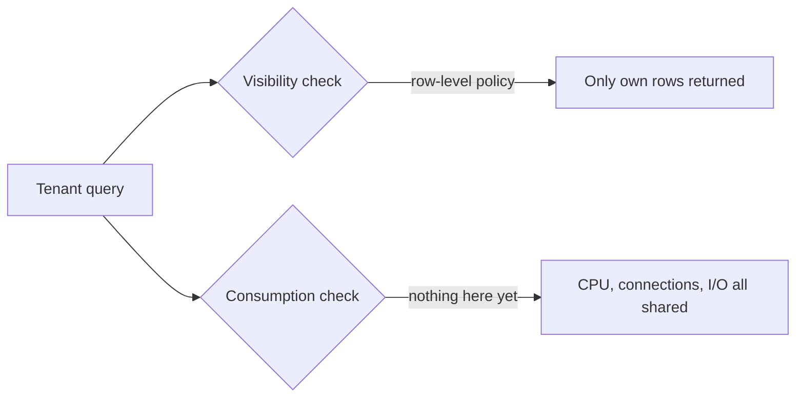

import Checkpoint from "../../../components/Checkpoint.astro";
import LevelIntro from "../../../components/LevelIntro.astro";
import PracticeCheck from "../../../components/PracticeCheck.astro";

export const unit = {
  track: "architecture",
  unitSlug: "multi-tenant-architecture",
};

L1 named two leaks, data and load, and three models that trade cost against
isolation strength. L2 asks what has to happen mechanically for a request to
stay inside its tenant's walls, and where each model puts the lock.

<LevelIntro
  items={[
    "Tenant context from request to query",
    "Convention versus enforced boundary",
    "Why load isolation is a separate mechanism",
  ]}
/>

## Where is the tenant decided, and who is allowed to decide it?

**Picture the building's front desk.** A visitor says "I'm here for apartment
9." Does the desk take their word for it, or check a keycard? Software has the
same choice at the front door of every request.



The tenant is resolved **once**, as early as possible, from something the
client cannot forge (a verified token, a routing rule). From there it travels
as **context**. Downstream layers receive the already-trusted value instead of
re-reading it from a request body or a header a client can set.

<PracticeCheck
  track={unit.track}
  unitSlug={unit.unitSlug}
  topicId="tenant-context"
/>

## Is "always remember the filter" a boundary?

**In the shared-table (pool) model, one fact carries the whole guarantee: every
query filters by tenant.** With dozens of query sites, that is a promise, and
promises break under deadline pressure. That is how the data leak in L1
happened. There are two ways to turn the promise into structure:

| Approach                   | Where the guarantee lives                   | What breaks it                                  |
| -------------------------- | ------------------------------------------- | ----------------------------------------------- |
| Convention (code review)   | In every developer's memory, on every query | One forgotten filter, one tired reviewer        |
| Query layer with no bypass | In an API that offers no unscoped read      | A new code path that talks to the table raw     |
| Database row-level policy  | In the database, checked on every query     | A connection that never sets the session tenant |

The database option looks like this. Reading it is the point, because the
policy is what replaces the habit:

```sql
ALTER TABLE orders ENABLE ROW LEVEL SECURITY;

CREATE POLICY tenant_isolation ON orders
    USING (tenant_id = current_setting('app.current_tenant')::uuid);
```

Even a query that forgets its `WHERE` clause gets filtered, because the policy
checks the connection's session value, not the query text. Both structural
options share one idea: the unsafe thing becomes hard or impossible to write,
instead of merely discouraged.

<Checkpoint question="A teammate argues code review will always catch a missing tenant filter, so no structural guard is needed. What is the actual risk?">

Review catches what a reviewer thinks to look for, on every query site,
forever. Six months from now someone adds a query under deadline pressure and
the reviewer is tired or new to the code. A structural guard is checked
automatically on every query, on every day. Review is still useful, but as a
second line of defense and not the only one between a forgotten filter and a
cross-tenant leak.

</Checkpoint>

<PracticeCheck
  track={unit.track}
  unitSlug={unit.unitSlug}
  topicId="data-boundary"
/>

## How do the models compare once enforcement is in place?

| Model  | Where the lock sits                        | Blast radius of a bug          | Cost per tenant | New tenant takes |
| ------ | ------------------------------------------ | ------------------------------ | --------------- | ---------------- |
| Silo   | Infrastructure: separate database or stack | One tenant                     | Highest         | A new stack      |
| Bridge | Schema or shard boundary on shared servers | The tenants in that schema     | Medium          | A new schema     |
| Pool   | Application code and or row-level policy   | Every tenant sharing the table | Lowest          | A new row        |

**Why does the cost column slope the way it does?** Shared infrastructure
splits across everyone on it, while dedicated infrastructure does not shrink.
A simple model makes this concrete. These figures are **assumptions for
illustration, not measurements**: $3,000 per month of shared infrastructure,
and $120 per month of dedicated infrastructure for each fully siloed tenant.

| Tenants | Fully pooled | Mostly pooled (30% silo) | Fully siloed |
| ------- | ------------ | ------------------------ | ------------ |
| 10      | $300         | $246                     | $120         |
| 50      | $60          | $78                      | $120         |
| 100     | $30          | $57                      | $120         |
| 500     | $6           | $40.20                   | $120         |

Pooling gets cheaper per tenant as tenants arrive. The dedicated part never
does, so any silo share puts a floor under the cost. The slider on this
unit's page lets you move both inputs and watch that floor appear.

## Why doesn't fixing the data leak fix the noisy neighbor?

**Imagine the mail wall now has perfect locks.** Can apartment 7 still hog the
elevator? Yes. Locks govern _which mail you can open_, not _how long you hold
the elevator_.



Row-level policy decides what a query may see. It says nothing about how much
CPU, how many connections, or how much I/O that query may consume. A tenant can
be perfectly isolated from everyone's data and still run a query heavy enough
to starve the shared connection pool.

<Checkpoint question="A pooled database enforces row-level security perfectly. Does that guarantee the noisy-neighbor incident cannot happen?">

No. Row-level security is purely about visibility, not about consumption of
shared capacity. A tenant's nightly export still opens real connections and
burns real CPU and I/O, and nothing in the visibility policy limits that. It
takes a separate mechanism that caps how much of the shared resource any one
tenant can use, independent of whether their queries are correctly scoped.

</Checkpoint>

That separate mechanism, a per-tenant limit, is the subject of L3.

- Resolve tenant identity once, early, from a source the client cannot forge,
  and carry it as context.
- A boundary is something the system enforces, not something developers
  remember. Prefer designs where the unscoped path does not exist.
- Data isolation and load isolation are different problems with different
  mechanisms. Solving one does not solve the other.
