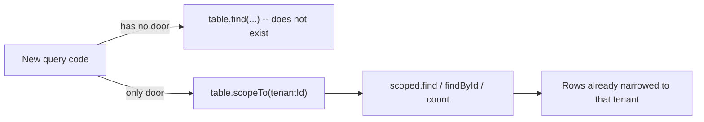
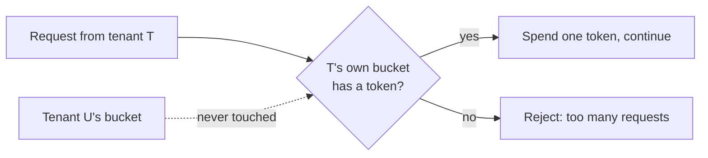
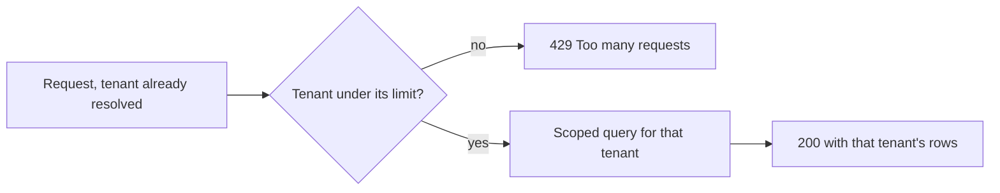

import Scenario from "../../../components/Scenario.astro";
import LevelIntro from "../../../components/LevelIntro.astro";
import Checkpoint from "../../../components/Checkpoint.astro";
import PracticeCheck from "../../../components/PracticeCheck.astro";

export const unit = {
  track: "architecture",
  unitSlug: "multi-tenant-architecture",
};

<Scenario label="The building manager's two rules">
  <Fragment slot="facts">
    <div class="not-prose flex flex-col gap-2 text-sm text-slate-700 dark:text-slate-300">
      <div class="flex items-center gap-1.5"><span>🔑</span> <strong>Rule 1</strong> — every mailbox opens only with its own key; there is no master slot to reach into</div>
      <div class="flex items-center gap-1.5"><span>🎟️</span> <strong>Rule 2</strong> — every household gets its own elevator ticket allowance, refilled slowly over time</div>
      <div class="flex items-center gap-1.5"><span>🧪</span> <strong>Test</strong> — the rules must hold even for a new staff member who never read them</div>
    </div>
  </Fragment>

Back at the building, the manager does not want posters saying "please don't
open other people's mail." She wants a mail wall where opening the wrong box is
**physically not possible**, and an elevator where one household's moving day
cannot spend anyone else's turns. **If both rules must work for someone who
never read the rules, what exactly has to be impossible, and what has to be
separately budgeted?**

</Scenario>

<LevelIntro
  items={[
    "A data path with no unscoped door",
    "A token bucket per tenant, step by step",
    "Gaps that code alone cannot close",
  ]}
/>

## How do you make the unscoped query impossible to write?

L2's convention failed because nothing stopped a developer from skipping the
filter. The structural fix removes the unscoped path from the API. The whole
design is visible in what the surface offers:



```typescript
class Table<T> {
  scopeTo(tenantId: string): TenantScopedQuery<T>; // the only public read
  // no find(), no all(): the raw rows are private
}
```

`scopeTo` rejects an empty tenant ID and narrows the rows before any query
method exists on the result. A forgotten filter is no longer a silent bug that
returns wrong rows. It is a call that does not compile. The guarantee lives in
the shape of the API, the same idea as the database policy in L2, expressed in
code instead of SQL.

<Checkpoint question="Incident 1 was a query that forgot its tenant filter. In this design, what does the equivalent mistake look like?">

There is no equivalent, because the unscoped read does not exist to call. The
only public path is `scopeTo(tenantId)`, and narrowing happens before any query
method can run. What used to be a silent runtime bug (a query that still
executes and returns wrong rows) is now code that cannot be written. That is
the difference between a convention and an enforced boundary, moved into the
type system.

</Checkpoint>

## How does a per-tenant token bucket work, tick by tick?

L2 showed that visibility policy says nothing about consumption. A **token
bucket** per tenant caps requests. Each tenant owns a bucket holding up to
`capacity` tokens. Every request spends one token. The bucket refills at
`refillPerSecond`, never above capacity. No token, no request.

**Worked example** (assumed settings: capacity 10, refill 2 per second). A noisy
tenant fires a burst while a quiet tenant makes no requests. All times are
seconds since the burst began.

| Time | Noisy attempts | Tokens before | Allowed | Rejected | Tokens after |
| ---- | -------------- | ------------- | ------- | -------- | ------------ |
| 0    | 15             | 10            | 10      | 5        | 0            |
| 1    | 15             | 2             | 2       | 13       | 0            |
| 5    | 3              | 8             | 3       | 0        | 5            |
| 10   | 0              | 10 (capped)   | 0       | 0        | 10           |

The quiet tenant's bucket sits at 10 through every row, because buckets are
keyed by tenant and share nothing. The noisy tenant's pain is its own.



The page's second slider uses the same settings. At 20 attempts per second for a
10-second window, the tenant attempts 200 requests and can be allowed at most
`capacity + refill x 10 = 10 + 20 = 30`, so 170 of 200 (85%) are rejected.
Raising capacity to 20 lowers that to 80%. Raising refill to 5 lowers it to
70%. Either way, the extra room is that tenant's own. It never borrows from a
neighbor's bucket.

<Checkpoint question="What happens to isolation if all tenants draw from one shared bucket instead of one bucket each?">

It collapses back into the noisy-neighbor problem. One tenant spending tokens
from a shared bucket leaves fewer for everyone else, which is the failure from
L1. The fix depends specifically on each tenant having an independent bucket, so
one tenant's consumption can never reduce what another has. It is the same
"independent unit per tenant" idea as the scoped data path, applied to rate
instead of rows.

</Checkpoint>

<PracticeCheck
  track={unit.track}
  unitSlug={unit.unitSlug}
  topicId="token-bucket"
/>

## What do the two mechanisms still not cover?

**Both are in place. Is the system now isolated?** Layered, yes for the common
failures. Complete, no:

| Mechanism          | Closes                                  | Does not close                                                         |
| ------------------ | --------------------------------------- | ---------------------------------------------------------------------- |
| Scoped data path   | Missing-filter data leaks               | Uneven use of shared storage or I/O                                    |
| Per-tenant limiter | One tenant's request rate starving rest | One very expensive request that stays under the rate limit             |
| Both together      | Most pooled-model failure modes         | A requirement for physically separate data, which needs silo or bridge |

Order matters too. In a request, the limiter should run first and the scoped
query second, so a throttled tenant never reaches the database at all. If the
order were reversed, an expensive query from an over-limit tenant would still
run before being rejected.



Code-level enforcement makes the pool model safe to operate. It does not turn
pool into silo. A tenant with a regulatory requirement for physically separate
storage still needs a different model, no matter how well queries are scoped.

<PracticeCheck
  track={unit.track}
  unitSlug={unit.unitSlug}
  topicId="layered-gaps"
/>

## What is this example not showing you?

This is one case, not the whole territory. Try extending it:

- Larger paying tenants are entitled to a higher capacity and refill rate. What
  has to change in the limiter, and what does it do to the fairness story for
  smaller tenants?
- Support staff legitimately need to read across all tenants. How would you add
  that without reopening the unscoped door this design closed?
- A tenant makes one request that is a thousand times more expensive than the
  rest. Which of the two mechanisms notices, and what third mechanism would you
  reach for?
- A tenant asks for a dedicated database. What changes in your enforcement, and
  what stays the same?
