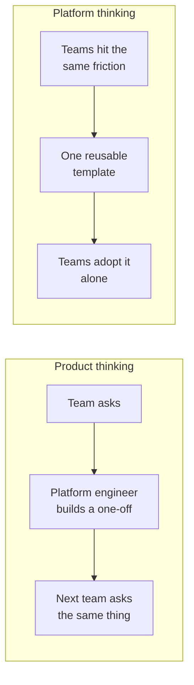

import Scenario from "../../../components/Scenario.astro";
import LevelIntro from "../../../components/LevelIntro.astro";
import PracticeCheck from "../../../components/PracticeCheck.astro";

export const unit = { track: "architecture", unitSlug: "platform-engineering" };

<Scenario label="One script worked for one team. Fourteen teams later, who is stuck?">
  <Fragment slot="facts">
    

      

        14 of 14
        teams onboarded by hand
      

      

        

      

      
0 teams deployed without a platform engineer in the room

    

    

      
🧑‍🔧 Platform team: 3 engineers

      
🎫 Open onboarding tickets: 60

      
🛣️ Paved road: a default path any team can walk alone

      
🚪 Escape hatch: a documented way off that road

    

  </Fragment>

A platform team of three wrote a deploy script for the Payments team. It
worked well. Fourteen teams later, every new team still starts with a chat
thread: a platform engineer walks them through 40 variables by hand,
because the script was built around Payments' repository layout and never
meant to be reused. The three engineers now spend their weeks on
onboarding calls and a backlog of 60 tickets.

**If the platform team hires two more engineers to answer tickets faster,
does the bottleneck go away, or does it just move?**

| What got built                        | What a platform needs to be                                 |
| ------------------------------------- | ----------------------------------------------------------- |
| One script, tuned to one team's setup | A default path any team can walk without a ticket           |
| Setup that lives in people's heads    | A documented, versioned template with a named owner         |
| No clean way to opt out               | A supported, visible way off the road for teams who need it |

It moves. More engineers answer tickets faster, but every team's first
deploy still waits on a person, so the platform team stays on the critical
path of everyone's work. The fix is to change what gets built, not how
many people answer.

</Scenario>

A **product** solves one customer's problem. A **platform** solves the
whole class of problem, packaged so other teams adopt it without the
platform team present. The other engineering teams are the customers, and
the paved road is what gets shipped to them.

<LevelIntro
  items={[
    "Platform versus product",
    "Paved road and escape hatch",
    "Self-service and the thinnest viable platform",
  ]}
/>

## What is the difference between a product and a platform?

| Term                              | Plain version                                                                     |
| --------------------------------- | --------------------------------------------------------------------------------- |
| Platform engineering              | Building internal tooling as a product for other engineering teams                |
| Internal developer platform (IDP) | The self-service tools, APIs and templates the platform team maintains            |
| Paved road (golden path)          | The default, supported, opinionated way to do a common task                       |
| Self-service                      | A team provisions or deploys alone, with no ticket                                |
| Escape hatch                      | A documented, supported way to leave the paved road when it truly does not fit    |
| Thinnest viable platform          | The smallest platform that removes friction already observed, nothing speculative |

<PracticeCheck
  track={unit.track}
  unitSlug={unit.unitSlug}
  topicId="platform-vs-product"
/>

**What would be the downside of making the paved road compulsory?** A
road with no way off is a paved prison. A team with a real reason to
deviate either fights the platform team or quietly forks the template,
and the platform team stops seeing what happens. A documented escape
hatch keeps the deviation visible and says what the team now owns for
itself (their own upgrades, their own maintenance).

**What should the platform team build first?** Only what removes friction
already observed, such as three teams each writing near-identical
infrastructure code. A roadmap driven by what looks impressive builds
things nobody asked for.

| Signal of a product             | Signal of a platform                              |
| ------------------------------- | ------------------------------------------------- |
| Each team needs a bespoke setup | Each team follows the same documented path        |
| Platform team present to deploy | Teams deploy while the platform team is elsewhere |
| Adoption is mandatory           | Adoption is voluntary and measured                |

<PracticeCheck
  track={unit.track}
  unitSlug={unit.unitSlug}
  topicId="paved-road-escape-hatch"
/>
