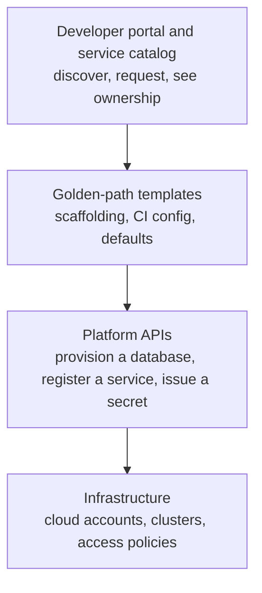
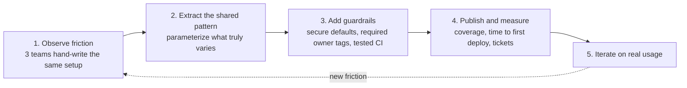

import Scenario from "../../../components/Scenario.astro";
import LevelIntro from "../../../components/LevelIntro.astro";
import Checkpoint from "../../../components/Checkpoint.astro";
import PracticeCheck from "../../../components/PracticeCheck.astro";

export const unit = { track: "architecture", unitSlug: "platform-engineering" };

<Scenario label="Team 15 deployed alone. Is that enough to call it a platform?">
  <Fragment slot="facts">
    

      
🏗️ The Payments script becomes a generic template

      
🧑‍🤝‍🧑 Team 15 uses it with no ticket and no chat thread

      
❓ Nobody has written what the template promises, or who owns it

    

  </Fragment>

The platform team turns the Payments script into a template: fill in a
service name, get a pipeline and a database. Team 15 uses it alone, the
first real self-service win. **Does one working template make this a
platform, or is something missing that decides whether Team 16 through
Team 50 can trust it too?**

Something is missing: a template plus a contract. The contract says what
it promises, who owns it, how it changes, and how a team gets off it. The
rest of this level builds that contract.

</Scenario>

<LevelIntro
  items={[
    "The layers of a platform",
    "The loop from friction to template",
    "Guardrails, mandates and adoption signals",
  ]}
/>

## How many layers sit under "fill in a service name"?

| Layer                | Its job                                      | If it needs a human, the bottleneck moves to |
| -------------------- | -------------------------------------------- | -------------------------------------------- |
| Portal / catalog     | Make the road discoverable, record ownership | Nobody knows the road exists                 |
| Golden-path template | Opinionated defaults built on the APIs       | Each team re-decides everything              |
| Platform APIs        | Turn infrastructure into callable operations | A ticket queue behind a nicer form           |
| Infrastructure       | Raw cloud and clusters                       | Unchanged: asking here is a ticket           |

Self-service only counts if it holds all the way down. A template that
looks instant but waits on a human approval one layer below has moved the
bottleneck, not removed it.

<Checkpoint question="A template looks instant, but the database API underneath needs a person to approve each request. Is the template self-service?">

No. The team still cannot get a running service without someone else's
availability, so the wait has only moved one layer down. Every layer above
depends on every layer below being callable by a script, which is why
platform APIs are automated operations and not ticket queues with a
friendlier form on top.

</Checkpoint>

<PracticeCheck
  track={unit.track}
  unitSlug={unit.unitSlug}
  topicId="self-service-layers"
/>

## Where should the next golden path come from?

**A brainstorm about what teams might need, or somewhere else?** Somewhere
else: from friction that is already happening.

| Built from                       | Instead of                         |
| -------------------------------- | ---------------------------------- |
| Friction three or more teams hit | One engineer's guess at the future |
| A diffed, generalized pattern    | The first team's script, renamed   |
| Measured adoption after shipping | "We built it, they will come"      |

Step 3 matters because it makes the paved road the compliant road: the
secure defaults a review would otherwise demand late are already inside
the template.

## Does the platform owe a team that does not fit the road?

A golden path earns adoption by being easier, not by being the only
legal option. **If a team has a genuine reason to deviate, should the
platform team block them?** No. It owes them an **escape hatch**: a
documented route off the road, with a clear statement of what stops being
guaranteed (their own CI upkeep, their own upgrades). Without one, the
team deviates anyway, and the platform team learns about it when it
breaks.

<Checkpoint question="A platform team makes the CI template mandatory with no opt-out. Six months later two teams turn out to have silently forked it. Did the mandate buy consistency?">

No, it cost consistency. The mandate did not remove the teams' real
reasons to deviate, it removed the platform team's view of the deviation.
A tracked exception is visible and can be revisited. A hidden fork drifts
unmaintained, which is a worse outcome than an acknowledged exception.

</Checkpoint>

<PracticeCheck
  track={unit.track}
  unitSlug={unit.unitSlug}
  topicId="paved-road-escape-hatch"
/>

## How do you know the road is working?

| Signal                      | What it tells you                                            |
| --------------------------- | ------------------------------------------------------------ |
| Golden-path coverage        | How much of a team's stack the road handles                  |
| Time to first deploy        | Whether the road is faster than the old way                  |
| Tickets deflected per month | Whether self-service removes the platform team from the path |
| Voluntary adoption          | Whether teams choose the road or are only forced onto it     |

The demo on this page uses assumed rates (about 4.3 tickets a month per
manually onboarded team, 0.4 per self-service team) to show the shape: at
14 teams with nobody on the road, that is roughly 60 tickets a month, the
backlog from L1. Move adoption and watch it fall.

<PracticeCheck
  track={unit.track}
  unitSlug={unit.unitSlug}
  topicId="friction-to-template"
/>
