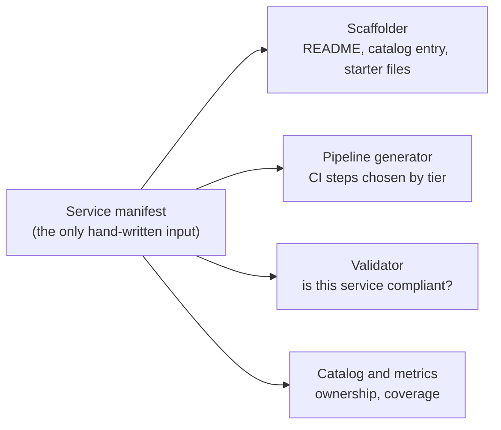
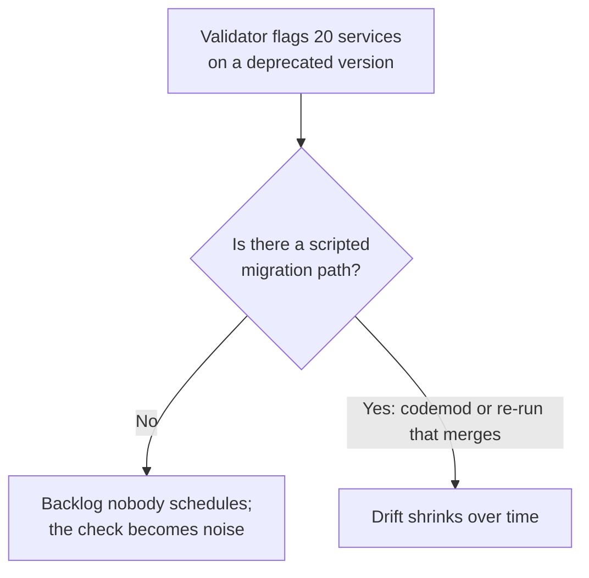

import Scenario from "../../../components/Scenario.astro";
import LevelIntro from "../../../components/LevelIntro.astro";
import Checkpoint from "../../../components/Checkpoint.astro";
import PracticeCheck from "../../../components/PracticeCheck.astro";

export const unit = { track: "architecture", unitSlug: "platform-engineering" };

<Scenario label="Nobody can tell which services are actually on the paved road">
  <Fragment slot="facts">
    

      
🧾 "On the road" has no definition a machine can check

      
🕰️ Template v1 became v2 with no migration path; 20 services stay on v1

      
👻 The catalog says a team owns a service; that team disbanded months ago

    

  </Fragment>

Fifty teams now use the template. Three things go wrong. Whether a
service is really on the road can only be answered by a person reading its
code. Upgrading the template to its second version left 20 services
behind, unnoticed. And the catalog still lists a disbanded team as the
owner of a live service. **If compliance can only be judged by a human,
does the paved road scale past the handful of teams the platform team can
personally review?**

It does not. The way out is to turn the contract into data and let
machines read it. This level shows that shape; it needs no code to
follow.

</Scenario>

<LevelIntro
  items={[
    "A manifest as the single input",
    "Generated pipelines and a checkable validator",
    "Drift, ownership rot and generator risk",
  ]}
/>

## What is the smallest thing every other tool can read from?

A **manifest** is a small, flat description of one service that a human
fills in once: name, owning team, tier (internal, customer-facing or
critical), template version, language, whether it needs a database, and a
list of declared escape hatches (each with a reason, an approver and an
expiry date). Anything that can be derived, such as which CI steps to run,
stays out of the manifest.

Because the scaffolder, the pipeline generator, the validator and the
catalog all read the same object, "what does the paved road require of
this service" has one authoritative answer instead of a wiki page that
drifts from what teams actually run.

## How do tier and manifest fields turn into a pipeline?

The pipeline is a decision table, not one fixed pipeline. Every service is
offered the same base steps; tier and database use decide what becomes
required.

| Manifest field                   | Steps it adds                               |
| -------------------------------- | ------------------------------------------- |
| every service                    | checkout, install, lint, test               |
| tier customer-facing or critical | security scan, two required approvals       |
| needs a database                 | migration check                             |
| tier critical                    | canary deploy, automatic rollback on errors |
| any other tier                   | plain deploy                                |

Note that a critical service gets canary deploy and rollback _instead of_
the plain deploy step, not in addition to it. "Critical services must
canary" is enforced by the generator itself rather than a review checklist
someone can forget.

<Checkpoint question="A scaffolder leaves an unfilled placeholder such as an owner field in the output instead of failing. Is that a safe default for a paved-road generator?">

No, not for this job. The generator exists so nobody has to proofread its
output, so a silently unfilled placeholder would ship straight into a new
service and be found only by luck. A forgiving default suits something
like a chat message where a gap is cosmetic. A paved-road generator should
fail loudly, or refuse to write the file, because trust in its output is
the product.

</Checkpoint>

## How does "compliant" become a question a machine answers?

The validator checks the manifest against rules the platform team owns.
Illustrative rules:

| Rule                                                                      | Failure it surfaces                      |
| ------------------------------------------------------------------------- | ---------------------------------------- |
| An owning team is named                                                   | Orphaned services                        |
| The template version is well formed, and its major is current             | Silent version drift (20 services on v1) |
| On a critical service, every escape hatch has reason, approver and expiry | Undocumented deviation                   |

This answers the scenario's first two failures directly. Compliance stops
being a person's judgment and becomes a check a CI gate, a nightly audit
or the developer portal can run. Version drift stops being invisible: the
next validation lists every service below the current major.

Two adoption numbers fall out of the same data. Coverage is the share of
teams on the road; tickets deflected compares each on-road team's tickets
against what a manual team would have filed.

<PracticeCheck
  track={unit.track}
  unitSlug={unit.unitSlug}
  topicId="contract-as-data"
/>

## What can still go wrong once the road is checkable?

| Failure                              | Why checking alone does not fix it                                 | Counter-measure                                         |
| ------------------------------------ | ------------------------------------------------------------------ | ------------------------------------------------------- |
| Version drift                        | A flag is not a migration                                          | A scripted upgrade path, not just an error message      |
| Stale ownership                      | The owner field is only as true as its last edit                   | Periodic cross-check against a live team registry       |
| Escape hatches never revisited       | Declared is not resolved; exceptions pile up with better paperwork | Expiry dates and a regular review of the list           |
| Generator as single point of failure | One bug breaks every service's pipeline at once                    | The same test discipline the platform asks of its users |

<Checkpoint question="The validator now flags 20 services on an old template version. Is the drift problem solved?">

No, it is only visible. Without a scripted migration the flags become a
backlog no team schedules, and people learn to ignore the check. Visibility
is the first step; a cheap upgrade path is what actually shrinks the
number.

</Checkpoint>

<PracticeCheck
  track={unit.track}
  unitSlug={unit.unitSlug}
  topicId="drift-and-ownership"
/>

## Worked example: one service end to end

The `checkout-api` service (fictional) is critical-tier, needs a database,
and belongs to the payments team. Its manifest says template version
1.9.0 and lists one escape hatch, a custom CI step, with a reason and an
approver but no expiry date. The current major is 2.

| Stage                                                              | Result                                                                                                                      |
| ------------------------------------------------------------------ | --------------------------------------------------------------------------------------------------------------------------- |
| Validator                                                          | Two errors: major 1 is below the supported major 2, and the critical-tier escape hatch has no expiry                        |
| Pipeline generator                                                 | Nine steps: checkout, install, lint, test, security scan, two approvals, migration check, canary deploy, automatic rollback |
| Coverage across three teams (two on the road, one not)             | 2 of 3, about 66.7 percent                                                                                                  |
| Tickets deflected (manual baseline 4; on-road teams filed 0 and 1) | (4 - 0) + (4 - 1) = 7 per month                                                                                             |

The validator's two errors are the two scenario failures in miniature.
Fixing them is a small manifest edit plus a scripted upgrade, which is the
whole point: the road tells the owner exactly what is off.

The demo on this page models the other side: with a fully manual baseline
of 10 days to first deploy, 20 percent coverage leaves about 8.2 days and
full coverage about 1.0 (assumed 90 percent time saved at full coverage).

## This is a case, not the whole territory

The example is one service, one organization and one set of invented
rules. Try extending it before moving on.

- **What changes for an internal-tier service with no customer traffic?**
  Should it need the same security scan as customer-facing services, or is
  that guardrail solving a problem this tier does not have?
- **What if a team's language has no template yet?** Are they stuck
  waiting on the platform team, or can the manifest and generator make
  "add a language" a self-service contribution?
- **What if the validator became mandatory in CI tomorrow?** Which of the
  20 drifted services would block releases, and how would you phase it so
  the check does not become the new bottleneck?
