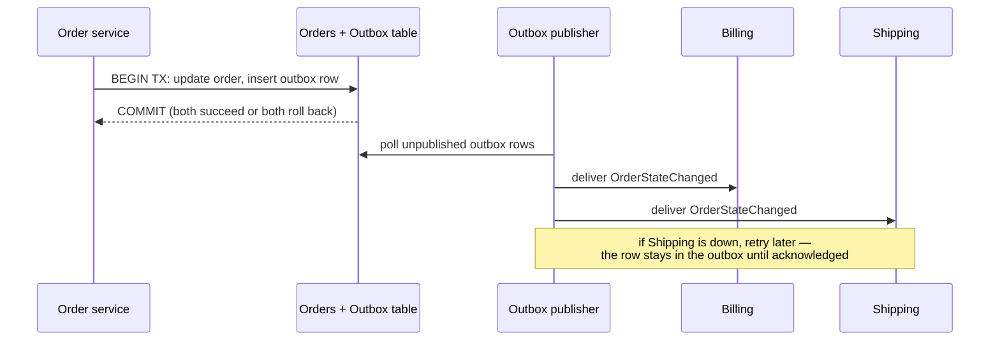
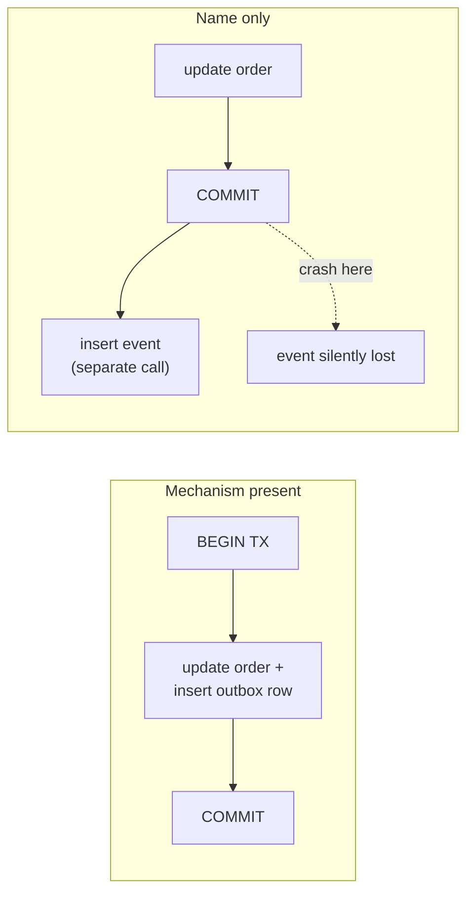

import Scenario from "../../../components/Scenario.astro";
import LevelIntro from "../../../components/LevelIntro.astro";
import Checkpoint from "../../../components/Checkpoint.astro";
import PracticeCheck from "../../../components/PracticeCheck.astro";

export const unit = {
  track: "architecture",
  unitSlug: "reference-architectures",
};

<Scenario label="The order-notification system, in numbers">
  <Fragment slot="facts">
    
Requirement

    

      
📦 Notify billing, shipping, analytics on every order-state change

      
⏳ Any downstream may be offline for hours — no notification may be lost

      
🧾 Auditor must be able to replay 6 months of history

    

    
Assumed estimate (not a measurement)

    

      
⏱️ 120 engineer-hours to design retry/ordering/replay from a blank page

      
📚 A catalogued pattern already matches this shape

    

  </Fragment>

Return to L1's team: notify billing, shipping, and analytics whenever an
order changes state, survive any of them being down for hours, and stay
replayable for a six-month audit. L1 named the shape (reliable, replayable
state-change notification) and pointed at "transactional outbox + event
log" as the catalog entry. This level does the part L1 and L2 stopped
short of: checking the fit against this team's real constraints, seeing
where the pattern still needed adapting, and naming the failure mode that
shows up when a team adopts the pattern's name without its mechanism.

**Recognizing the right catalog entry got the team out of three sprints of
rediscovery. What is still left to decide once the pattern is picked?**

</Scenario>

<LevelIntro
  items={[
    "Checking constraints against the pattern's assumptions",
    "Where the entry still needed adapting",
    "Name versus mechanism: the cargo-cult failure",
  ]}
/>

## How do you check a pattern's assumptions against your constraints?

A reference architecture is only a good fit if the assumptions it was
designed around actually hold for this system. Checking that match is the
step a rushed adoption skips.

| This system's constraint                               | Transactional outbox + event log assumption                          | Match?                                                   |
| ------------------------------------------------------ | -------------------------------------------------------------------- | -------------------------------------------------------- |
| Notification must never be lost, even mid-crash        | Event write happens in the same DB transaction as the state change   | ✅ direct fit                                            |
| Downstream may be offline for hours                    | Consumers pull from a durable log at their own pace, not a live push | ✅ direct fit                                            |
| 6-month replay for an audit                            | Log retention is a config choice, not a redesign                     | ✅ direct fit, needs a retention policy decision         |
| Only 3 known consumers today, unlikely to grow past ~5 | Pattern scales to many consumers without change                      | ✅ fit, but over-provisioned — not a reason to reject it |

Every row holds, which is what makes this a genuinely good match and not
just a plausible name. **Compare this to L2's CQRS counter-example: a slow
report was a performance symptom, not a shape match. Here all four
constraints line up with the pattern's assumptions, which is the bar for
adopting a catalog entry.**

Notice what is absent: there is no direct call from the order service to
billing or shipping. That absence is the point. It is what lets any
downstream be offline for hours without blocking an order update or losing
the notification.

<Checkpoint question="If the publisher called the subscribers directly inside the same transaction as the order update, instead of polling the outbox separately, what property of the pattern would be lost?">

The ability to survive a downstream outage without blocking the write.
Calling subscribers synchronously inside the order-update transaction
means a slow or down billing service now blocks, or fails, the order
state change itself, which was one of the two hard requirements. The
outbox exists as a separate table with a separate poller to decouple "the
state change is durable" from "every consumer has acknowledged it," so a
flaky consumer degrades to "notifications are delayed," never to "orders
can't be updated."

</Checkpoint>

<PracticeCheck
  track={unit.track}
  unitSlug={unit.unitSlug}
  topicId="fit-check"
/>

## Where did the pattern still need adapting?

The catalog entry does not answer everything. This team still had to
decide, on their own constraints:

- **Retention: 6 months, not indefinite.** The audit requirement is
  bounded, so an indefinite log (which a naive "full event sourcing" read
  of the pattern might default to) is unneeded cost. A scheduled job
  archives and prunes older rows.
- **No full event-sourced read model.** Only three consumers exist, and
  none needs to reconstruct arbitrary past state, just the current one
  plus the specific `OrderStateChanged` fact. A full CQRS read-model layer
  would solve a problem ("reads and writes need different shapes") this
  system does not have; see L2's CQRS signal check.
- **Polling interval, not push.** A short poll was cheap and simple to
  operate; a push-based broker was rejected as unneeded operational
  surface for 3 known consumers.

None of these were in the catalog entry's diagram. They came from checking
the pattern's assumptions against this system's actual numbers, as in the
fit table above.

**How much does a good match actually save?** The interactive demo below
uses an assumed model: a 120-hour from-scratch design, plus up to 40 hours
of learning curve for a team unfamiliar with the pattern. At 20% team
familiarity, the numbers fall out like this.

| How closely the problem matches the entry | Hours saved vs. designing from scratch |
| ----------------------------------------- | -------------------------------------- |
| 100%                                      | 88                                     |
| 90% (this case)                           | 76                                     |
| 75%                                       | 58                                     |
| 50%                                       | 28                                     |
| 25%                                       | 0 (clipped; the pattern saves nothing) |

The curve is the lesson: the benefit comes from the share of the design
the pattern genuinely removes, so a weak match shrinks it quickly. The
figures are assumptions of the demo, not measurements from real projects.

## What goes wrong when a team adopts the name but not the mechanism?

**What actually goes wrong when a team says "we're doing the outbox
pattern" but skips the adaptation and fit steps?** The most common version
is not over-adaptation. It is copying the pattern's name and diagram shape
while skipping the one property that makes it work.

| Symptom                                                                                               | What was actually skipped                                                        |
| ----------------------------------------------------------------------------------------------------- | -------------------------------------------------------------------------------- |
| "We have an outbox table" but the event insert happens in a separate DB call after the update commits | The atomicity guarantee — a crash between the two calls loses the event silently |
| "We use CQRS" but the read model is just a cached copy of the write model, updated synchronously      | The actual separation of concerns — this is caching with extra steps, not CQRS   |
| "We implemented a saga" with no compensating action for a failed step                                 | The undo mechanism — partial failure still leaves the system inconsistent        |

Each of these is cheaper to fix than to have shipped, but only if the
mismatch is caught by checking the fit table above rather than assumed
away because the name was right.

<Checkpoint question="A different team adopts the transactional outbox for a system where downstream consumers need updates within 50ms and can never tolerate a silent miss. What should they check before assuming this fit transfers?">

Whether their latency and delivery-guarantee requirements match the ones
this system actually had. The outbox's poll-based delivery fits
"eventually, tolerating hours of downstream downtime, replayable". It is
not built for very low latency, and its retry-until-acknowledged model
still needs an explicit answer for "what happens if a consumer never comes
back" (dead-letter handling), which this walkthrough did not need because
none of its three consumers had that requirement. The pattern's name
transferring does not mean its assumptions do.

</Checkpoint>

<PracticeCheck
  track={unit.track}
  unitSlug={unit.unitSlug}
  topicId="name-vs-mechanism"
/>

## Extend the case

This walkthrough is one case, not the whole territory. Try changing it:

- **What if the audience were different?** Suppose one of the three consumers
  were an external partner you cannot ask to poll. Which fit-table row
  changes, and what mechanism would you need to add?
- **What if the news were worse?** Suppose the audit window grew from six
  months to several years. Which decisions move, and which part of the
  mechanism stays exactly the same?
- **What if no row matched?** If two of the four rows failed, would you
  still adopt the pattern, adapt it, or go back to the problem shape?
