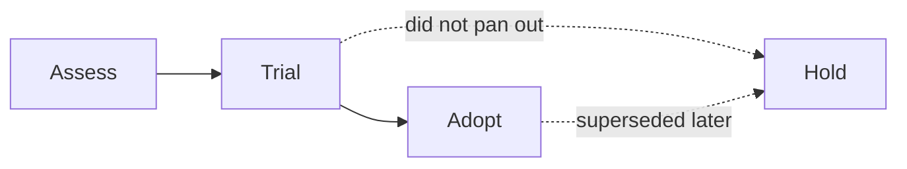

import Scenario from "../../../components/Scenario.astro";
import LevelIntro from "../../../components/LevelIntro.astro";
import PracticeCheck from "../../../components/PracticeCheck.astro";

export const unit = {
  track: "architecture",
  unitSlug: "tech-radar",
};

<Scenario label="The framework nobody voted on">
  <Fragment slot="facts">
    

      
🎤 <strong>Trigger</strong> — one engineer saw a framework at a conference two weeks ago

      
📦 <strong>Result</strong> — 3 of 11 services now use it, the rest don't

      
🤷 <strong>Nobody can answer</strong> — "is this an experiment, or the new default?"

    

    

      

        
Services on the new framework3 of 11

        

      

    

  </Fragment>

Picture a shared workshop where one person buys a new kind of power tool
after seeing it at a trade show. It works well for them. Two colleagues
borrow it, then buy their own. A month later a third of the workshop depends
on a tool nobody agreed to support, and the only person who knows how to
repair it is away. In a software team the same thing happens with a
framework: it spreads because the last person to touch the code happened to
know it. **Nobody ever decided to adopt this technology. It just
accumulated. What shared record could have made "we are trying this" look
different from "we stand behind this"?**

</Scenario>

The missing piece is a visible place to write down how committed the team is
to each technology. A **technology radar** is that place: a short, shared map
of every technology the team knowingly uses, each with an explicit level of
commitment.

<LevelIntro
  items={[
    "The four rings: Adopt, Trial, Assess, Hold",
    "The four quadrants a radar sorts by",
    "Why sprawl happens without a shared map",
  ]}
/>

## What do the four rings say about a technology?

**If two engineers both say "we use X", how can a newcomer tell whether X is
a safe default or one person's experiment?** The ring answers it. Each ring
is a promise about commitment, and each tells the reader what they may do.

| Ring       | What the team is saying                                   | What a newcomer may do                               |
| ---------- | --------------------------------------------------------- | ---------------------------------------------------- |
| **Adopt**  | We have real production experience and stand behind it    | Pick it by default for new work in its category      |
| **Trial**  | Someone is using it on a real, bounded project            | Use it on new projects, knowing it is not proven yet |
| **Assess** | Worth exploring to understand it, not worth committing to | Run a spike, away from anything critical             |
| **Hold**   | Known problems, or a deliberate step back                 | Start nothing new with it; existing use is tolerated |

The rings are not a ladder every technology is expected to climb. Most things
that get assessed never reach Trial, and any entry can be pulled back to Hold
the moment it stops earning its place.

<PracticeCheck track={unit.track} unitSlug={unit.unitSlug} topicId="rings" />

## What do quadrants add, and what goes wrong without a radar?

**If rings say how sure we are, what says what kind of thing it is?** The
**quadrant**. It stops a practice such as feature flags from being compared
head to head with a platform such as a database.

| Quadrant                   | What it holds                                 | Example                      |
| -------------------------- | --------------------------------------------- | ---------------------------- |
| **Techniques**             | Practices and ways of working                 | Contract testing             |
| **Tools**                  | Things that support building and running code | A CI system, a linter        |
| **Platforms**              | Things you build and run on top of            | A cloud provider, a database |
| **Languages & Frameworks** | The code-level building blocks                | A web framework              |

So every entry answers two questions at a glance: how sure are we (ring), and
what kind of thing is it (quadrant). Without that shared map you get
**technology sprawl**: many local, uncoordinated choices that nobody can
separate into "experiment" and "standard". The radar is a living document
rather than an approval committee, so it never blocks anyone from trying
something.

<PracticeCheck
  track={unit.track}
  unitSlug={unit.unitSlug}
  topicId="quadrants-and-sprawl"
/>

Key terms: technology radar, ring, quadrant, adopt, trial, assess, hold,
technology sprawl.

## What the next levels cover

L2 follows one entry through its life and asks what evidence justifies a ring
change and how often the radar must be reviewed. L3 compares three
candidates with a weighted score and shows where the score stops helping.
