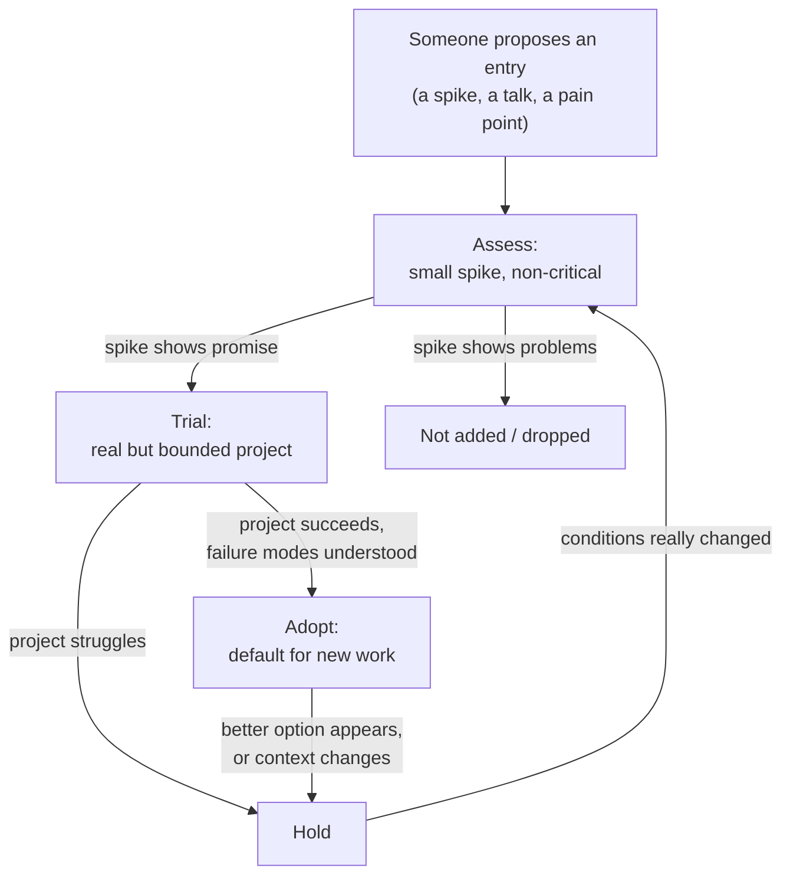
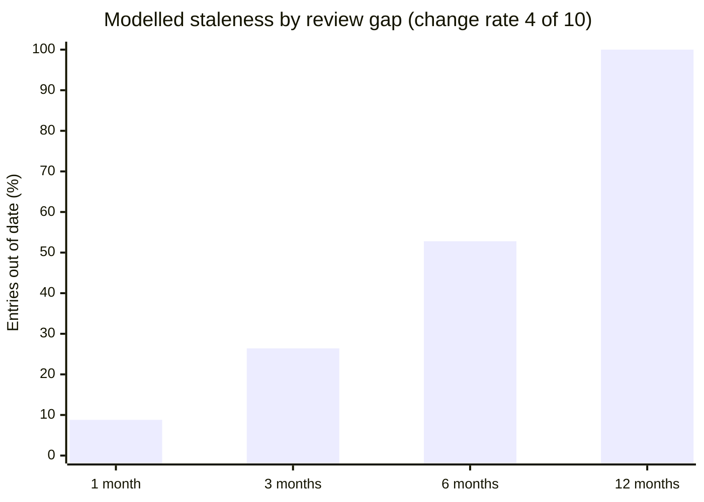

import LevelIntro from "../../../components/LevelIntro.astro";
import Checkpoint from "../../../components/Checkpoint.astro";
import PracticeCheck from "../../../components/PracticeCheck.astro";

export const unit = {
  track: "architecture",
  unitSlug: "tech-radar",
};

L1 named the four rings and four quadrants as a shared vocabulary. That
vocabulary only helps if something actually moves entries between rings on a
real schedule, otherwise the radar goes stale and becomes the unmaintained
document nobody trusts. L2 works out who moves an entry, on what evidence,
and how often the whole radar is revisited.

<LevelIntro
  items={[
    "The lifecycle of one radar entry",
    "What evidence justifies each ring move",
    "Why review cadence matters as much as rings",
  ]}
/>

## What happens to one technology from first try to commitment?

**Before choosing an evidence bar or a review schedule: what actually
happens to a single technology between the day someone first tries it and
the day the team commits or drops it?** Tracing one entry shows that every
ring change has a natural trigger.

An entry moves forward on **evidence from using it**, never on how
convincing the pitch was. It is just as normal for an entry to stop at any
ring.

<Checkpoint question="A team ran a 2-day spike on a new observability tool and liked what they saw. Per the lifecycle above, does that spike alone justify moving the tool straight to Adopt?">

No. A 2-day spike is exactly what Assess is for. It builds understanding and
exposes obvious dealbreakers, but it has not touched a real, bounded project,
which is what Trial requires. Skipping Trial means adopting on enthusiasm
instead of operating experience, which is the same failure as the ungoverned
framework in L1, only with a stamp on it.

</Checkpoint>

<PracticeCheck
  track={unit.track}
  unitSlug={unit.unitSlug}
  topicId="evidence-for-moves"
/>

## What evidence actually moves an entry?

**If "it worked" is too vague to justify a ring change, what is specific
enough?** Each transition should point at one concrete, falsifiable question
the previous ring existed to answer.

| Transition            | The question that ring exists to answer                                                                                    |
| --------------------- | -------------------------------------------------------------------------------------------------------------------------- |
| Assess → Trial        | Did the spike surface a dealbreaker (licensing, a missing feature, unacceptable performance)?                              |
| Trial → Adopt         | Did a real project run it in production and survive an actual failure (an outage, a bad deploy, a page)?                   |
| Adopt → Hold          | Has something changed (a better option, an abandoned upstream, a security issue) that makes recommending it irresponsible? |
| Hold → Assess (again) | Did the condition that caused the Hold actually change, or is someone just hoping it did?                                  |

Without a question per transition, ring changes drift toward "the loudest
advocate wins", which recreates the hype-driven adoption the radar exists to
prevent.

## How often must the radar be reviewed?

**A radar with perfect rings, reviewed once two years ago: is it doing its
job today?** No. Every entry is a snapshot of a moment that has passed. A
Hold from an old major version may no longer apply, and an Adopt from before
a security disclosure may now be dangerous to keep recommending. A radar's
value decays like any cached decision.

The chart below is an **illustrative model**, not measured data. It uses the
same formula as the interactive demo at the end of this unit (entries out of
date, in percent, equals months between reviews times a stack change rate of
4 out of 10 times 2.2, capped at 100), so you can move the sliders and
reproduce each bar.

Most teams settle on a quarterly review as a practical middle: often enough
that no entry sits stale for a whole release cycle, rare enough to be a real,
scheduled conversation rather than noise.

<Checkpoint question="A team reviews its radar once a year. A library on Adopt had a critical vulnerability disclosed 8 months ago. What does the yearly cadence mean for that entry, and is the fix simply reviewing more often?">

For 8 of those 12 months the radar is actively misleading: it tells readers
"this is the safe default" when it is not. A faster scheduled cadence helps,
but the deeper fix is that **security disclosures should not wait for the
next scheduled review**. A radar needs a routine cadence for ordinary drift
and an out-of-band trigger (a vulnerability, an upstream project going
unmaintained) that forces an immediate ring change wherever the calendar
sits.

</Checkpoint>

<PracticeCheck
  track={unit.track}
  unitSlug={unit.unitSlug}
  topicId="review-cadence"
/>
