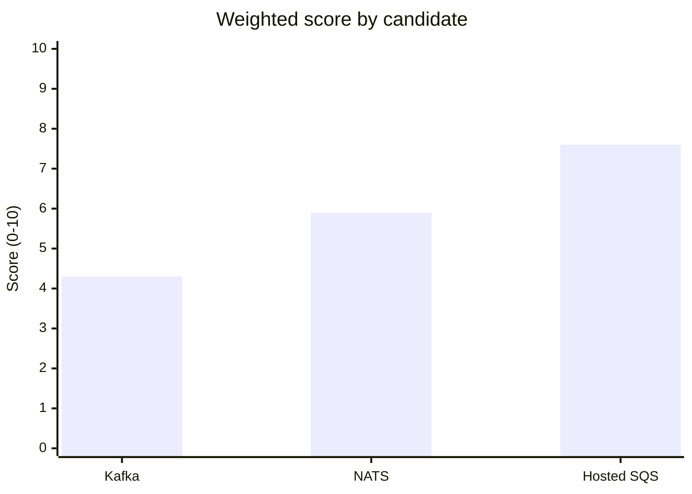

import Scenario from "../../../components/Scenario.astro";
import LevelIntro from "../../../components/LevelIntro.astro";
import Checkpoint from "../../../components/Checkpoint.astro";
import PracticeCheck from "../../../components/PracticeCheck.astro";

export const unit = {
  track: "architecture",
  unitSlug: "tech-radar",
};

<Scenario label="Three candidates, one Trial slot">
  <Fragment slot="facts">
    

      
📨 <strong>Problem</strong> — the team's message queue needs replacing this quarter

      
🗳️ <strong>Candidates</strong> — Kafka, NATS, and a hosted SQS-based approach

      
⚖️ <strong>Tension</strong> — each of three engineers is confident a different one is "obviously right"

    

  </Fragment>

Three engineers each did their own research and each came back convinced.
One wants Kafka ("it's what every serious company runs"), one wants NATS
("it's simpler and we don't need Kafka's scale"), one wants the hosted
SQS-based approach ("we're not an infra company, let AWS run it"). All three
are defensible, and none is wrong on the facts they picked. **With three
confident, contradictory recommendations and one Trial slot, how do you turn
"everyone has an opinion" into a decision the team can defend later?**

</Scenario>

<LevelIntro
  items={[
    "A weighted score built from the team's own criteria",
    "Why the score structures judgment, not replaces it",
    "Running the three candidates through it",
  ]}
/>

## Why do three engineers disagree about the same facts?

**What makes one engineer's "obviously right" different from another's when
they look at the same three options?** They are not weighing the same
things. The Kafka advocate weights long-term scale, the NATS advocate
operational simplicity, the SQS advocate "who is on call at 3am". The
disagreement is about **weight**, not fact. A scoring table does not remove
judgment; it pulls the judgment about weights into the open, where it can be
argued explicitly instead of hiding inside three separate "obviously"s.

A reasonable starting set of criteria for a Trial-ring decision:

| Criterion          | What it is really asking                                                                         |
| ------------------ | ------------------------------------------------------------------------------------------------ |
| Team familiarity   | How much operational pain will the learning curve cost, right now?                               |
| Ecosystem maturity | How many of our real problems has someone else already solved and written up?                    |
| Migration cost     | How much existing code and infrastructure must change to try this at all? (scored so 10 = cheap) |
| Strategic fit      | Does it match where the architecture is headed, or fight it?                                     |

Each candidate gets a 0 to 10 sub-score per criterion, and each criterion a
weight, with weights summing to 1:

$$\text{score} = \sum_i w_i \cdot s_i$$

<Checkpoint question="Two engineers use the same table with the same three candidates and the same sub-scores, yet reach different winners. What is the only thing that can differ, and what does that say about what the table is for?">

Only the weights can differ. One engineer weights migration cost heavily
(favouring the cheap-to-adopt option), the other weights strategic fit
(favouring the option matching the architecture's direction). That is the
point of the method: it does not manufacture agreement, it narrows the
disagreement to "how much does each criterion matter", which a team can
discuss out loud, instead of three unfalsifiable "obviously"s.

</Checkpoint>

## What does the worked example produce?

These sub-scores are the unit's illustrative judgments for a small team with
no dedicated infra staff, not measurements. The weights are 0.3 familiarity,
0.2 maturity, 0.3 migration cost, 0.2 strategic fit.

| Candidate  | Familiarity | Maturity | Migration cost | Strategic fit | Weighted score |
| ---------- | ----------- | -------- | -------------- | ------------- | -------------- |
| Kafka      | 3           | 9        | 2              | 5             | 4.3            |
| NATS       | 5           | 6        | 6              | 7             | 5.9            |
| Hosted SQS | 8           | 8        | 8              | 6             | 7.6            |

Check one row: Kafka is 3 × 0.3 + 9 × 0.2 + 2 × 0.3 + 5 × 0.2 = 0.9 + 1.8 +
0.6 + 1.0 = 4.3.

Hosted SQS wins here, and not because Kafka is worse in any absolute sense:
its maturity sub-score is the highest of the three. A small team with no
infra staff pays heavily for Kafka's operational weight, and the table made
that cost visible in the final number instead of leaving it as "everyone
knows Kafka is heavier". The slider demo at the end of this unit varies the
migration-cost weight (splitting the rest evenly), so you can see how far
the weights must move before the winner changes.

<Checkpoint question="The same table is used by a company with a dedicated 6-person platform team and throughput needs 50 times higher. Would you expect the same winner?">

Not necessarily, and that is the method working. A platform team raises
Kafka's familiarity score, because the operating cost is spread across
specialists, and much higher throughput likely raises its strategic fit.
Identical weights and arithmetic applied to honestly re-scored inputs can and
should produce a different winner. The table claims no universal answer; it
makes explicit what changed about the situation.

</Checkpoint>

<PracticeCheck
  track={unit.track}
  unitSlug={unit.unitSlug}
  topicId="weighted-scoring"
/>

## Where does the score stop replacing judgment?

- **Garbage in, garbage out.** If sub-scores are guessed instead of coming
  from a real spike (L2's Assess evidence), the score is three opinions
  laundered through arithmetic. Score after a spike, not before.
- **A close score is not a decisive score.** 4.3 against 5.9 is a real gap.
  5.6 against 5.9 is close enough that factors the table cannot capture (team
  morale, a project's responsiveness, a looming deprecation) should probably
  decide.
- **The weights are the real decision.** Two teams scoring the same three
  candidates with different weights can reach different, equally defensible
  answers. The value is that the team agreed on weights out loud before the
  number existed.

**Extend it.** This worked example is a case, not the whole territory. It
assumed a moderate-traffic product team. What would the weights (not the
scores) look like for a financial ledger where every message must be durable
and auditable, and could that change the winner with identical sub-scores?
And if the decision were not a Trial pick but whether to move an existing
Adopt entry to Hold, is a weighted score even the right tool, or does that
call for a different kind of evidence?
