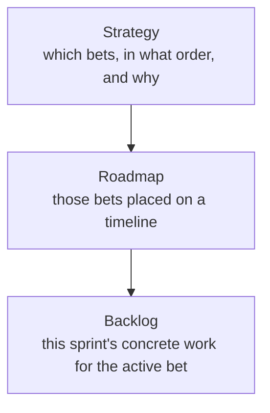

import Scenario from "../../../components/Scenario.astro";
import LevelIntro from "../../../components/LevelIntro.astro";
import PracticeCheck from "../../../components/PracticeCheck.astro";

export const unit = {
  track: "architecture",
  unitSlug: "technical-strategy-roadmapping",
};

<Scenario label="Three urgent requests, one team that can carry about one and a half">
  <Fragment slot="facts">
    

      
🏗️ <strong>Platform director</strong> — split the legacy monolith into services, about 4 quarters

      
💳 <strong>Payments director</strong> — event-driven billing to stop double-charges, about 3 quarters

      
🔒 <strong>Sales director</strong> — SOC 2 compliance to close a deal, about 2 quarters

    

    

      
Asked for at once vs. assumed capacity (initiatives in parallel)

      

        

      

      

        

      

      
Top bar: 3 asked for. Bottom bar: about 1.5 sustainable (an assumption for this unit).

    

  </Fragment>

Imagine a household with two people and three jobs that all feel urgent:
repaint the house, fix the leaking roof, and file the tax paperwork.
Doing all three at once means none of them finishes. Now give the same
shape to an engineering org: three directors each pitch one
"top priority", and the VP asks for a two-year plan by Friday. The team
can realistically carry about one and a half of these in parallel (an
assumption for this unit, not a measured figure).

| Initiative           | Pitched as                                 | Quarters | Depends on                    |
| -------------------- | ------------------------------------------ | :------: | ----------------------------- |
| Split the monolith   | "Everything is blocked on this eventually" |    4     | Nothing                       |
| Event-driven billing | "We are losing money to double-charges"    |    3     | Partially, the monolith split |
| SOC 2 compliance     | "The deal closes or it does not"           |    2     | Nothing                       |

**Picking whichever pitch was presented most recently is reacting, not
planning. What would it take to put these three in a defensible order?**

</Scenario>

That job is **technical strategy and roadmapping**: turning a pile of
competing "most important" pitches into a sequenced plan an org can
execute and defend when someone asks "why this order?"

<LevelIntro
  items={[
    "Strategy, roadmap and backlog as three altitudes",
    "What a bet is and why capacity limits it",
    "Why the order of bets matters",
  ]}
/>

## What are strategy, roadmap and backlog?

**If all three describe "the plan", why keep three words?** Because they
answer three different questions, and a plan missing one of them fails in
a recognisable way:

| Layer    | Question it answers                         | Missing it looks like                         |
| -------- | ------------------------------------------- | --------------------------------------------- |
| Strategy | What are we betting on, and why this first? | A calendar of whatever was pitched loudest    |
| Roadmap  | When does each bet happen, and what blocks? | Good intentions with no dates or dependencies |
| Backlog  | What does someone build this sprint?        | Planning that never turns into shipped work   |

A backlog with no roadmap behind it is busywork. A roadmap with no
strategy behind it is a calendar.

<PracticeCheck
  track={unit.track}
  unitSlug={unit.unitSlug}
  topicId="strategy-altitudes"
/>

## What is a bet, and why is capacity the limit?

**Why call a multi-quarter project a "bet" at all?** Because the word keeps
the trade-off visible: it can fail to pay off, and choosing it means _not_
choosing something else. Capacity is the limit that makes this true. The
more bets run at once, the more everyone loses to coordination and
context switching.

The unit's interactive demo models this with an assumed 12% loss per
extra parallel bet on a 40-engineer team. The numbers it produces:

| Parallel bets | Effective engineers | Engineers per bet |
| :-----------: | :-----------------: | :---------------: |
|       1       |         40          |        40         |
|       2       |         35          |        18         |
|       3       |         30          |        10         |
|       4       |         26          |         7         |

Going from one bet to three does not give each bet a third of the team. It
gives each bet a quarter of it (10 of 40), because 10 engineers' worth of
capacity disappears into overhead. The 12% figure is an illustration
chosen for the demo, not a measurement.

<PracticeCheck
  track={unit.track}
  unitSlug={unit.unitSlug}
  topicId="bets-and-capacity"
/>

## Does the order of bets matter, or only the list?

Two bets can both be worth doing and still have exactly one sensible
order, if one makes the other cheaper or safer. That relationship is a
**dependency**: splitting the monolith first means billing is built once
against clean service boundaries, instead of built now and rebuilt later.

| Order                           | Logic                        | Risk                                    |
| ------------------------------- | ---------------------------- | --------------------------------------- |
| SOC 2, then billing, then split | Revenue and urgency first    | Billing is built twice                  |
| Split, then billing, then SOC 2 | Reduce dependency cost first | The deal's deadline is an external risk |

Neither order is correct in the abstract. The output of strategy is the
explicit, defensible choice between these two risks.

<PracticeCheck
  track={unit.track}
  unitSlug={unit.unitSlug}
  topicId="sequencing-order"
/>

## Key terms

- **Bet**: a multi-quarter commitment chosen over other uses of the same
  engineering time.
- **Dependency**: one bet that makes another cheaper, safer or possible.
- **Horizon**: how far out a bet sits, staged as Now (committed), Next
  (planned, not locked) and Later (directional only).
- **Capacity**: how many bets the org can sustain at once, almost always
  fewer than feel urgent.
