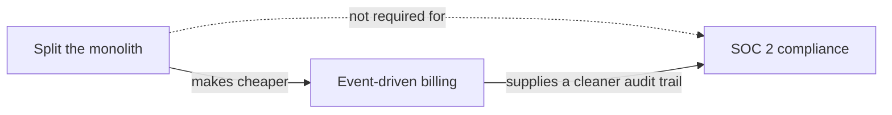
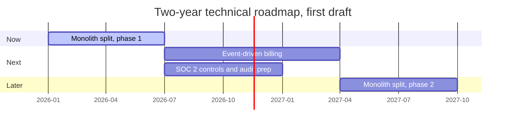

import Scenario from "../../../components/Scenario.astro";
import LevelIntro from "../../../components/LevelIntro.astro";
import Checkpoint from "../../../components/Checkpoint.astro";
import PracticeCheck from "../../../components/PracticeCheck.astro";

export const unit = {
  track: "architecture",
  unitSlug: "technical-strategy-roadmapping",
};

<Scenario label="Two careful proposals, two different orders">
  <Fragment slot="facts">
    

      

        
Proposal A: revenue first

        SOC 2, then billing, then monolith split. The deal can close in about 2 quarters.
      

      

        
Proposal B: foundation first

        Monolith split, then billing, then SOC 2. Billing is built once, not rebuilt.
      

    

    

      Same three bets as L1, same team, same budget.
    

  </Fragment>

Two engineers each spent a week writing a proposal for the three bets from
L1. Both documents are internally consistent. Both cannot be the roadmap.

**When two well-reasoned proposals disagree on order, the useful question
is not "who is right" but "which inputs did each one weigh, and which did
it leave out?"**

</Scenario>

L1 said order matters. L2 shows what has to be on the table before an
order can be called defensible, and how a plan is staged once it is.

<LevelIntro
  items={[
    "Four inputs behind every sequencing decision",
    "How a dependency changes a bet's real cost",
    "Staging bets into Now, Next and Later",
  ]}
/>

## What inputs does a sequencing decision need?

Neither proposal is wrong. Each optimises a real input and under-weights
another:

| Input            | Question it answers                                 | Proposal A | Proposal B |
| ---------------- | --------------------------------------------------- | :--------: | :--------: |
| Business context | What is the company betting on this year?           |    High    |    Low     |
| Current pain     | What is costing money or trust right now?           |   Medium   |   Medium   |
| Org capacity     | How many bets can run at once without stalling all? |  Missing   |  Missing   |
| Dependency graph | Which bets make other bets cheaper or safer?        |    Low     |    High    |

Both skip **org capacity**, which is the input that turns "here is an
order" into "here is what happens in quarter one versus quarter three".

<Checkpoint question="Proposal A leads with SOC 2 because a deal depends on it. Proposal B leads with the split because billing gets cheaper after it. Is one of those inputs simply more important in general?">

No. Both are real costs, denominated differently: lost revenue if the deal
slips, duplicated engineering work if billing is built twice. A defensible
decision puts both on one table and states the trade-off: "we accept this
risk of the deal slipping to avoid that cost of rebuilding billing."
Silently favouring the input the author weighed by instinct is the failure.

</Checkpoint>

<PracticeCheck
  track={unit.track}
  unitSlug={unit.unitSlug}
  topicId="sequencing-inputs"
/>

## How does a dependency change a bet's real cost?

**If billing can start without the split, why does the split go first?**
Because starting is not the same as being cheap. Billing built against the
tangled monolith has to be rebuilt once the split moves its data:

The split is first on the roadmap not because it is the most urgent, but
because skipping it adds a rebuild cost to the bet after it. Note the
dotted line: SOC 2 does not need the split, so nothing forces it to wait.

<PracticeCheck
  track={unit.track}
  unitSlug={unit.unitSlug}
  topicId="dependency-cost"
/>

## How are bets staged into Now, Next and Later?

Bets are not all committed with the same confidence. The further out a bet
sits, the less certain its timing should be:

| Horizon | Commitment                               | Can still change?           |
| ------- | ---------------------------------------- | --------------------------- |
| Now     | A team is staffed on it this quarter     | Rarely                      |
| Next    | Planned, order and scope not locked      | Yes, based on how Now lands |
| Later   | Directional, shows the shape of the plan | Expected to change          |

SOC 2 starts in Next, not after the whole split. Dependency reduction
decided which bet goes first, not that everything else must wait.

<Checkpoint question="A stakeholder asks why SOC 2 work starts in Next instead of waiting until the split is completely finished. What is the answer?">

Now and Next are a confidence horizon, not a strict queue. The split was
placed first because it lowers the cost of the billing work, not because
every bet depends on it. SOC 2 has no such dependency, so it can run in
parallel once capacity allows. It sits in Next because its own scope is
still firming up, not because it is waiting in a single-file line.

</Checkpoint>

<PracticeCheck
  track={unit.track}
  unitSlug={unit.unitSlug}
  topicId="now-next-later"
/>

## Where L3 goes

L3 follows this roadmap through its first real test: scoring the bets with
explicit numbers, re-sequencing after an incident without abandoning the
method, and measuring whether the plan worked.
