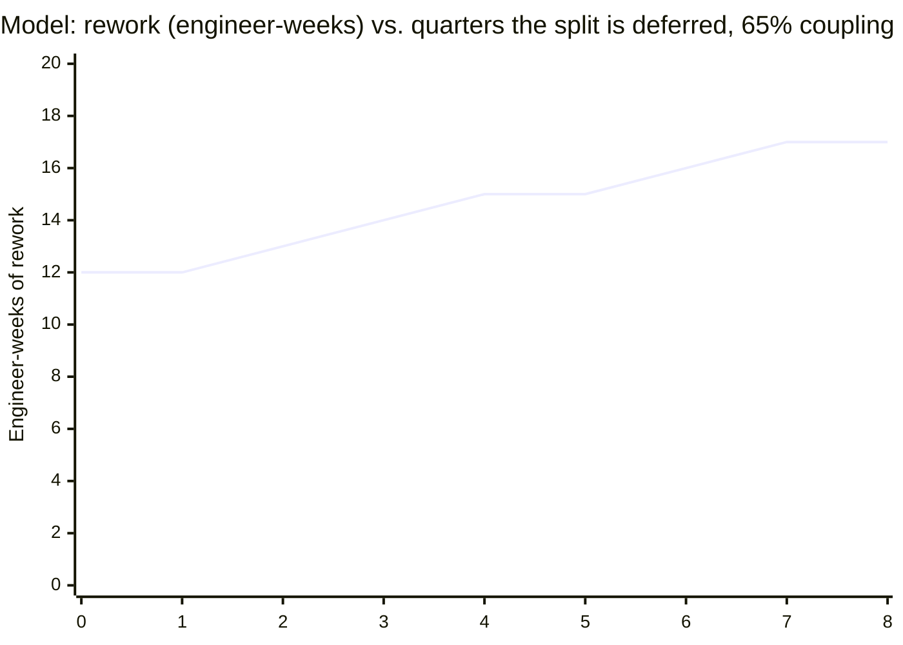
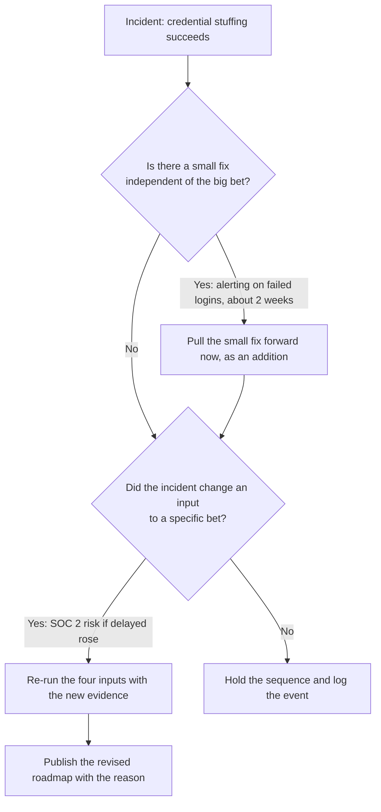
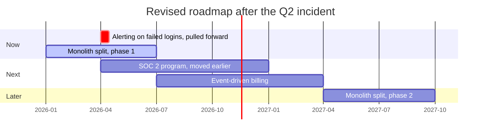
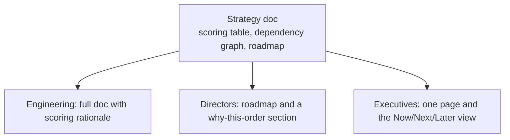

import Scenario from "../../../components/Scenario.astro";
import LevelIntro from "../../../components/LevelIntro.astro";
import Checkpoint from "../../../components/Checkpoint.astro";
import PracticeCheck from "../../../components/PracticeCheck.astro";

export const unit = {
  track: "architecture",
  unitSlug: "technical-strategy-roadmapping",
};

<Scenario label="The roadmap survives one quarter before reality disagrees with it">
  <Fragment slot="facts">
    

      
📅 <strong>Q1</strong> — roadmap published: split, then billing, then SOC 2

      
🚨 <strong>Q2</strong> — a credential-stuffing incident exposes missing alerting on failed logins

      
❓ <strong>Now</strong> — does the incident change the plan, or is it noise the plan should absorb?

    

    

      Aperture Health is a fictional company. Every score, dollar figure and week count below is an illustrative assumption.
    

  </Fragment>

A small child's rule says "finish the game before starting a new one". The
rule is fine until the house is on fire. The roadmap from L2 was published,
staffed and moving at Aperture Health when a postmortem showed that a
credential-stuffing attack had worked because nothing alerted on bursts of
failed logins. SOC 2 was staged for Next, months away.

**A strategy that never changes when reality disagrees is stale. A
strategy that changes whenever something alarming happens is not a
strategy. Where is the line between "this changes the plan" and "this is
the noise the plan was built to absorb"?**

</Scenario>

This case is one worked example, not the whole territory. It follows a
roadmap from scoring, through a forced re-sequencing, to measurement.

<LevelIntro
  items={[
    "Scoring bets, then placing them by dependency",
    "Re-sequencing under pressure without dropping the method",
    "Leading indicators and the depth each audience sees",
  ]}
/>

## How are the bets scored, and why does the score not settle the order?

The author of the plan built a scoring table from inputs each director
could contest, but not override by volume. All values here are assumed for
illustration:

| Bet                   | Quarters | Impact (assumed)                  | Risk if delayed                      | Dependency value                      | Score (0-10) |
| --------------------- | :------: | --------------------------------- | ------------------------------------ | ------------------------------------- | :----------: |
| Monolith split, ph. 1 |    2     | Indirect, unblocks two other bets | Low, no external deadline            | High, halves billing's estimated cost |      8       |
| Event-driven billing  |    3     | About $40k a month in refunds     | Medium, a slow ongoing cost          | Medium, cleaner audit trail for SOC 2 |      7       |
| SOC 2 compliance      |    2     | A $2M deal depends on it          | High but bounded: one deal, one date | Low, unblocks neither other bet       |      7       |

The scores sit close together on purpose. None is a throwaway, so the score
alone cannot settle the order. Dependency does. The model behind the
unit's second demo estimates the extra rework when billing ships before the
split, as the share of billing code coupled to the monolith, grown by drift
for every quarter the split is deferred:

At 3 quarters deferred the model gives 14 engineer-weeks. Moving the
coupling from 65% to 30% drops that to 6; moving it to 90% raises it to 19. The shape is the lesson: rework is never zero once billing is built
against the monolith, and it only grows the longer the split waits.

<Checkpoint question="A new bet arrives scoring 9, above all three in the table. Does it automatically take the front of the roadmap?">

No. A higher score ranks a bet against others in isolation. If the new bet
neither depends on nor unlocks the staged ones, a 9 makes it a strong
candidate for the next open capacity slot, not a reason to bump the split,
whose position was justified by the cost it removes later. Treating the
table as a strict priority queue repeats the mistake of Proposals A and B:
optimising one input and dropping the others.

</Checkpoint>

<PracticeCheck
  track={unit.track}
  unitSlug={unit.unitSlug}
  topicId="score-vs-dependency"
/>

## How does a plan re-sequence under real pressure?

**What changed in the evidence, as opposed to the mood?** The process is a
sequence of questions, asked in order:

The two-week alerting fix was pulled into the current quarter as an
addition, not a replacement. Separately, the incident was real new
evidence about one input: SOC 2's risk if delayed went from "one bounded
deal" to "one deal plus a security gap proven exploitable". Re-running the
four inputs moved SOC 2 earlier, to overlap the tail of the split:

The split still runs first, because the incident did not touch the
dependency math that put it there. Only SOC 2's position moved, because
the incident was new evidence about SOC 2 specifically.

<Checkpoint question="A director concludes the incident proves 'security should always come first' and wants every future roadmap to lead with security. Is that the right lesson?">

No. What justified the move was a specific, evidenced change to one input
for one bet, run back through the same four-input process. A standing
"security first" rule would replace the process with a fixed priority,
which is the opening failure again: reacting to the most recent pressure,
only with security as the trigger. The discipline is re-running the method
with better inputs, not swapping the method for a rule.

</Checkpoint>

<PracticeCheck
  track={unit.track}
  unitSlug={unit.unitSlug}
  topicId="resequencing"
/>

## How do you know the roadmap worked?

"Done" is not "worked", and waiting for a bet to finish before checking is
too late to adjust. Each bet needs an indicator you can read while it runs:

| Bet                  | Leading indicator during execution              | What it can flag early                        |
| -------------------- | ----------------------------------------------- | --------------------------------------------- |
| Monolith split ph. 1 | Services extracted per quarter versus plan      | A stalled split before it derails the roadmap |
| Event-driven billing | Weekly double-charge rate, not only at ship     | Whether the fix works mid-rollout             |
| SOC 2 program        | Controls implemented versus checklist, biweekly | Audit failure risk before the audit itself    |

A "status: on track" per bet at quarter end is a lagging indicator in a
status update's clothing.

<PracticeCheck
  track={unit.track}
  unitSlug={unit.unitSlug}
  topicId="leading-indicators"
/>

**Now stretch it.** This case was an org sequencing three bets after a
security incident. What would change in the scoring table, the four inputs
or the indicators if it were a twelve-person startup? What if the trigger
were a competitor shipping the same billing fix first instead of a breach?
Which inputs move, and which parts of the method stay the same?

## Who sees which depth of the strategy?

A roadmap that lives in one person's head does not survive its first
disagreement:

Engineering gets the scoring and dependency reasoning so it can contest
the plan with the same inputs. Directors get the order and the why. The
executives get the two-year shape. Withholding the deepest layer from
engineering is the common way buy-in quietly erodes: a team that cannot
inspect a sequencing decision treats it as a mandate and re-litigates it
informally, sprint by sprint, instead of once up front.

## Takeaways

- A scoring table settles which bets; a dependency graph settles which
  order. Neither is enough alone.
- Re-sequencing means re-running the same inputs with new evidence, not
  replacing the method with a reactive rule.
- Track leading indicators while a bet runs, and publish the reasoning at a
  depth each audience can inspect.
