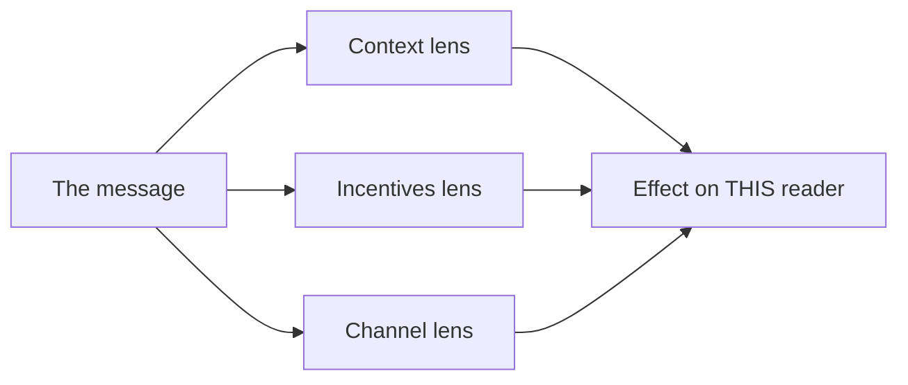

import Scenario from "../../../components/Scenario.astro";
import LevelIntro from "../../../components/LevelIntro.astro";
import PracticeCheck from "../../../components/PracticeCheck.astro";

export const unit = {
  track: "business-communication",
  unitSlug: "audience-awareness",
};

<Scenario>
  <Fragment slot="facts">
    

      

        $340
        of $500 goal
      

      

        

      

    

    

      
🌧️ Rain forced the move inside, cut selling time in half

      
🔁 Fix: make-up sale <strong>Saturday</strong>

    

    
Readers

    

      
🙋 Groupmate — was there

      
🧑‍🏫 Teacher — accountable for the $500

      
🏫 Principal — only cares if the trip is on

    

  </Fragment>

Your class ran a bake sale to raise $500 for a field trip. Rain forced
everyone to move the tables inside at the last minute, and you only raised
$340 — but you already have a plan: a make-up sale Saturday that should
close the gap. You have to tell three people the same news today.

| Reader                                    | Reaction                                                                      |
| ----------------------------------------- | ----------------------------------------------------------------------------- |
| Your groupmate who ran the table          | Calm: "Okay — what do we do differently Saturday?"                            |
| Your teacher, who's counting on the money | Concerned, but focused on the plan: "Are we still going to hit $500 in time?" |
| The principal, hearing it secondhand      | Alarmed: "Wait — is the trip cancelled?!"                                     |

**Before reading on: all three hear the same $340 and the same reason (rain) — so why does only the principal panic, while the other two stay calm?**

</Scenario>

It wasn't the facts. It was everything _around_ them: what got explained, what got cut, and what question the message answered first.

<LevelIntro
  items={[
    "Facts vs. the effect a message produces",
    "The three lenses: context, incentives, channel",
    "Load-bearing detail vs. spin",
  ]}
/>

## Why do identical facts produce different reactions?

The **facts** in a message and the **effect** of a message are two different things. The same true statement can build trust with one audience and alarm another, because the reader brings their own knowledge and stakes to it.

| Axis   | What it is                           | Who controls it                                  |
| ------ | ------------------------------------ | ------------------------------------------------ |
| Facts  | What is true and checkable           | The writer                                       |
| Effect | How the message lands on this reader | The writer's choices plus the reader's situation |

<PracticeCheck
  track={unit.track}
  unitSlug={unit.unitSlug}
  topicId="facts-vs-effect"
/>

## What filters a message on its way to a reader?

Every audience filters what you say through three lenses at once:

- **Context**: how much background do they already have? Your groupmate watched the rain happen; your teacher is only checking in now.
- **Incentives**: what do they personally care about? Your teacher is on the hook for the $500 goal; your groupmate just wants Saturday to go better.
- **Channel expectations**: what does the way you tell them train them to expect? A text to your groupmate reads casual; an announcement to the whole school reads official.

The lenses aren't checked one at a time. They apply to the same message simultaneously, and all three feed into a single effect on that reader:

In plain words:

| Term                 | Simple meaning                                                        |
| -------------------- | --------------------------------------------------------------------- |
| Context              | What the reader already knows before your message arrives             |
| Incentives           | What the reader cares about, is responsible for, or will be judged on |
| Channel expectations | What the format makes them expect: text, email, announcement, meeting |
| Foregrounded         | What you put first, because it should shape the reader's reaction     |
| Load-bearing detail  | A detail that would change what the reader decides or does            |
| Spin                 | Twisting the story to create an impression the facts do not support   |

<PracticeCheck
  track={unit.track}
  unitSlug={unit.unitSlug}
  topicId="three-lenses"
/>

## Isn't tailoring a message just spin?

**Audience awareness is not spin.** You are not changing what is true. You are changing what is foregrounded, how much detail is load-bearing, and what decision you are asking the reader to make. If the principal hears "$340 of $500, make-up sale Saturday, the trip is on track", every part of that is true. If the principal hears "we hit our goal", that is spin, because the facts do not support it.

<PracticeCheck track={unit.track} unitSlug={unit.unitSlug} topicId="not-spin" />

## What should you ask before writing anything that matters?

A message written with no audience in mind defaults to the writer's own frame, which is usually the most detailed and least decision-oriented version possible. Three questions fix that:

| #   | Question                                               | What it decides                                   |
| --- | ------------------------------------------------------ | ------------------------------------------------- |
| 1   | What do they already know, and need to know to act?    | What's redundant to explain vs. genuinely missing |
| 2   | What decision or reaction am I trying to produce?      | The actual ask, explicit or implicit              |
| 3   | What will they misread if I don't address it directly? | What has to be stated, not just implied           |

Getting this wrong costs more than clarity. It costs **credibility**. Someone who explains a topic in exactly the same words to a seven-year-old and to a room of adults comes across as not really understanding the room, however correct the explanation is. That is not about intelligence or respect: a child, a teacher, and a principal are each trying to decide something different, so each needs a different version.

<PracticeCheck
  track={unit.track}
  unitSlug={unit.unitSlug}
  topicId="default-frame"
/>
