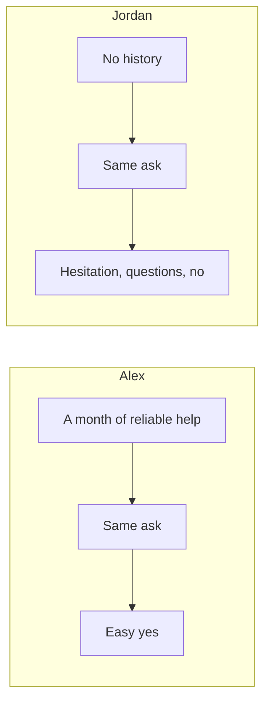

import Scenario from "../../../components/Scenario.astro";
import LevelIntro from "../../../components/LevelIntro.astro";
import PracticeCheck from "../../../components/PracticeCheck.astro";

export const unit = {
  track: "business-communication",
  unitSlug: "building-credibility-ahead-ask",
};

<Scenario label="Same bike, same weekend, two very different answers">
  <Fragment slot="facts">
    

      
🚲 <strong>The ask</strong> — "can I borrow your bike for the weekend?"

      
👤 <strong>Alex</strong> — has spent a month helping Maya, showing up reliably

      
👤 <strong>Jordan</strong> — has barely spoken to Maya before, asks the same thing

    

  </Fragment>

Two people ask Maya the exact same question: "can I borrow your bike
for the weekend?" Alex has spent the past month helping Maya study,
giving her a ride when it rained, and generally being someone she can
count on. Jordan has barely spoken to Maya before this moment. Maya
says yes to Alex without much hesitation. She says no to Jordan, or at
best hesitates and asks a lot of questions first. **The request was
identical. What actually made the difference?**

</Scenario>

<LevelIntro
  items={[
    "What separated the two answers",
    "Key terms: credibility, trust deposit, trust withdrawal",
    "Why the moment of asking matters",
  ]}
/>

## What actually separated the two answers?

The sentence was identical, so the difference must live somewhere else. **Where
did Maya look before answering?**

| Question                      | Alex                      | Jordan       |
| ----------------------------- | ------------------------- | ------------ |
| Words of the ask              | Identical                 | Identical    |
| What Maya has seen beforehand | A month of follow-through | Nothing      |
| How the ask reads             | A reasonable request      | Presumptuous |

- A request is never judged in isolation. It is judged against everything the
  asker has already shown about themselves, whether or not either person
  thinks about it explicitly.
- Waiting until you need something to start earning goodwill is backwards: by
  the time the ask arrives, it is too late to change how much someone trusts
  you.

The bike example is small on purpose. The same pattern sits behind asking for
support on an idea, a decision, a team priority, or an exception at work, where
the word for the payoff is **buy-in**: someone is willing to back your request
before the formal decision moment arrives.

<PracticeCheck
  track={unit.track}
  unitSlug={unit.unitSlug}
  topicId="same-ask-different-answer"
/>

## What do the key terms mean?

- **Ask** — the thing you want someone to say yes to: help, time,
  approval, risk, priority, or support.
- **Buy-in** — support that has enough trust behind it that the other
  person is willing to help the request move forward.
- **Credibility** — the accumulated reason someone has to believe
  you'll follow through, be honest, or act in their interest, built up
  from what you've actually done, not what you say about yourself.
- **Trust deposit** — a small, reliable action that adds to how much
  someone trusts you: showing up when you said you would, following
  through on something small, noticing something genuine about them.
- **Trust withdrawal** — anything that draws down that accumulated
  trust: a broken promise, an inconsistency, or a big ask that draws
  on more trust than a small one would.
- **Timing of the ask** — the difference between asking for something
  before you've established any track record versus after — the same
  words can land completely differently depending on what came before
  them.

In plain words: people remember whether you usually do what you said,
warn early when something changes, and help without only showing up
when you need something.

<PracticeCheck
  track={unit.track}
  unitSlug={unit.unitSlug}
  topicId="trust-vocabulary"
/>

## Does the moment of asking change anything?

**If Jordan asked in exactly the same polite words, but a month later after
showing up reliably, would the answer change?** Yes. The words stay fixed; only
the history behind them moves.

- Ask **before** any track record exists: nothing to draw on, so the request
  feels presumptuous.
- Ask **after** a record exists: the same request feels reasonable.
- Wording and politeness help at the margins but cannot stand in for history.

<PracticeCheck
  track={unit.track}
  unitSlug={unit.unitSlug}
  topicId="ask-timing"
/>

## What this unit covers

L2 works through the "trust account" idea — deposits and withdrawals
happening whether or not anyone tracks them explicitly — and why a
bigger ask requires a bigger balance built up in advance. L3 walks
through Alex's actual month, using a simple illustrative point model of the
trust balance, and shows why the same ask from Jordan, starting at zero,
gets a very different response. The same pattern applies when the "bike" is
a proposal, a priority change, or someone's support in a meeting.
