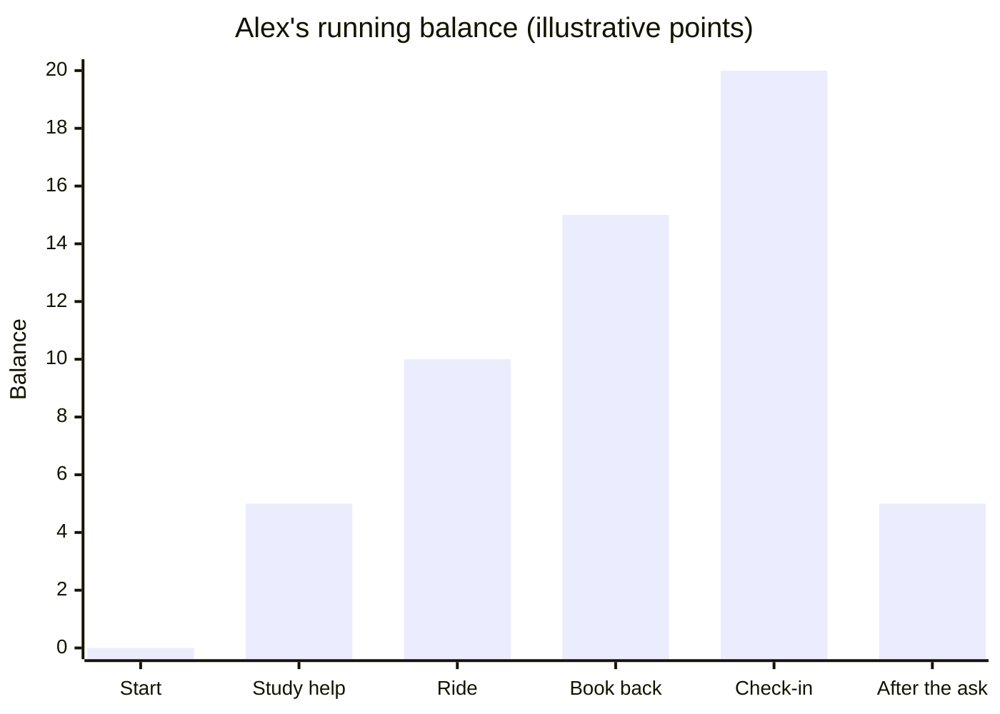

import Scenario from "../../../components/Scenario.astro";
import LevelIntro from "../../../components/LevelIntro.astro";
import Checkpoint from "../../../components/Checkpoint.astro";
import PracticeCheck from "../../../components/PracticeCheck.astro";

export const unit = {
  track: "business-communication",
  unitSlug: "building-credibility-ahead-ask",
};

<Scenario label="Alex's month, as a running balance">
  <Fragment slot="facts">
    

      
➕ <strong>Each genuine deposit</strong> — worth +5 on the balance

      
➖ <strong>The big ask</strong> — borrowing the bike for the weekend, costs 15

      
📏 <strong>Rule of thumb</strong> — balance stays at or above zero after the ask → likely yes

    

  </Fragment>

**Before reading further, predict: with four genuine deposits worth 5
each, and a big ask that costs 15, does Alex's balance stay positive
after the ask — and by how much?**

</Scenario>

<LevelIntro
  items={[
    "Alex's month as a running trust balance",
    "Jordan's cold ask tracked the same way",
    "Failure modes that break the balance",
  ]}
/>

## Tracking Alex's month as a running balance

This is an illustrative point system, not a precise formula for how
real trust works — but the arithmetic makes the underlying logic
checkable rather than just asserted.
Do not use these numbers literally with real people. The model is a
teaching tool for seeing the direction and timing of trust, not a
scorecard for relationships.

| Day         | What happened                                           | Change | Running balance |
| ----------- | ------------------------------------------------------- | ------ | --------------- |
| Mon, week 1 | Helped Maya study for a test                            | +5     | 5               |
| Thu, week 1 | Gave her a ride when it started raining                 | +5     | 10              |
| Tue, week 3 | Returned a book she'd lent, exactly on time as promised | +5     | 15              |
| Fri, week 4 | Noticed she seemed stressed and checked in genuinely    | +5     | 20              |
| Sat, week 4 | Asks to borrow the bike for the weekend                 | -15    | 5               |

Four genuine deposits bring the balance to 20 before the ask. The ask
itself draws down 15, leaving a balance of 5 — still positive. By the
rule of thumb, that's a comfortable "likely yes," which matches what
actually happened: Maya said yes without much hesitation.

<PracticeCheck
  track={unit.track}
  unitSlug={unit.unitSlug}
  topicId="running-balance"
/>

## Tracking Jordan's cold ask the same way

| Day         | What happened                           | Change | Running balance |
| ----------- | --------------------------------------- | ------ | --------------- |
| —           | (no prior interactions with Maya)       | —      | 0               |
| Sat, week 4 | Asks to borrow the bike for the weekend | -15    | -15             |

With no deposits at all, the same ask drives the balance to -15 — deep
negative. This is exactly why the identical sentence lands so
differently: Jordan isn't being punished for anything specific, but
there's simply nothing built up to draw the withdrawal from, so the
ask reads as presumptuous rather than reasonable.

<Checkpoint question="Jordan starts at 0 and ends at -15 after the ask. What does the negative number say about Jordan's request, and how would a small ask of cost 2 from the same starting point read differently?">

The negative number is the part of the ask that nothing covers: the
request costs 15 and Jordan has built up none of it, so the whole 15
is borrowed against trust that does not exist yet. A cost-2 ask from
the same zero starting point would end at -2, a shortfall small enough
to read as someone simply being friendly. So the sting in Jordan's case
comes from the size of the ask relative to the history, not from
Jordan having done anything wrong, which is also why the remedy is to
deposit first rather than to rephrase.

</Checkpoint>

<PracticeCheck track={unit.track} unitSlug={unit.unitSlug} topicId="cold-ask" />

## What if Alex asked again the following weekend?

**Suppose Alex's balance sits at 5 after the first ask, and the very
next weekend, Alex asks to borrow the bike again — same size ask,
costing 15. What does the running balance become, and what does that
predict about how the second ask will land, even though Alex has a
real track record?** Run the arithmetic: 5 minus 15. **Does having
built a positive balance once mean it's safe to keep withdrawing from
it repeatedly without making any more deposits in between — or does
the balance need to be rebuilt between asks, the same way it needed to
be built the first time?**

The arithmetic is `5 - 15 = -10`. The second ask can feel like too
much, too soon, even though Alex was trusted the first time. A past
yes does not create a permanent credit line; repeated asks need new
deposits between them.

<Checkpoint question="A colleague got your support on one risky proposal last quarter after months of reliable updates. This quarter they show up asking you to back a second risky proposal, with no new updates or follow-through in between. Does last quarter's track record carry over automatically?">

No. The running-balance arithmetic makes this concrete: a past
positive balance gets drawn down by the ask that used it, and it stays
drawn down until new deposits rebuild it. Last quarter's reliability
explains why the first ask worked, not why the second one should. The
colleague needs new evidence between the two asks — another round of
reliable updates or follow-through — or the second ask lands as
presumptuous in exactly the way Jordan's did, even though this
colleague has a real history with you.

</Checkpoint>

<PracticeCheck
  track={unit.track}
  unitSlug={unit.unitSlug}
  topicId="repeat-asks"
/>

## The same pattern at work

Two engineers ask a manager to support a risky proposal. One has spent
the previous month warning early about risks, following through on
small commitments, and helping another team before asking for anything.
The other appears only on decision day with the same proposal and the
same slide deck. The request may be identical, but the trust balance is
not. In work, deposits look like reliable updates, useful context, and
small fulfilled promises; withdrawals look like asking someone to spend
time, change priority, approve risk, or defend your idea in a room.

## Failure modes

| Failure mode                                                    | What it gets wrong                                                                                                   |
| --------------------------------------------------------------- | -------------------------------------------------------------------------------------------------------------------- |
| Making the ask before any deposits have been made               | The withdrawal has nothing to draw from — this is Jordan's exact situation                                           |
| Assuming one deposit earns any size of ask                      | A big ask draws far more than a small deposit adds — the sizes have to roughly match                                 |
| Faking a deposit to set up a future ask                         | An insincere gesture is usually detectable, and getting caught can subtract from the balance instead of adding to it |
| Treating a positive balance as permanent                        | A balance can be drawn down to zero or negative by a big ask, and needs rebuilding before the next one               |
| Judging the ask's wording instead of the relationship behind it | The exact same sentence can be reasonable or presumptuous depending entirely on what came before it                  |

<PracticeCheck
  track={unit.track}
  unitSlug={unit.unitSlug}
  topicId="failure-modes"
/>

In work, those failures look like asking for public support in a
meeting after weeks of silence, asking another team to change priority
without having helped them understand the context, asking for an
exception after missing smaller commitments, or expecting someone to
defend your proposal when they have never seen you handle risk
reliably.

## A case, not the whole territory

Alex's month is one worked case with deliberately tidy numbers. Real
relationships have uneven deposits, deposits that matter to one person and not
another, and asks whose cost depends on who is listening. **Try extending it
yourself:** what changes if Maya had been burned by a borrowed item last year,
so that every ask costs more to her? What changes if one of Alex's deposits was
quietly forgotten, or if Alex missed a promise in week three? Rework the table
with those changes and see which conclusion survives.
