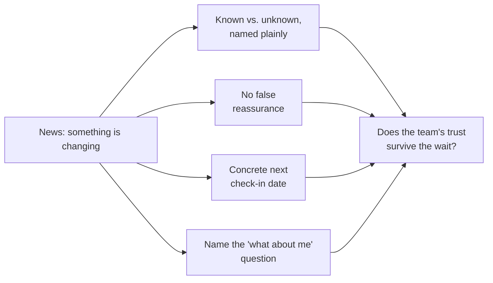

import Scenario from "../../../components/Scenario.astro";
import LevelIntro from "../../../components/LevelIntro.astro";
import PracticeCheck from "../../../components/PracticeCheck.astro";

export const unit = {
  track: "business-communication",
  unitSlug: "change-management",
};

<Scenario label="The problem">
  <Fragment slot="facts">
    

      

        15 → 10
        combined headcount after the merge, 5 roles cut
      

      

        

      

    

    

      
✅ Decided: the two teams merge

      
❓ Not decided: which 5 people. HR finalizes in 9 days

      
👀 Two engineers already spotted a leadership calendar invite titled "Org restructuring"

    

  </Fragment>

Priya Nandakumar manages an 8-person backend team at Fintrail, a payments
startup. Yesterday her director told her, in confidence, that Fintrail is
merging her team with another 7-person team as part of a company-wide
budget cut. Fifteen people become ten: 5 roles will be eliminated. Which 5
is not decided yet. HR and the directors will have names in about 9 days.

This morning, two of her engineers mentioned a leadership calendar invite
titled "Org restructuring — Eng leadership only" and asked her, half-joking,
half-not, if everything is okay.

**Priya cannot share names that do not exist yet, and she was asked to keep
the details confidential until the list is final. But she cannot say
"everything's fine" either. What does she say in the next hour?**

</Scenario>

Saying nothing lets the calendar invite become the whole story, and a rumor
mill fills a silence with the worst plausible version. Saying "your job is
safe" when she does not know that is worse: if it turns out false, she is
not just delivering bad news later, she is delivering it as someone whose
word has stopped meaning anything.

<LevelIntro
  items={[
    "Splitting what is decided from what is not",
    "Why a comforting promise costs more than it buys",
    "Replacing an open-ended wait with a date",
  ]}
/>

## What can Priya say when she does not have the answer?

**If she cannot give names, what is left to say?** More than it seems. The
situation is not one big unknown; part of it is settled and part is open,
and the first job is to say which is which.

- **Change management communication** means telling a team about a
  disruptive, not-yet-fully-decided change (a reorg, layoffs, a merger) in a
  way that keeps their trust in you intact through the wait, not just at the
  moment of the announcement.
- **Known / unknown split:** "The merge is happening. That is decided. Which
  five roles is not decided yet." Blurring the two into "some changes are
  coming" makes the settled part sound as shaky as the open part.

| Fact                           | Status      | What Priya says                         |
| ------------------------------ | ----------- | --------------------------------------- |
| Teams merge, 15 becomes 10     | Decided     | States it plainly                       |
| Which 5 roles are cut          | Not decided | Says it is open, and who decides        |
| When names will exist          | Known       | Gives the date she will share them      |
| Whether any one person is safe | Unknown     | Says she does not know, not "you're ok" |

<PracticeCheck
  track={unit.track}
  unitSlug={unit.unitSlug}
  topicId="known-unknown"
/>

## Why not just reassure them?

**Dev asks "is my job safe?" and Priya wishes she could say yes. Why is that
the one sentence to avoid?**

- **False reassurance** is a comforting claim made without the standing to
  guarantee it. It feels kind for a day and costs far more later.
- If the claim turns out false, the damage is not only the bad news. Priya's
  word stops being reliable on this topic and on the next hard one.
- The honest alternative is not a dodge: "I don't have a list, nobody has
  been ranked, and you will hear the same day I do" is true, useful, and
  something she can stand behind.

<PracticeCheck
  track={unit.track}
  unitSlug={unit.unitSlug}
  topicId="false-reassurance"
/>

## What turns an endless wait into a bearable one?

**Nine days of "I'll tell you when I know" and nine days of "I'll tell you
Friday" contain the same information. Why do they feel so different?**
Because a wait with an edge is easier to carry than one without.

- **Concrete next check-in:** a specific date the team will hear more,
  whatever the news is that day. It replaces "soon."
- **The question everyone has** is "what does this mean for me." Name it out
  loud, even when the honest answer is "I don't fully know yet." Leaving it
  unspoken lets each person answer it privately, usually pessimistically.
- Getting this right does not make the news good. Someone may still lose a
  role. The goal is a team that still trusts Priya's word afterward.

| Term                      | Simple meaning                                                          |
| ------------------------- | ----------------------------------------------------------------------- |
| Uncertainty communication | Talking honestly about what is not decided, without silence or promises |
| False reassurance         | A comforting claim you cannot guarantee                                 |
| Concrete next check-in    | A named date for the next update, replacing an open wait                |

<PracticeCheck
  track={unit.track}
  unitSlug={unit.unitSlug}
  topicId="bounded-wait"
/>
