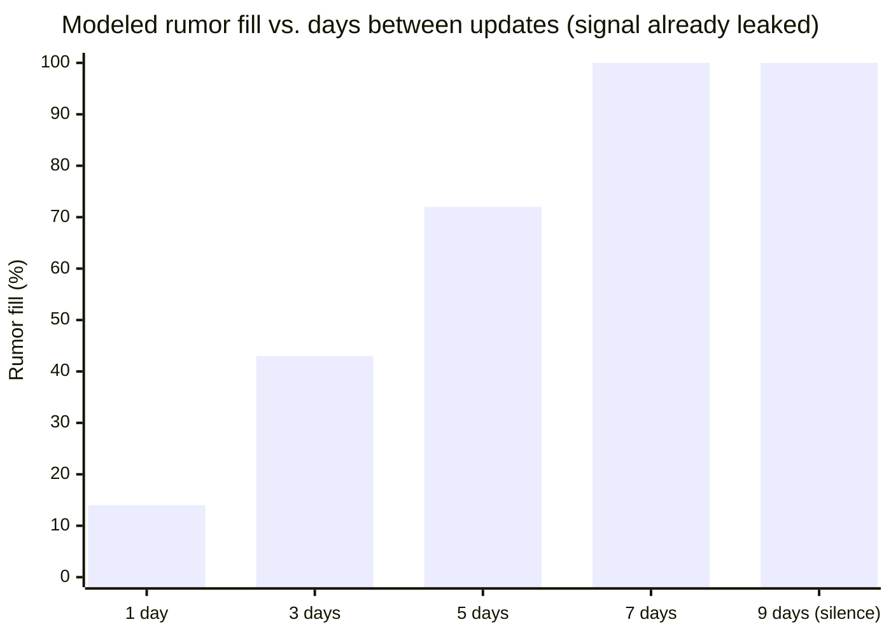
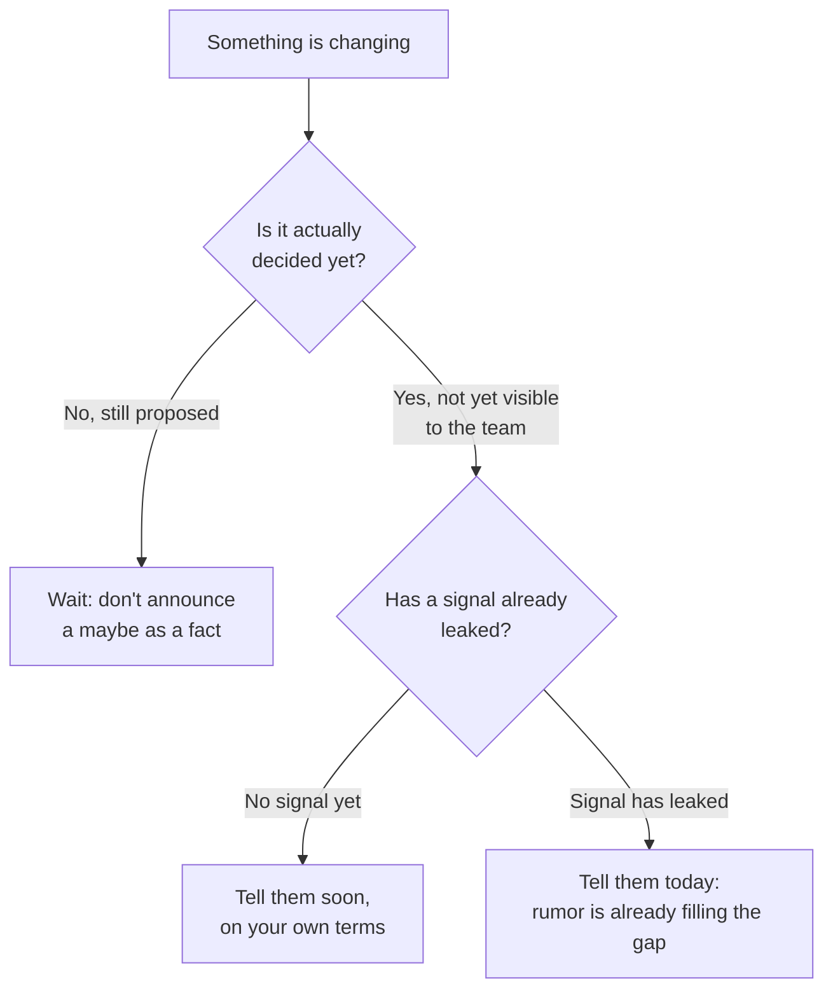

import LevelIntro from "../../../components/LevelIntro.astro";
import Checkpoint from "../../../components/Checkpoint.astro";
import PracticeCheck from "../../../components/PracticeCheck.astro";

export const unit = {
  track: "business-communication",
  unitSlug: "change-management",
};

L1 showed Priya holding a real fact (the teams merge, 5 of 15 roles go, names
in 9 days) while her team has already noticed something is off. L2 works out
why the same facts can hold a team's trust together through the wait or break
it quietly, depending on what Priya says, leaves unsaid, and when.

<LevelIntro
  items={[
    "What a silent wait does to a team",
    "The question behind every question",
    "Timing as a separate decision from wording",
  ]}
/>

## What actually happens during a silent wait?

If Priya has no names, is the honest move to say nothing until she does?
**Before reading on: what does a team do with silence?**

It fills it. A team that notices a signal (a calendar invite, a canceled
all-hands, a closed door) and hears nothing from its manager does not assume
"no news, probably fine." An unexplained gap reads as something being hidden,
and hidden is scarier than almost any specific fact. The rumor that fills the
gap is usually worse than the truth, and Priya cannot correct it if she never
said anything to correct it against.

The interactive demo on this unit lets you drag the gap between updates. The
shape it shows, using this unit's modeled numbers for a team where a signal has
already leaked:

This is a teaching model, not a measurement of any real team. The direction is
the point: the longer the gap, the more the team's own guesses take over, and
the leak makes it faster.

<Checkpoint question="Both 'I'll tell you once I know for certain' and 'something is happening; here is what is decided and when you will hear more' are honest. Why is the first the worse first move once a rumor has started?">

Both are true, but they land differently. "I'll tell you once I know" leaves
the team with only the version the calendar invite already gave them, plus no
sign that Priya has even noticed, which reads as avoidance or inattention. The
second replaces a vacuum with a confirmed, bounded fact: something is happening,
this part is settled, this part is open, and here is when you will know more.
Neither version has names, but only one leaves the team alone with a rumor.

</Checkpoint>

<PracticeCheck
  track={unit.track}
  unitSlug={unit.unitSlug}
  topicId="silence-fills-gap"
/>

## What is every listener really asking?

**Priya explains the merge perfectly. Why do people still leave the room tense?**
Because the question each person came with, "what does this mean for me,"
may not have been touched.

| Move                                   | The failure it prevents                                               | What it sounds like                                                                 |
| -------------------------------------- | --------------------------------------------------------------------- | ----------------------------------------------------------------------------------- |
| Separate known from unknown            | The whole situation reading as one big unknown                        | "The merge is decided. Who ends up where is not."                                   |
| Never promise what you can't guarantee | A later loss of trust if the promise breaks                           | "I don't know if your role is affected" instead of "you're fine"                    |
| Give a concrete next check-in          | An open-ended wait                                                    | "You will hear from me Friday, whatever the news is."                               |
| Name the personal-impact question      | People privately concluding Priya either doesn't know or doesn't care | "I know the question is what this means for your role. Here is what I can say now." |

When the question goes unnamed, each person answers it alone, and a worried
mind answers it pessimistically. Saying it out loud, with an honest "I don't
fully know yet," costs nothing and stops the private versions from forming.
None of the four moves improves the news; they decide whether the team spends
the wait trusting Priya or assuming she is hiding something.

<Checkpoint question="A manager tells the team 'I really don't think anyone here is at risk' before roles are decided, and someone turns out to be affected. What breaks besides the bad news itself?">

The bad news was always coming; that part is not new damage. What is new is that
the manager now delivers it as someone who was wrong on this exact topic in the
reassuring direction, which reads either as not knowing what they were
promising or as saying it anyway to ease an uncomfortable moment. Either read
makes the team wonder whether the next reassurance is real, so the cost lands
on every future hard conversation, not only this one.

</Checkpoint>

<PracticeCheck
  track={unit.track}
  unitSlug={unit.unitSlug}
  topicId="personal-impact"
/>

## When should she say it?

Even with all four moves ready, one question stays open: **when?** Too early,
before the merge is finalized at the director level, and she announces
something that may change, teaching the team that her "confirmed" is not
always confirmed. Too late, after the rumor has hardened into its own story,
and she is correcting a version instead of telling one.

| Situation                                | Right timing       | Why                                                      |
| ---------------------------------------- | ------------------ | -------------------------------------------------------- |
| Still just a proposal                    | Don't announce yet | A maybe announced as fact weakens the word "confirmed"   |
| Decided, no leak                         | Tell them soon     | Hearing it from you first keeps you the trusted source   |
| Decided, and a signal has already leaked | Tell them today    | The gap is already filling; every hour adds to the rumor |

Priya sits in the last row: the merge is decided and a calendar invite has
already been seen. That combination makes "today" right. It is a read of this
situation on the tree, not a rule that managers should announce everything at
once. Perfect wording at the wrong time still lands badly.

<PracticeCheck track={unit.track} unitSlug={unit.unitSlug} topicId="timing" />
