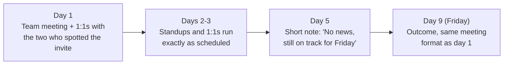

import Scenario from "../../../components/Scenario.astro";
import LevelIntro from "../../../components/LevelIntro.astro";
import Checkpoint from "../../../components/Checkpoint.astro";
import PracticeCheck from "../../../components/PracticeCheck.astro";

export const unit = {
  track: "business-communication",
  unitSlug: "change-management",
};

<Scenario label="The scenario">
  <Fragment slot="facts">
    

      
👩‍💼 <strong>Priya Nandakumar</strong>, manages an 8-person backend team at Fintrail

      
🔀 Merge with a 7-person team: 15 → 10, 5 roles cut

      
❓ Which 5 is undecided; HR finalizes on Friday, 9 days out

      
👀 A leaked "Org restructuring" invite is already circulating

    

  </Fragment>

Same facts as L1 and L2: Priya's team is merging with another as part of a
budget cut, 5 of the combined 15 roles go, and she will not have names for 9
days. A rumor has already started from a leaked calendar invite. L3 walks the
actual nine days: the team meeting, the days between, and the individual
conversations at the end.

**Before reading on, predict: of the nine days, which single moment is the
easiest one to get wrong, and why?**

</Scenario>

<LevelIntro
  items={[
    "The team meeting and the question with no honest yes or no",
    "The quiet middle days and the private conversations at the end",
    "What changes if the audience, the news, or the timeline differs",
  ]}
/>

## Before the meeting: what must be decided in advance?

Beyond "be honest," what does Priya need settled before she speaks? A message
assembled live in front of a nervous team wanders into things she is not ready
to say. So she spends 30 minutes writing down four items:

1. **What is decided, in one plain sentence:** the merge is happening; 15
   becomes 10.
2. **What is not decided, just as plainly:** which five roles, and who fills
   the ten spots.
3. **The one honest thing about impact:** she cannot promise anyone's role is
   safe, and she will share names the same day she gets them.
4. **A specific next check-in:** Friday, nine days out. A named day, said out
   loud in the room, not "soon."

Writing them first means that when someone asks "is my job safe?" she is
repeating a decision she already made, not inventing an answer under pressure.

## What does she say when someone asks the question with no honest yes or no?

She calls a 15-minute meeting for 2pm, the same day the invite was spotted,
and sends a two-line heads-up an hour before: "Want to grab everyone for 15
minutes at 2pm. There's a real update I'd rather share directly than let turn
into a guessing game." No euphemism, so nobody walks in blindsided.

**Priya:** "I want to tell you directly rather than let the calendar invite
turn into speculation. Fintrail is merging our team with the Ledger team into
one team of 10. That part is decided. What's not decided is which 10 people,
out of the 15 of us combined. HR is finalizing that, and I'll have real names
on Friday, nine days from today."

**Dev:** "So... is my job safe?"

**Priya:** "I'm not going to say 'don't worry' when I genuinely don't know that
yet. I'd rather you trust what I tell you than feel better for a day. What I
can say is: I don't have a list, I haven't been asked to rank anyone, and the
moment I know anything, you'll know it the same day. I know that's not the
answer you wanted. It's the honest one."

**Lin:** "What happens between now and Friday?"

**Priya:** "Work continues as normal. I need the Q3 migration on track whatever
the org chart does, and staying focused will make nine days easier than
waiting would. I'll check in with everyone Friday, whatever the news is. If
something changes before then, you hear it when I do."

| Moment              | What Priya does                                          | What it prevents                         |
| ------------------- | -------------------------------------------------------- | ---------------------------------------- |
| Opening             | Names the decided part without hedging                   | The merge sounding as shaky as the names |
| Names the open part | Says "not decided" without minimizing it                 | A later "you said it was settled"        |
| Dev's question      | Refuses the comforting lie, gives something true instead | A promise she might have to walk back    |
| Lin's question      | Gives a date and something to focus on                   | Open-ended anxiety                       |

<Checkpoint question="Dev asks 'is my job safe?' and Priya answers with what she does and does not know instead of yes or no. Why is that a real answer and not a dodge?">

She has no information that would justify a yes, and a no would alarm people
over something undecided. What she offers (no list exists, nobody has been
ranked, Dev hears the same day she does) is the most complete accurate answer
available, delivered as itself instead of forced into a yes/no shape it does
not fit. Declining to promise an outcome you do not control is not the same as
declining to answer.

</Checkpoint>

<PracticeCheck
  track={unit.track}
  unitSlug={unit.unitSlug}
  topicId="unanswerable-question"
/>

## What does she do on a day when nothing has changed?

The meeting starts the wait; it does not end it. What she does next decides
whether Friday lands as a kept promise or one more slipped date.

The day-5 note matters more than it looks. Nothing happened, and that is the
point. A team hearing nothing for nine straight days starts to wonder whether
Friday will hold. The note costs two minutes. In the unit's model, splitting
the nine-day gap in half moves the rumor fill from the silent-wait ceiling
down to the 5-day figure shown in L2.

<Checkpoint question="On day 5 nothing has changed. Why does Priya send an update anyway instead of waiting for real news?">

"Nothing has changed" is information the team does not have unless she says it.
Without the note, silence between day 1 and day 9 is ambiguous: nothing
happened, or something did and she has not shared it. A team primed by a
leaked invite tends to assume the second. The note is not news; it keeps the
day-1 promise visibly alive during the stretch where it is easiest to doubt.

</Checkpoint>

<PracticeCheck
  track={unit.track}
  unitSlug={unit.unitSlug}
  topicId="nothing-new-update"
/>

## Friday: who hears what, and in what order?

HR confirms the list. Two of the five eliminated roles are on Priya's team:
one is absorbed into the Ledger team's structure (the person stays, the title
changes), and one is a genuine layoff, an engineer named Sam whose
specialization does not map onto the merged team.

Priya talks to Sam privately, before the group meeting. A specific person's
job ending should never be first delivered as one line in a group readout,
where Sam learns it at the same instant as everyone else with no privacy to
react. Then she runs the group meeting as promised: what is final, what it
means structurally, and what support exists (severance, a stated reference
policy, time to process before sprint planning).

The seven teammates who keep their jobs still get a short individual 1:1 each.
**Why does "you're safe" need its own private conversation when everyone heard
it together?** Relief delivered in a group lands as procedural. Delivered
individually, "I know the last nine days were hard to sit with, and I wanted
to tell you directly" lands as being seen. These are the people she needs
engaged through the months of merging two teams' workflows.

<Checkpoint question="What would go wrong if Priya announced the final list to everyone at once and let Sam find out with the group?">

Sam would lose their role in the same moment as everyone else, with no privacy
to react, ask questions, or take it in before sitting through the rest of the
meeting in front of colleagues. It would also flatten the hardest, most
individual piece of news into a line in an org-chart update. A private
conversation first lets Sam respond honestly and lets Priya talk with them
instead of at them before the group convenes.

</Checkpoint>

<PracticeCheck
  track={unit.track}
  unitSlug={unit.unitSlug}
  topicId="private-first"
/>

## Extend it: what changes if the details are different?

This sequence worked because Priya had a real decided fact to anchor on, a date
she could keep, and leadership that let her speak early. It is one worked
case, not the whole territory. Try extending it before moving on.

**What if the audience were 40 people in an all-hands instead of 8 in a small
room?** The four moves still apply, but the individual follow-up does not
scale the same way in one afternoon. What would change about the format of the
follow-up, not the content of the message, so people still get something more
than a line in a mass email?

**What if the news were worse: the whole team dissolving, every role ending on
the same date?** The unknown disappears, so "name the personal-impact question"
changes shape. Is that easier or harder than Priya's nine days of real
uncertainty, and what does a "concrete next check-in" mean when there is no
decision left to wait for?

**What if HR said the date might slip?** Which of the four moves is under the
most pressure, and what does Priya now say about the date she already
promised?

None of these has one clean answer. The four moves are a starting shape for
uncertain, disruptive news, not a script that reproduces Priya's nine days in
every situation.

<PracticeCheck
  track={unit.track}
  unitSlug={unit.unitSlug}
  topicId="adapt-to-context"
/>
