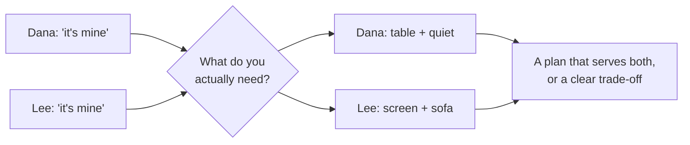

import Scenario from "../../../components/Scenario.astro";
import LevelIntro from "../../../components/LevelIntro.astro";
import PracticeCheck from "../../../components/PracticeCheck.astro";

export const unit = {
  track: "business-communication",
  unitSlug: "conflict-resolution",
};

<Scenario label="Two housemates, one living room, Friday night">
  <Fragment slot="facts">
    

      
📚 <strong>Dana</strong> — "The living room is mine tonight. I booked it for my study group."

      
🎬 <strong>Lee</strong> — "It's mine. I've lived here longest and it's movie night."

      
🔎 <strong>Underneath</strong> — Dana needs a big table and quiet; Lee needs a big screen

      
🗣️ <strong>Stated claims</strong> — identical: "it's mine"

    

  </Fragment>

Dana and Lee share a flat with one living room. On Friday evening, Dana
says the room is hers because she booked it for a study group. Lee says it
is his because he has lived there longest and it is movie night. Both
raise their voices, and both are sure the other is the one being
unreasonable. Neither is lying about caring. **If they keep arguing about
who the room belongs to, will they ever get to the thing that actually
matters to each of them?**

</Scenario>

<LevelIntro
  items={[
    "Positions versus interests",
    "Why ownership claims hide the real need",
    "What an escalation path is for",
  ]}
/>

## What are they really fighting over?

Dana says "it's mine" and Lee says "it's mine". Those two sentences are
identical, yet the needs behind them are not.

| What each says (position) | What each needs (interest)               |
| ------------------------- | ---------------------------------------- |
| Dana: "The room is mine." | A large table and a quiet space to study |
| Lee: "The room is mine."  | A big screen and a sofa for friends      |

The stated claim is a **position**. The need behind it is an **interest**.
Two incompatible positions can sit on top of interests that do not collide
at all: Dana could study at the dining table with the door closed while
Lee uses the screen in the living room, or they could swap rooms.

<PracticeCheck
  track={unit.track}
  unitSlug={unit.unitSlug}
  topicId="position-vs-interest"
/>

## What if talking does not settle it?

Suppose both need the exact same thing, such as the only quiet room on the
night before two exams. Talking more will not create a second quiet room.
At that point the housemates need someone with the authority to decide,
for example the landlord, or a house meeting everyone agreed to respect in
advance. That agreed route is an **escalation path**: a named decider, a
forum, and a clear question to settle.

Without one, the argument either gets avoided until resentment builds, or
it blows up personally ("I'm telling the landlord what you did"), which
hurts a relationship the two still have to live with.

<PracticeCheck
  track={unit.track}
  unitSlug={unit.unitSlug}
  topicId="escalation-path-basics"
/>

## The same shape at work

| Housemates version         | Workplace version                                       |
| -------------------------- | ------------------------------------------------------- |
| One living room            | One shared service two teams both depend on             |
| "It's mine"                | "We own this service"                                   |
| Table and quiet vs. screen | Reviewed, stable changes vs. predictable shipping speed |
| House meeting or landlord  | A named director or a standing decision forum           |

At work the stakes are higher, because a clash can mean a production
incident, as when two teams ship conflicting changes to the same service
in the same week. The reasoning is unchanged: separate the claim from the
need, look for a design that serves both needs, and escalate only the
trade-off that is truly left.

## Key terms

- **Position** — the specific thing someone says they want or are entitled
  to ("it's mine", "we own this service").
- **Interest** — the underlying need that drives the position.
- **Ownership ambiguity** — more than one party has a legitimate claim and
  nobody has documented who decides.
- **Escalation path** — an agreed route to a person or forum with the
  authority to make a binding call when direct talks cannot resolve it.
- **Trade-off** — a choice where serving one interest costs another.

## What this unit covers

L2 explains why naming interests unlocks solutions, and what separates a
real escalation path from a complaint sent upward. L3 follows two teams
through a full conversation that finds a design, then a second dispute that
genuinely needs a decider.

The practical path:

1. Name each side's position without mocking it.
2. Ask what each side needs to be true underneath it.
3. Look for an option that serves both needs.
4. Escalate only the real trade-off that remains, with both interests named.
