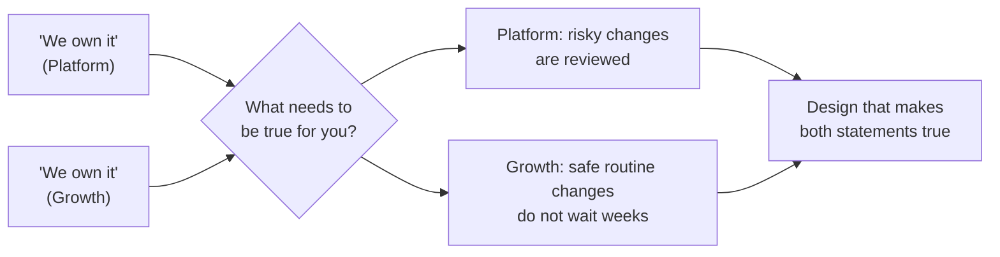

import Checkpoint from "../../../components/Checkpoint.astro";
import LevelIntro from "../../../components/LevelIntro.astro";
import PracticeCheck from "../../../components/PracticeCheck.astro";

export const unit = {
  track: "business-communication",
  unitSlug: "conflict-resolution",
};

L1 used two housemates to show that "it's mine" is a position sitting on top
of a need. L2 moves to the workplace version, where Platform and Growth
both say "we own the notification service", and works through why naming
interests unlocks a solution and what separates a real escalation path from
a complaint sent upward.

<LevelIntro
  items={[
    "Positions vs. underlying interests",
    "Designing instead of picking a winner",
    "What makes an escalation path effective",
  ]}
/>

## Why is "who owns it" usually the wrong fight?

**If both teams insist they own the service, is there a real conflict
underneath?** Possibly, but ownership is rarely what is at stake. It is a
position both teams defend because the interests under it have not been
named:

| Team's position                   | Underlying interest                                                  |
| --------------------------------- | -------------------------------------------------------------------- |
| "We own this service." (Platform) | Changes are reviewed so reliability and on-call load stay manageable |
| "We own this service." (Growth)   | Experiments ship on a predictable schedule, not behind another queue |

**Do these two interests actually conflict?** Not necessarily. Platform
wants _review_ and Growth wants _speed_. A design that gives Growth a fast
self-service path inside guardrails Platform set in advance could serve
both, and nobody wins the ownership argument. That design stays invisible
as long as both sides keep arguing about the position.

<Checkpoint question="Platform says 'we own this service' and Growth says 'we own this service.' Does that mean their actual interests are in conflict too?">

Not necessarily. A position is the claim each team defends out loud, and two
positions can sound directly opposed while the interests behind them barely
touch. Platform cares about controlling risk through review, and Growth
cares about not being stuck in a queue. Those are different concerns, not
one claim stated twice. Treating the positions as the real fight is what
makes the dispute look zero-sum when it may not be.

</Checkpoint>

<PracticeCheck
  track={unit.track}
  unitSlug={unit.unitSlug}
  topicId="interests-not-conflicting"
/>

## What question replaces "whose is it?"

**If arguing about ownership does not work, what does?** Ask what each side
needs to be true for the arrangement to work. That turns a zero-sum claim
into a design problem both can work on.

Sometimes interests genuinely conflict and a real trade-off remains. Even
then, naming them makes the trade-off explicit and negotiable, instead of an
unexplained outcome where one team simply lost and resents it.

## What makes an escalation path effective?

**If two teams cannot resolve something, is going to a manager always the
fix?** Only if the route is defined: a specific person or forum with real
authority to decide, a rule for when it is appropriate to use, and an
expectation that both sides bring interests, not grievances. An ad hoc "I'll
email your manager" feels personal and adversarial.

A good escalation packet is small and concrete:

| Field          | What to write                                            |
| -------------- | -------------------------------------------------------- |
| Decision-maker | The person or forum with authority to decide             |
| Exact question | The one trade-off that remains unresolved                |
| Interest A     | What one side legitimately needs                         |
| Interest B     | What the other side legitimately needs                   |
| Deadline       | When the decision is needed and what happens if it waits |

For more on naming who decides, see `decision-making-frameworks`.

<Checkpoint question="A team lead is frustrated and messages the other team's manager: 'your team keeps overstepping.' Is this an escalation path?">

No, and the difference shapes what happens next. A real path names a
decision-maker in advance, hands that person one unresolved question instead
of a complaint, and states both sides' legitimate interests so they can be
weighed. The ad hoc message skips all of that. It hands over a grievance
instead of a decision, which lands as personal and adversarial, and it
damages a relationship between teams that still have to work together.

</Checkpoint>

<PracticeCheck
  track={unit.track}
  unitSlug={unit.unitSlug}
  topicId="effective-escalation"
/>

## Failure modes at this level

| Failure mode                                   | Why it hurts                                                                              |
| ---------------------------------------------- | ----------------------------------------------------------------------------------------- |
| Treating ownership as a prize to win           | The losing side's real interest is unaddressed, so the same conflict resurfaces later     |
| Escalating before naming interests aloud       | The path is spent on something the teams might have solved directly                       |
| Informal complaining instead of a defined path | The decision is one-sided and poorly informed, and the relationship between teams suffers |
