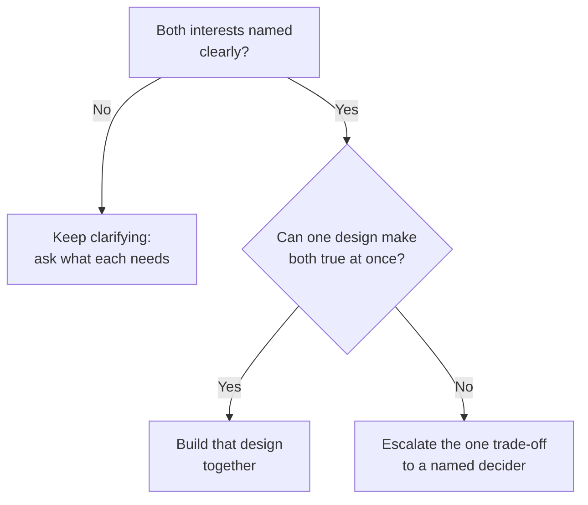

import Scenario from "../../../components/Scenario.astro";
import Checkpoint from "../../../components/Checkpoint.astro";
import LevelIntro from "../../../components/LevelIntro.astro";
import PracticeCheck from "../../../components/PracticeCheck.astro";

export const unit = {
  track: "business-communication",
  unitSlug: "conflict-resolution",
};

<Scenario label="Platform and Growth, three days after the incident">
  <Fragment slot="facts">
    

      
🛠️ <strong>Platform</strong> — maintains the notification service; fears unreviewed changes

      
📈 <strong>Growth</strong> — ships onboarding experiments; fears waiting in a queue

      
💥 <strong>Trigger</strong> — two conflicting changes collided in production the same week

      
❓ <strong>Later question</strong> — who is on call at 2am when it breaks?

    

  </Fragment>

Platform and Growth both believe they own the notification service, and
their changes collided in production. Three days later the two team leads sit
down together. They will face two disputes: one that a conversation can
solve, and one that cannot be solved by conversation at all. **How do you
tell, in the moment, which kind you are in?**

</Scenario>

L2 gave the vocabulary: positions, interests, and a well-defined escalation
path. L3 plays both disputes out in full so you can see each ending done
well.

<LevelIntro
  items={[
    "An interest-based conversation, in full",
    "A design that serves both interests",
    "Spotting a trade-off that needs a decider",
  ]}
/>

## What does asking about interests sound like?

**What does the opening move look like when you drop "who owns it"?**

> Platform lead: "Before we talk about who owns what, can I ask what you
> needed from this service that made this week's change urgent?"
>
> Growth lead: "We have to ship onboarding experiments on our own timeline.
> I don't care who reviews the code. I just can't wait two weeks in a queue."
>
> Platform lead: "That helps. My worry isn't who makes changes. Unreviewed
> changes to this service have taken down onboarding twice this year. If you
> could ship fast inside guardrails we had already checked, would that work?"

| Less useful                                       | More useful                                                     |
| ------------------------------------------------- | --------------------------------------------------------------- |
| "You keep overstepping and breaking our service." | "What did you need that made the change urgent?"                |
| "We own it, so stop touching it."                 | "My real concern is unreviewed changes taking onboarding down." |

**What did this surface that "who owns it" never would?** Neither lead wanted
their name on the service. Platform wanted risk control and Growth wanted
shipping speed. A design question replaced an ownership argument.

<Checkpoint question="In the exchange above, the Platform lead never says 'we own this service.' Has Platform given up its stake?">

No. Naming an interest instead of a position makes the stake usable rather
than abandoning it. The concern about unreviewed changes taking down
onboarding is just as real as the ownership claim, but unlike "we own it",
Growth can design around it. Dropping the position does not mean dropping the
concern. It means stating the concern in a form the other side can respond to
instead of only refuting.

</Checkpoint>

<PracticeCheck
  track={unit.track}
  unitSlug={unit.unitSlug}
  topicId="interest-conversation"
/>

## What design could serve both interests?

**Given both interests, what concrete arrangement satisfies them?**

> Platform lead: "What if we define a small set of pre-approved experiment
> types, safe changes within known limits, that your team ships without a
> review each time? Anything outside that set still needs our sign-off."
>
> Growth lead: "That covers most of what we ship. For the rest, a review queue
> is fine if it's fast."

This is not a compromise where each side gets half. Platform keeps reliable
guardrails and Growth keeps mostly unblocked shipping, because the
conversation found what each side needed. In plain terms, Growth makes small
changes that were already approved as safe, and Platform reviews the unusual
or risky ones. That differs from both "Growth can do anything" and "Platform
blocks everything".

<PracticeCheck
  track={unit.track}
  unitSlug={unit.unitSlug}
  topicId="design-satisfies-both"
/>

## When does the same approach hit a wall?

**A month later: who is on call when the service breaks at 2am? Does the same
approach solve it?** Not by itself. Both teams legitimately do not want to be
on call for a system they do not control end to end, and no arrangement lets
both teams be off the rota at once. This is a genuine trade-off, so
escalation is the correct outcome of the conversation, not a failure of it.

> Platform lead: "I don't think the two of us will settle on-call ownership.
> We both have a real case, and someone who sees both teams' wider load
> should decide. Can we take it to Priya, the engineering director, at next
> week's staff sync, with both cases laid out?"

**Why does this escalation work?** It names a person with real authority, a
forum that already exists, and an agreement that both sides present interests
instead of complaints. Priya is asked to make one well-framed decision, not to
referee a personality clash.

<Checkpoint question="The on-call dispute sounds much like the shipping-speed one: two teams, two interests. Why does one get resolved by conversation and the other by escalation?">

The difference is not how the dispute sounds but whether a single design can
make both interests true at once. For shipping, pre-approved experiment types
let Growth move fast while Platform kept its guardrails. For on-call there is
no equivalent, because only one team can hold the rotation. When no design can
satisfy both, more conversation just repeats the standoff. That is the signal
to escalate, and it does not mean the leads negotiated badly.

</Checkpoint>

<PracticeCheck
  track={unit.track}
  unitSlug={unit.unitSlug}
  topicId="genuine-tradeoff-escalation"
/>

## What generalizes, and what does not?

The core lesson holds for almost any cross-team disagreement, such as budget,
roadmap priority or shared infrastructure: positions create false zero-sum
fights, naming interests often reveals a design that serves both, and a
defined escalation path is a normal tool for real trade-offs.

This worked example is a case, not the whole territory. The pre-approved list
solves _this_ pair of interests (risk control vs. shipping speed). A different
conflict needs a design built from its own interests, not this one copied
over.

**Try extending it yourself.** If a third team also depended on this service
with a third set of interests, would the two-team pre-approved list still
work as is? What if the news were worse and Platform's real interest turned
out to be headcount, not reliability? Would interests still be the right
frame, and what would you ask first? The `reading-stakeholder-incentives`
unit is a natural next step when more than two parties or hidden incentives
are involved.

## Failure modes

| Failure mode                                                          | What it gets wrong                                                                                             |
| --------------------------------------------------------------------- | -------------------------------------------------------------------------------------------------------------- |
| Escalating the shipping-speed dispute without naming interests first  | Spends the path on something the teams could likely have solved directly                                       |
| Treating the on-call dispute as something more conversation could fix | Some disputes are real trade-offs, and pushing more talk delays the decision that is actually needed           |
| Bringing only complaints, not interests, to the escalation forum      | A decider asked to referee "they're being difficult" has far less to work with than one weighing two interests |
| Treating the interest-based design as final and permanent             | Interests change as teams and priorities evolve, so the design may need revisiting                             |
