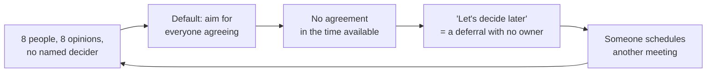

import Scenario from "../../../components/Scenario.astro";
import LevelIntro from "../../../components/LevelIntro.astro";
import PracticeCheck from "../../../components/PracticeCheck.astro";

export const unit = {
  track: "business-communication",
  unitSlug: "decision-making-frameworks",
};

<Scenario label="Eight friends, 45 minutes, and no destination">
  <Fragment slot="facts">
    

      
👥 <strong>Group</strong> — 8 friends planning one weekend trip, all with a favorite

      
⏱️ <strong>First call</strong> — 45 minutes, ends with "let's think about it and decide later"

      
🔁 <strong>Two weeks later</strong> — the same 45-minute argument happens again, from scratch

      
❓ <strong>Missing piece</strong> — nobody was ever asked to make the final call

    

  </Fragment>

Eight friends get on a call to pick where to spend a long weekend. Everyone
has a favorite, the conversation is friendly and thoughtful, and 45 minutes
later it ends with "let's think about it and decide later." Two weeks on, a
second call covers the same ground: same options, same pros and cons, same
favorites, because nothing was decided the first time. **Nobody on that call
was unprepared or unreasonable. So what was missing that would have let the
same conversation end in a decision instead of a rerun?**

</Scenario>

<LevelIntro
  items={[
    "Why a room full of opinions isn't a decision",
    "What a decision framework answers up front",
    "DACI for one call, RACI for ongoing work",
  ]}
/>

## Why does a group with opinions still decide nothing?

- A room full of people with opinions is not the same as a room with someone
  whose job is to _decide_. When that is never said out loud, the group
  quietly defaults to needing agreement from everyone, and agreement among
  eight people with different priorities rarely arrives in 45 minutes.
- "We'll figure it out" is not a decision. It is a deferral, and a deferral
  with no owner does not pick itself back up. It waits for someone to schedule
  another meeting, and the same people re-argue the same points.
- A **decision-making framework** answers one question before the discussion
  starts: who will actually make this call, and who only needs to give input
  or hear the result afterward?

The same pattern shows up at work, where the group might be picking a
software vendor or a launch date instead of a destination. The mechanics are
identical: a group without a named decider produces discussion, not outcomes.

<PracticeCheck
  track={unit.track}
  unitSlug={unit.unitSlug}
  topicId="why-no-decision"
/>

## What are the two frameworks, in one table?

| Term                            | Plain meaning                                                                     |
| ------------------------------- | --------------------------------------------------------------------------------- |
| **DACI**                        | Roles for one decision: Driver, Approver, Contributors, Informed                  |
| **RACI**                        | Roles for ongoing work: Responsible, Accountable, Consulted, Informed             |
| **Decision rights**             | An explicit statement of who has authority to make a specific call                |
| **Diffusion of responsibility** | When a call belongs to "the group", so everyone assumes someone else will make it |
| **Deferral**                    | Postponing the decision instead of making it                                      |

- **DACI**: the **D**river runs the process and gathers input, the
  **A**pprover is the one person who decides, **C**ontributors give input but
  do not decide, and the **I**nformed are told the outcome afterward.
- **RACI**: **R**esponsible people do the work, the **A**ccountable person
  answers for the outcome, **C**onsulted people give input along the way, and
  **I**nformed people are kept in the loop.
- DACI is for deciding one thing. RACI is for dividing responsibility across
  ongoing work.

Meetings feel like they decide nothing when nobody knows who has both
permission and responsibility to decide.

<PracticeCheck
  track={unit.track}
  unitSlug={unit.unitSlug}
  topicId="daci-raci-defined"
/>

## What the next levels cover

L2 works through DACI and RACI role by role, shows a RACI matrix, explains
when each framework fits, and traces how a decision moves from input to
outcome. L3 reruns an eight-person decision with DACI roles assigned and
counts the person-minutes saved, then examines how the setup fails when roles
are named badly.
