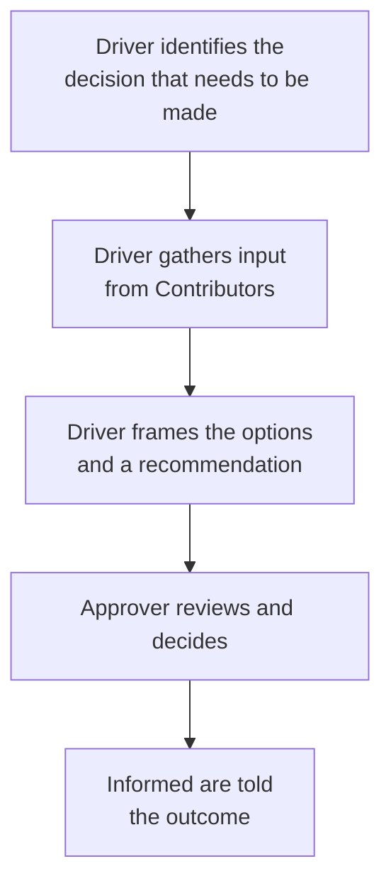

import LevelIntro from "../../../components/LevelIntro.astro";
import Checkpoint from "../../../components/Checkpoint.astro";
import PracticeCheck from "../../../components/PracticeCheck.astro";

export const unit = {
  track: "business-communication",
  unitSlug: "decision-making-frameworks",
};

L1 established that the weekend-trip calls failed because nobody had both
permission and responsibility to decide. L2 works through the two frameworks
that fix that, DACI and RACI, role by role, and then follows a decision from
first input to final outcome.

<LevelIntro
  items={[
    "The four DACI roles and what each does",
    "RACI roles, a matrix, and when each fits",
    "How a decision moves from input to outcome",
  ]}
/>

## DACI: how do many voices become one decision?

**If a decision needs input from many people but a final call from one, how
does DACI split that up?**

| Role             | What they do                                                              | What they don't do                                             |
| ---------------- | ------------------------------------------------------------------------- | -------------------------------------------------------------- |
| **D**river       | Runs the process: gathers input, frames the options, drives toward a call | Doesn't have to be the one who decides                         |
| **A**pprover     | The one person who makes the actual decision                              | Doesn't need to personally gather all the input first          |
| **C**ontributors | Give input and expertise before the decision is made                      | Don't get a vote; their input shapes the call, doesn't make it |
| **I**nformed     | Told the outcome once it's made                                           | Don't weigh in beforehand at all                               |

The critical property is that exactly **one** person is the Approver. Not a
committee, not "the group": one name. That single point of accountability is
what a consensus-seeking meeting is missing by default. A committee can
advise, but if the committee is the Approver, nobody knows who is supposed to
end the discussion.

<Checkpoint question="A group decides the Approver for its next decision should be 'everyone on the team' so nobody feels left out. What goes wrong with that setup?">

It stops being DACI in any way that matters. The reason to name an Approver is
a single, named point of accountability, and making the whole group the
Approver brings back the diffusion of responsibility that sank the original
calls. If everyone is accountable, in practice no one is, and the group again
needs near-unanimous agreement to move, which is exactly what a real Approver
exists to avoid.

</Checkpoint>

<PracticeCheck
  track={unit.track}
  unitSlug={unit.unitSlug}
  topicId="daci-roles"
/>

## RACI: what is it for if DACI already assigns roles?

**DACI covers one decision. What covers the dozens of tasks in a long
project?** RACI tracks who does what across ongoing work, usually as a
matrix with tasks down the side and people across the top:

| Task (organizing a club fundraiser) | Ana | Ben | Cleo | Dev |
| ----------------------------------- | --- | --- | ---- | --- |
| Book the venue                      | A   | R   | C    | I   |
| Sell tickets                        | I   | C   | A, R | R   |
| Arrange food                        | C   | A   | I    | R   |
| Thank-you notes afterward           | I   | I   | A, R | I   |

Read a row left to right: for "Book the venue", Ben does the work (**R**),
Ana answers for it (**A**), Cleo is asked for input (**C**), and Dev is just
kept updated (**I**). Each row should have exactly one **A**.

| Role            | What it tracks                                                     |
| --------------- | ------------------------------------------------------------------ |
| **R**esponsible | Who actually does the work                                         |
| **A**ccountable | Who answers for whether it got done correctly (ideally one person) |
| **C**onsulted   | Who's asked for input while the work is happening                  |
| **I**nformed    | Who's kept updated, without needing to weigh in                    |

RACI's Accountable and DACI's Approver are similar in spirit, a single named
owner, but RACI is built for a matrix of many tasks over time, while DACI is
built for one decision with a clear before and after. Using RACI to force one
meeting to a conclusion, or DACI to track a quarter-long project's task
ownership, is reaching for the wrong tool.

| Situation                            | Better fit | Why                                        |
| ------------------------------------ | ---------- | ------------------------------------------ |
| Choose a logging vendor for the team | DACI       | One decision needs a final call            |
| Decide a product launch date         | DACI       | Input matters, but one person must approve |
| Run weekly support operations        | RACI       | Ongoing work needs responsibility by task  |
| Maintain a recurring review process  | RACI       | People need stable roles over time         |

<Checkpoint question="A team lead wants to use DACI to track who is responsible for each part of a quarter-long migration project with dozens of ongoing tasks. Why is that the wrong tool, and what fits better?">

DACI is built for a single decision with a clear before and after, one moment
where an Approver makes a call. A quarter-long migration is not one decision;
it is an ongoing set of tasks, each needing its own owner over time. That is
what RACI is for: Responsible and Accountable assigned per task, with
Consulted and Informed showing who else is involved. DACI would try to squeeze
a continuing project into a decide-and-done shape it does not have.

</Checkpoint>

<PracticeCheck
  track={unit.track}
  unitSlug={unit.unitSlug}
  topicId="raci-vs-daci-fit"
/>

## How does a decision actually move under DACI?

**If the Approver is the only one who decides, are the Driver and Contributors
irrelevant until the end?** No. The Driver's whole job happens _before_ the
Approver has to decide:

Notice what is _not_ in this flow: a live debate where everyone argues
together until agreement emerges. Contributor input is gathered, often
individually and often asynchronously, before the Approver weighs anything in
real time. That is what makes the decision moment fast: the hard part,
surfacing the trade-offs, is already done.

**And if nobody assigns roles at all?** The meeting defaults to something
close to consensus among everyone present, which takes real time among people
with different priorities or never converges. "Let's take this offline" then
is not a decision mechanism; it is the meeting quietly declining to produce
one and handing the problem, undiminished, to whoever schedules the next one.

Before the meeting, the Driver should be able to fill in this checklist:

| Question               | Answer needed before the meeting starts          |
| ---------------------- | ------------------------------------------------ |
| What exact decision?   | The specific call, not the general topic         |
| Who approves?          | One named Approver                               |
| Who contributes input? | Only people whose expertise changes the decision |
| Who is only informed?  | People who need the outcome, not live debate     |
| What summary goes out? | Decision, reason, trade-off, next step           |

<Checkpoint question="Under DACI, a Contributor sends the Driver detailed concerns the day before the decision meeting. Where does that input do its work, and why does the meeting itself get shorter because of it?">

The input does its work in the Driver's framing: the Driver folds the concern
into the options and the recommendation, so the Approver sees the trade-off
already laid out. Because surfacing disagreements happened beforehand and in
writing, the meeting does not have to discover them live. What remains is
review and a decision, which is why the same group takes far less time than it
would arguing from a blank page.

</Checkpoint>

<PracticeCheck
  track={unit.track}
  unitSlug={unit.unitSlug}
  topicId="daci-flow"
/>
