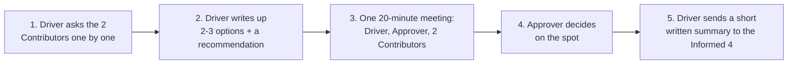
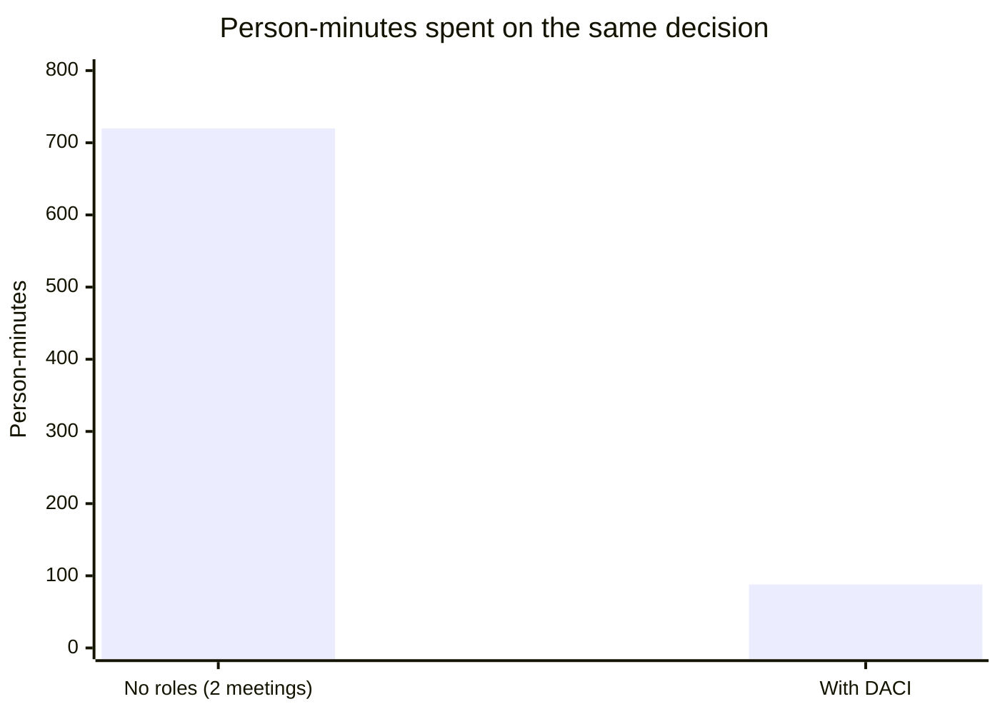

import Scenario from "../../../components/Scenario.astro";
import LevelIntro from "../../../components/LevelIntro.astro";
import Checkpoint from "../../../components/Checkpoint.astro";
import PracticeCheck from "../../../components/PracticeCheck.astro";

export const unit = {
  track: "business-communication",
  unitSlug: "decision-making-frameworks",
};

<Scenario label="Same 8 people, same decision, two very different processes">
  <Fragment slot="facts">
    

      
🔴 <strong>No roles</strong> — 8 people, 2 full 45-minute meetings, still no decision: 720 person-minutes

      
🟢 <strong>With DACI</strong> — 1 focused meeting, a decision, and everyone else reads a short summary

      
🎯 <strong>Goal</strong> — assign the actual roles, then count what changes

    

  </Fragment>

An eight-person club committee must choose a venue for its annual dinner.
The first attempt was two 45-minute meetings with everyone present, and it
ended with no venue booked. Each meeting cost `8 x 45 = 360` person-minutes,
so the pair cost 720, or 12 person-hours, for nothing. **If a DACI structure
only needs a focused group of 4 in the room and lets the other 4 read a
2-minute summary afterward, roughly how much of that 720 would survive?**

</Scenario>

<LevelIntro
  items={[
    "Assigning DACI roles to the real committee",
    "What changes about the process itself",
    "Counting person-minutes saved, and where it breaks",
  ]}
/>

## Who gets which role, and why?

| Role         | Who                                                        | Why                                                                        |
| ------------ | ---------------------------------------------------------- | -------------------------------------------------------------------------- |
| Driver       | The member who first proposed changing venues              | Already did the initial research, so a natural fit to run the process      |
| Approver     | The committee chair                                        | Owns the budget and the final say on event logistics                       |
| Contributors | 2 members who have organized dinners at the top two venues | Their firsthand knowledge of real trade-offs is what the decision needs    |
| Informed     | The remaining 4 committee members                          | Affected by the outcome, but their input isn't what the decision hinges on |

Nothing here says the other 4 members' opinions do not matter. It says their
input is not the _deciding_ factor, and being told the outcome with the
reasoning serves them as well as sitting through a live debate would have.

<Checkpoint question="One of the 4 Informed members complains they were left out of the decision entirely. Based on what the Informed role actually is, is that complaint accurate?">

Not quite, because being Informed is not the same as being left out. The role
exists so that people who do not need to shape the decision still receive the
outcome and the reasoning, instead of hearing it secondhand or not at all.
What they did not get was a seat in the live debate, since their input was not
what the decision hinged on. A short written summary is still owed to them,
and skipping it would be a real failure of the process rather than a feature
of the role.

</Checkpoint>

## What does the process look like step by step?

1. The Driver gathers input from the 2 Contributors individually, before
   scheduling anything.
2. The Driver frames 2 or 3 concrete options with trade-offs and brings a
   recommendation.
3. A single focused meeting of 4 people reviews the framing.
4. The Approver decides in that meeting, because the hard part already
   happened beforehand.
5. The Driver sends the Informed 4 the decision and the reasoning. No meeting
   is needed for them.

<PracticeCheck
  track={unit.track}
  unitSlug={unit.unitSlug}
  topicId="roles-and-informed"
/>

## How much time does that actually save?

A **person-minute** is one person spending one minute. A meeting's cost grows
with people and time, not only clock time.

| Version             | Who's involved                                                   | Time per person | Total (person-minutes) |
| ------------------- | ---------------------------------------------------------------- | --------------- | ---------------------- |
| No roles (original) | All 8, twice (45-minute meetings)                                | 90 min each     | **720**                |
| With DACI           | 4 in the decision meeting (20 min) + 4 reading a summary (2 min) | 20 min / 2 min  | **88**                 |

Check: `4 x 20 + 4 x 2 = 80 + 8 = 88` person-minutes. The reduction is
`(720 - 88) / 720 = 632 / 720`, about 88%, and this version actually ends
with a decision.

One honest caveat: the 88 counts only the meeting and the summary. The Driver's
one-on-one conversations and write-up also cost time. If we assume 60 extra
minutes of preparation in total, the DACI version costs 148 person-minutes,
still about a 79% reduction (`572 / 720`). The saving survives the correction
because the expensive part was never the preparation; it was 8 people
repeatedly sitting through a conversation that most of them did not need to
shape.

<Checkpoint question="The no-roles version and the DACI version involve the same 8 people and the same decision. What actually produced most of the savings: people talking faster, or something else?">

Something else. Nobody talked faster. What changed is how many people's time a
single decision consumed. Instead of all 8 sitting through two full meetings,
only 4 needed a real meeting, and even that one was short because the input
gathering and trade-off framing had happened beforehand and individually. The
other 4 spent 2 minutes on a summary instead of 90 minutes in meetings. The
savings come from narrowing who must be present live, not from speeding up
the conversation itself.

</Checkpoint>

**This worked example is a case, not the whole territory.** It fixed the
Contributors at 2, the decision meeting at 20 minutes, and the old process at
two meetings. **What happens to the total if the decision genuinely needs input
from 4 Contributors, so 6 people sit in the decision meeting instead of 4?**
Recompute it: does the percentage saved change much, or stay in the same
range? Then push further: what if the news were worse, say the Approver turns
out to be unavailable for two weeks? Which role would you re-assign first, and
what does that tell you about why exactly one named Approver matters?

<PracticeCheck
  track={unit.track}
  unitSlug={unit.unitSlug}
  topicId="person-minutes"
/>

## How does a DACI setup fail?

| Failure mode                                                          | What it gets wrong                                                                                                                          |
| --------------------------------------------------------------------- | ------------------------------------------------------------------------------------------------------------------------------------------- |
| Naming a Driver but never naming an Approver                          | The meeting still defaults to needing consensus; a Driver without an Approver just organizes the same deadlock more neatly                  |
| Making "the whole team" the Approver                                  | This isn't DACI; a group Approver brings back the diffusion of responsibility DACI exists to remove                                         |
| Treating Contributors as if they have veto power                      | Their input shapes the decision; if their disagreement can block it outright, they are working as co-Approvers, and that should be explicit |
| Skipping the Informed step because "they'll hear about it eventually" | Silent decisions erode trust; a short summary costs the Driver a few minutes and prevents people finding out secondhand                     |
| Using DACI for something that is really an ongoing responsibility     | A single-decision framework applied to "who owns this recurring task" fits badly; that is what RACI is for                                  |

Two terms in that table are easy to blur. A **veto** means one Contributor can
block the decision outright. **Co-Approvers** means two people both believe
they must sign off, so neither can decide alone. Both quietly recreate the
consensus problem, just with fewer people.

<Checkpoint question="A Contributor says 'I'll go along with the group, but only if my concern is fixed first.' The Driver treats that as a condition the Approver must meet. Which failure mode is this, and what is the cleaner fix?">

This is a Contributor functioning as a co-Approver: their disagreement can
block the outcome, which is a veto in everything but name. The cleaner fix is
to keep the concern as input, have the Driver put it into the framing with its
cost, and let the Approver decide whether it changes the call. If the
Contributor truly should hold a veto, the group should say so openly and name
them as a second Approver, instead of letting the power appear by accident.

</Checkpoint>

<PracticeCheck
  track={unit.track}
  unitSlug={unit.unitSlug}
  topicId="failure-modes"
/>
