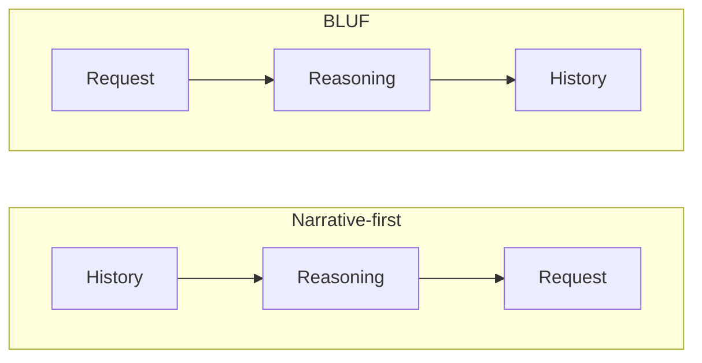

import Scenario from "../../../components/Scenario.astro";
import LevelIntro from "../../../components/LevelIntro.astro";
import PracticeCheck from "../../../components/PracticeCheck.astro";

export const unit = {
  track: "business-communication",
  unitSlug: "executive-summaries",
};

<Scenario label="The request was on the last line. The reader stopped at the first.">
  <Fragment slot="facts">
    

      

        

          First note
          request found 90% of the way down
        

        

          

        

      

      

        

          Rewritten note
          request found in the first line
        

        

          

        

      

      
📝 <strong>Content</strong> — identical in both; only the order changed

    

  </Fragment>

Alex leaves a note on the fridge. It opens with three paragraphs about
the history of the shared washing machine, how it was bought, and why it
has been temperamental. Only on the last line does it say: "Please do
not run it before Thursday evening; the plumber needs the water off."
A flatmate glances at the first two lines on the way to grab milk,
decides it is the usual washer saga, and starts a load that night. **Every
sentence in the note was true. What made it fail anyway, and what would
Alex change about the note's order, not its content?**

</Scenario>

<LevelIntro
  items={[
    "What BLUF means and why it reorders",
    "The parts: ask, stake, recommendation, detail",
    "Why a true note can still fail",
  ]}
/>

## Why does a true note still fail?

Alex's note has two orders available, and the facts are the same in both:

| Order           | A reader who stops after the first lines has seen |
| --------------- | ------------------------------------------------- |
| Narrative-first | The history, and no request                       |
| BLUF            | The request, and perhaps the reason               |

**BLUF** (bottom line up front) means opening with the conclusion or
request, then letting the reasoning follow for whoever has time. Narrative
order mirrors how the writer worked things out; BLUF mirrors what the
reader needs in order to act. It began as a military briefing convention
and works for any message a reader might stop reading partway through.

<PracticeCheck
  track={unit.track}
  unitSlug={unit.unitSlug}
  topicId="bluf-order"
/>

## What are the parts of a good first block?

"Put the point first" is vague until the point is broken into pieces. Four
terms are worth keeping apart:

| Term               | Plain meaning                                          | In Alex's note                                            |
| ------------------ | ------------------------------------------------------ | --------------------------------------------------------- |
| The ask            | The specific action or decision wanted from the reader | "Do not run the washer before Thursday evening"           |
| The stake          | What changes if the reader says yes, no, or waits      | A flooded flat if the water is on while the plumber works |
| The recommendation | The path the writer favors                             | "Use the laundromat this week"                            |
| Supporting detail  | Evidence and reasoning, placed after                   | Which valve, which hours, how the washer failed           |

An **executive summary** is a short opening block that is self-contained: a
reader of only that block knows what is requested and why. An
**executive** here means whoever can approve, reject, or redirect the ask;
the word points to decision pressure, not to job title. An **inverted
pyramid**, borrowed from newspaper writing, is the shape where each
paragraph matters a little less than the one before.

<PracticeCheck
  track={unit.track}
  unitSlug={unit.unitSlug}
  topicId="summary-parts"
/>

## What the next levels cover

L2 explains why narrative order and a hurried reader are structurally
mismatched, shows the pyramid order, and lists the four questions a
first block answers. L3 applies all of it to a real workplace document: a
three-page proposal rewritten line by line. For the status-update variant of
the same idea, see `business-communication/status-updates-build-trust`.
