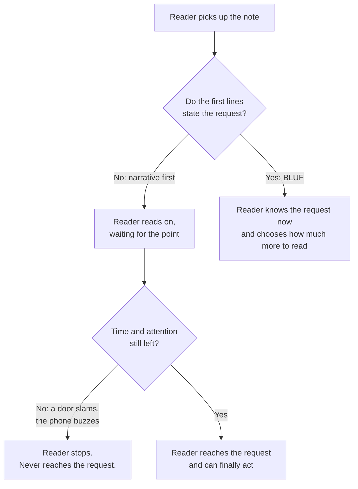
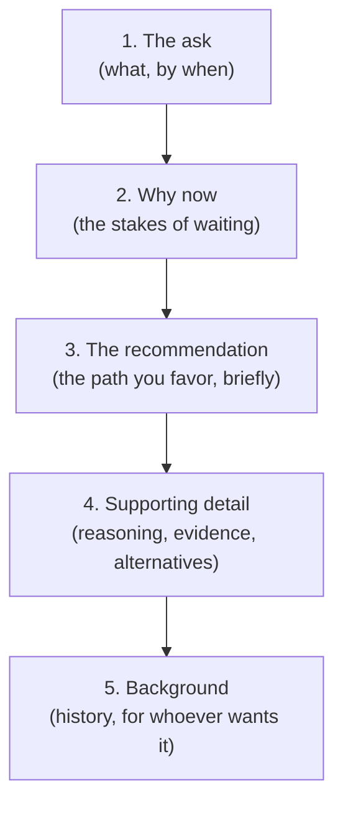

import LevelIntro from "../../../components/LevelIntro.astro";
import Checkpoint from "../../../components/Checkpoint.astro";
import PracticeCheck from "../../../components/PracticeCheck.astro";

export const unit = {
  track: "business-communication",
  unitSlug: "executive-summaries",
};

L1 named BLUF (bottom line up front) and the parts of a good opening: the
ask, the stake, the recommendation, and the supporting detail. This level
explains why narrative order and a hurried reader clash, what order replaces
it, and which four questions the opening block should answer.

<LevelIntro
  items={[
    "Why one order fails some readers and the other fails none",
    "The inverted pyramid: first, second, last",
    "The four questions a first block answers",
  ]}
/>

## If every sentence was true, what actually broke?

**Alex's fridge note was accurate. So what was wrong with it?** Not the
content but the order. A narrative-first note asks the reader to invest
several lines of attention before learning what is wanted, and a reader who
may stop at any moment cannot afford that trade:

**Why does this favor BLUF even for a reader with all the time in the
world?** Because BLUF costs that reader nothing: they still read everything,
just in a different order. Narrative order, by contrast, fails every reader
who runs out of time before the point, and you rarely know in advance who
that will be.

| Reader                  | Narrative-first    | BLUF                |
| ----------------------- | ------------------ | ------------------- |
| Reads every word        | Gets everything    | Gets everything     |
| Stops after a few lines | Misses the request | Has the request     |
| Skims                   | May miss it        | Finds it at the top |

<Checkpoint question="A colleague says BLUF is only for people in a hurry, and a careful reader doesn't need it. Are they right?">

No. A careful reader loses nothing under BLUF because they still read every
line, only in a different sequence. The hurried reader, though, is badly
served by narrative order, since they may stop before the request appears,
and that happens unpredictably. Since BLUF has no downside for the first
kind of reader and a real upside for the second, it is the safer default
whenever you can't be sure which one you are writing for.

</Checkpoint>

<PracticeCheck
  track={unit.track}
  unitSlug={unit.unitSlug}
  topicId="reader-asymmetry"
/>

## If the request goes first, where does everything else go?

**What happens to all the careful reasoning Alex wrote?** It does not
disappear. It moves, ordered so that each piece matters a little less to a
reader who has stopped there than the piece before it:

Notice what moved. The history of the washer was not deleted; it went from
position one to position five. It is still there for a reader who wants it,
but it no longer stands between a reader and the request. The ordering rule is
importance to the reader's decision, not effort spent or the order events
happened in.

<PracticeCheck
  track={unit.track}
  unitSlug={unit.unitSlug}
  topicId="inverted-pyramid"
/>

## What exactly belongs in the first few lines?

**Is the request alone enough, or does the opening need more?** A reader
deciding whether to keep reading needs enough to evaluate the request, not
just notice it. Four questions do that job:

| Question                | What it answers                        | Fridge note                                         | Workplace example                                                              |
| ----------------------- | -------------------------------------- | --------------------------------------------------- | ------------------------------------------------------------------------------ |
| What decision, by when? | The concrete ask                       | "Don't run the washer before Thursday evening."     | "Approval to move a quarter of next term's capacity to the billing migration." |
| Why now?                | The specific cost of waiting           | "The plumber has the water off and a pipe is open." | "The old service has no maintainer and has failed twice this year."            |
| What do you recommend?  | The path, briefly                      | "Use the laundromat this week."                     | "Move to the existing payments platform over six weeks."                       |
| What does it cost?      | What the reader gives up by saying yes | "A few trips to the laundromat."                    | "The analytics dashboard slips by one work cycle."                             |

**Why include the cost, when it might make approval harder?** Because
leaving it out does not make the trade-off vanish; the reader just finds it
later, at a worse moment, and wonders what else was left out. A summary that
lists only benefits reads as advocacy. One that shows upside and trade-off
reads as analysis, which is what earns the reader's trust.

<Checkpoint question="Someone drops the cost line from their summary, reasoning it will be approved faster without it. Does leaving it out actually help?">

Not really. The cost still exists, so either the reader notices it is missing
and asks, which now looks like something was hidden, or they approve without
knowing and discover it afterwards, which damages trust in every later
request from the same person. Naming the trade-off up front is what makes the
summary credible, and that credibility is exactly what makes the next request
easier to approve rather than harder.

</Checkpoint>

<PracticeCheck
  track={unit.track}
  unitSlug={unit.unitSlug}
  topicId="four-questions"
/>

## Failure modes at this level

- **Treating BLUF as "add a TL;DR at the end."** A summary placed last has
  already lost every reader who stopped before it. It has to come first.
- **Shortening the narrative without reordering it.** Compressing "history,
  reasoning, request" into three sentences still puts the request last. BLUF is
  a reordering, not a shortening.
- **Vague asks and missing costs.** "We should think about this eventually"
  gives the reader nothing to approve or reject, which tends to produce a
  polite non-answer.
