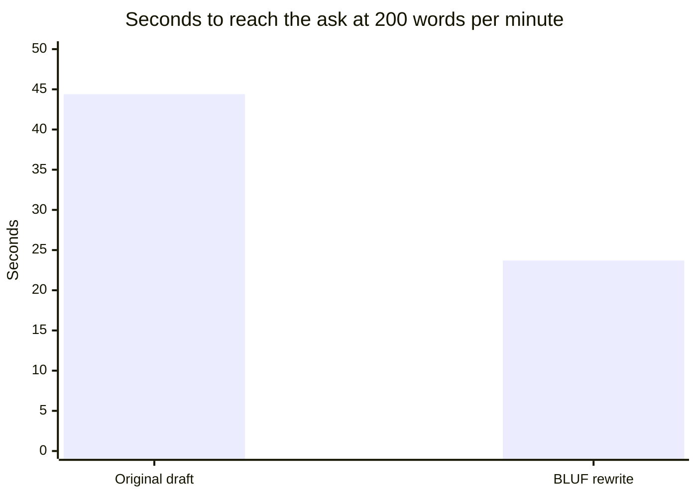

import Scenario from "../../../components/Scenario.astro";
import LevelIntro from "../../../components/LevelIntro.astro";
import Checkpoint from "../../../components/Checkpoint.astro";
import PracticeCheck from "../../../components/PracticeCheck.astro";

export const unit = {
  track: "business-communication",
  unitSlug: "executive-summaries",
};

<Scenario label="A three-page proposal and ninety seconds">
  <Fragment slot="facts">
    

      
👤 <strong>Writer</strong> — Jordan, an engineer proposing a fix to an old billing service

      
🧑‍💼 <strong>Reader</strong> — a VP who can approve or decline, reading in about ninety seconds

      
🎯 <strong>The ask</strong> — move about a quarter of next quarter's team time to a six-week migration

      
📍 <strong>Where it sits</strong> — the final paragraph of the draft

    

  </Fragment>

Jordan spends a week on a careful three-page proposal. It opens with
history, then context about the team's workload, and only at the end states
the ask. The VP skims it for about ninety seconds, never reaches the last
paragraph, and replies "thanks, let's discuss sometime", which never happens.
**Before reading the diagnosis: which paragraph do you expect the VP's
attention ran out at, and what single change would you make first?**

</Scenario>

<LevelIntro
  items={[
    "The original draft, paragraph by paragraph",
    "The same content reordered, with timings",
    "What carries over to other documents",
  ]}
/>

L2 gave the inverted pyramid and the four questions. Here they are applied
to one real document line by line, using Q3 and Q4 for business quarters
(three-month planning periods) and "sprint" for a short work cycle of one or
two weeks.

## What does a hurried reader do with each paragraph?

**If the VP genuinely has ninety seconds, what happens at each paragraph?**
Reading as the VP would, and stopping when attention runs out, makes the
failure concrete:

> **Paragraph 1: history.** "The billing service was built five years ago by
> a team that has since moved on to other projects. It was designed for our
> transaction volume at the time, which was roughly a tenth of what we process
> today. Over the years, several workarounds have been layered on top of the
> original design to handle edge cases the service was never built for."
>
> **What the VP does:** Reads it. Nothing signals urgency or asks for
> anything, so it reads as background for a point not yet made.

> **Paragraph 2: more history.** "The original architecture decisions made
> sense given the constraints at the time, but three separate incidents in the
> past year have traced back to the service's inability to handle current load
> reliably..."
>
> **What the VP does:** Skims. "Three incidents" registers, but with no ask
> attached it reads as justification still in progress.

> **Paragraph 3: team capacity.** "The team currently has capacity allocated
> across the analytics dashboard, the reporting API redesign, and ongoing
> maintenance. Any additional work would require reprioritization
> discussions..."
>
> **What the VP does:** This is roughly where the ninety seconds run out. A
> meeting starts, and the VP has read three paragraphs without learning what
> Jordan wants.

> **Paragraph 4 (never reached): the ask.** "Given the above, I'm requesting
> approval to reprioritize approximately 25% of Q3 capacity toward migrating
> the billing service to the payments team's existing platform over the next
> six weeks."

**The ask was specific and well reasoned. It was also the one sentence the VP
never reached.**

<Checkpoint question="Paragraph 4 was specific, well justified and aimed at the VP's own priorities. Why did it still fail to get a decision?">

Because how good an argument is and whether it gets read are separate
things, and the draft only controlled the second one weakly. The ask only
matters to a reader who reaches it, and a reader working in gaps between
meetings stopped three paragraphs earlier, however good paragraph 4 was.
Making the ask more convincing would not help, since nobody sees it. What
helps is moving it to where the reader will actually look.

</Checkpoint>

## What does the same content look like reordered?

**What happens to the identical facts when the order changes but nothing is
cut?** Every fact is still here, with the parts needed for a decision first:

|                              | Original draft                | BLUF rewrite                              |
| ---------------------------- | ----------------------------- | ----------------------------------------- |
| Opens with                   | History of the service        | The ask, with a decision date             |
| Stakes appear                | Paragraph 2, as justification | Second sentence, as the reason to act now |
| Recommendation               | Final paragraph               | Third sentence                            |
| Cost of saying yes           | Never stated                  | Fourth sentence                           |
| History and capacity context | Paragraphs 1 to 3, first      | Labeled "Background", last                |

> **Opening block (executive summary), enough for a reader who stops here:**
>
> "**Requesting approval to reprioritize 25% of Q3 engineering capacity to
> migrate the legacy billing service. Please decide by [date] so the 6-week
> migration finishes before Q4 load.** The current billing service has caused
> three production incidents this year and has no dedicated maintainer; the
> risk of a customer-facing billing failure grows every quarter this is
> delayed. Recommended approach: migrate to the payments team's existing
> platform (estimated 6 weeks). Trade-off: this delays the analytics
> dashboard project by one sprint."
>
> **Then, for anyone still reading:** the same three paragraphs of history and
> context, now labeled "Background".

The `[date]` is a placeholder to replace with the real decision date. The
opening block is about 79 words, versus roughly 150 words of setup before
the ask in the original. At a typical reading speed of 200 words per minute,
that is the difference in time to reach the ask:

The demo on this level lets you vary the reading speed. The shape stays the
same: the rewrite reaches the ask in about half the time at any speed. And
because the ask, stakes, recommendation and cost are all inside that opening,
a decision is possible even if nothing after it is read.

## Why is this not just "make it shorter"?

**Could Jordan have fixed this by cutting the draft to one page and keeping the
same paragraph order?** No. A shorter version of paragraphs 1, 2, 3, 4 in
that order still buries the ask behind setup, only smaller setup. What fixed it
was not cutting anything, but moving one sentence from the end to the
beginning. The background paragraphs are fully present in the rewrite, just
demoted to "read if you have time".

<Checkpoint question="A teammate proposes: 'let's just make Jordan's draft half as long, same order.' Does that fix the failure?">

No. Trimming reduces how much the reader must get through before the ask,
but the ask is still last, so a reader who stops after ninety seconds in a
one-page narrative version still hasn't reached it; they have only stopped
a bit deeper into a shorter document. Reordering, not trimming, is what
guarantees the ask is seen by someone who might stop at any point. They are
two different fixes, and only one addresses what went wrong.

</Checkpoint>

<PracticeCheck
  track={unit.track}
  unitSlug={unit.unitSlug}
  topicId="reorder-not-shorten"
/>

## What generalizes, and what does not?

The principle, which is to lead with what matters most to a reader who may
stop, applies to almost any document: a status update, a postmortem summary,
an incident report, a note on a fridge. What is specific to Jordan's case is
the exact four questions, which fit a request for a decision. Other
documents front-load different things:

| Document               | What its opening carries                            |
| ---------------------- | --------------------------------------------------- |
| Request for a decision | The ask, why now, the recommendation, the cost      |
| Status update          | Current status, impact, what changed, next estimate |
| Incident summary       | What broke, the state now, what is being done       |

**Try extending it yourself.** Suppose Jordan were instead reporting that the
migration is now two weeks behind and needed no decision. Would the same four
questions still be the right opening? What would a stopped reader of that
update most need? Then try a harder variation: what changes if the reader is
a peer who disagrees with the plan rather than a VP who approves it?

For the first variation, the opening should carry current status, impact,
what changed, and the next estimate, with an ask only if there is one. The
`status-updates-build-trust` unit covers that pattern directly.

## This worked example is a case, not the whole territory

Jordan's proposal is one document, with one reader, under one kind of time
pressure. Treat it as a way to see the principle at work, not as a template to
copy. A different reader, a different document type or a different cost of
being wrong all change what belongs in the first lines.

<PracticeCheck
  track={unit.track}
  unitSlug={unit.unitSlug}
  topicId="generalize-bluf"
/>

## Failure modes

| Failure mode                                           | What it gets wrong                                                                                                                       |
| ------------------------------------------------------ | ---------------------------------------------------------------------------------------------------------------------------------------- |
| Assuming a well-reasoned document will be read in full | Soundness doesn't guarantee attention; a reader who stops at paragraph 3 never benefits from paragraph 4                                 |
| Cutting a narrative draft down without reordering      | Shortening lowers the cost of reaching the ask but leaves the ask last                                                                   |
| Omitting the trade-off to make the ask more appealing  | A reader who finds the missing cost later trusts everything else less                                                                    |
| Using one template for every kind of document          | A request, a status update and an incident report front-load different information; the principle is general, the four questions are not |
