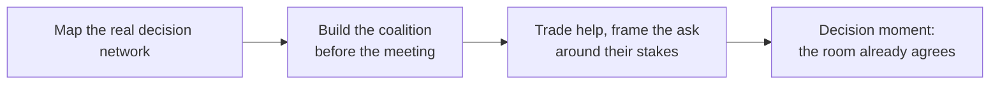

import Scenario from "../../../components/Scenario.astro";
import LevelIntro from "../../../components/LevelIntro.astro";
import PracticeCheck from "../../../components/PracticeCheck.astro";

export const unit = {
  track: "business-communication",
  unitSlug: "informal-authority",
};

<Scenario>
  <Fragment slot="facts">
    

      

        0 of 4
        tech-lead allies secured
      

      

        

      

    

    
Decision meeting

    

      
📅 <strong>12 days</strong> away

      
🧑‍💼 Dev has <strong>no formal authority</strong> over anyone in the room

    

    
Who's in the room

    

      
🖋️ VP Farid — signs the decision

      
🧭 4 tech leads — write the recommendation Farid signs

    

  </Fragment>

Strip away the job titles first. A school is choosing between a
one-day trip and a three-day trip. The principal signs the form, but
she has never organized a trip herself, so she signs whatever the four
parent representatives agree on. A student who wants the shorter trip
cannot vote and cannot sign anything. **Who does that student need to
talk to, and when?**

The same shape shows up at work. Dev is an engineer on the Platform
team at Lattice Freight, a logistics company. In twelve days a steering
committee will decide how to migrate the system that routes every
order: a **hard cutover** (replace the old system in one weekend) or an
**incremental migration** (run old and new side by side for a month).
Dev has watched a hard cutover go badly before, and this one lands in
peak shipping season. But Dev manages no one in that room, does not own
the system, and is not on the committee.

**If Dev walks into the meeting on day 12 and makes his case out loud
for the first time, what are his odds, and is that even the right day
to be making his case?**

</Scenario>

Both natural instincts are wrong. Waiting for the meeting is too late,
and speaking loudly is not the same as being heard by the people who
actually decide.

<LevelIntro
  items={[
    "Formal vs. informal authority",
    "Nominal vs. real decision-makers",
    "Coalition-building before the meeting",
  ]}
/>

## What kinds of authority are there?

**If Dev has no title that matters here, does he have any power at all?**
He does, but of a different kind than the one the org chart shows.

| Term               | Simple meaning                                                         |
| ------------------ | ---------------------------------------------------------------------- |
| Formal authority   | Power that comes from a title: the right to decide, assign, or approve |
| Informal authority | Influence earned through trust, credibility, and relationships         |

- A manager can assign work and a director can approve budget. That is
  formal authority, and it stops where the title stops.
- Informal authority comes from being someone whose judgment people
  already weigh before they decide. It travels across teams and
  reporting lines because it is not attached to a box on a chart.

<PracticeCheck
  track={unit.track}
  unitSlug={unit.unitSlug}
  topicId="authority-types"
/>

## Who actually decides?

**In the school story, whose opinion decides the trip: the principal's,
or the four representatives'?** Every decision has two maps that do not
always match.

| Map                    | Who is on it                                                           |
| ---------------------- | ---------------------------------------------------------------------- |
| Nominal decision-maker | Whoever's name is on the sign-off: the org-chart answer                |
| Real decision-makers   | Whoever's input the nominal decision-maker cannot comfortably overrule |

- Arguing brilliantly to the nominal decision-maker while the real
  decision has already been made by others is a common and avoidable
  failure.
- The practical test is one question: whose objection would actually
  stop this?

<PracticeCheck
  track={unit.track}
  unitSlug={unit.unitSlug}
  topicId="real-decision-network"
/>

## When does the work happen?

**Why not simply win the argument in the meeting?** Because people do
not change a position they have had no time to sit with, in front of an
audience, on the spot.

- A **coalition** is a set of people who support your position before
  the decision moment arrives.
- Built **before** the meeting, it changes what the meeting is: the
  signer hears a shared recommendation, not one person's lone
  objection.
- Built **during** the meeting from a standing start, it almost never
  forms.
- **Reciprocity** (trading real help now for support later) and a
  **credible messenger** (someone with standing on the topic who carries
  your point) are the two tools that make early conversations land.

<PracticeCheck
  track={unit.track}
  unitSlug={unit.unitSlug}
  topicId="coalition-timing"
/>

## What this unit covers

L2 works out the mechanism behind each move: mapping the real network,
why timing and a majority threshold matter, how reciprocity and framing
make an early conversation land, and when to hand a point to a
messenger. L3 follows Dev through his twelve days and then breaks the
plan by changing the room.
