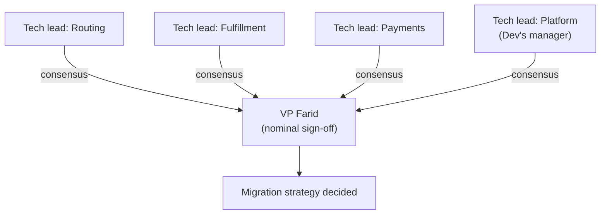
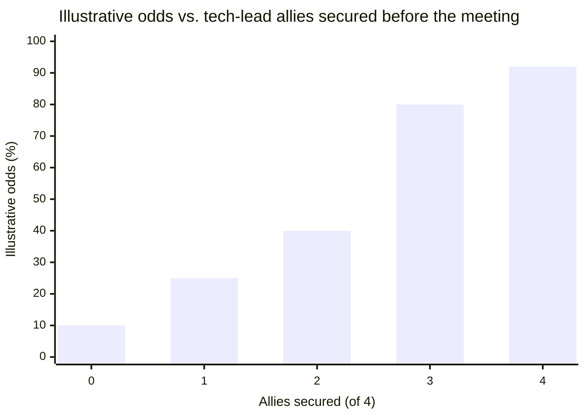

import LevelIntro from "../../../components/LevelIntro.astro";
import Checkpoint from "../../../components/Checkpoint.astro";
import PracticeCheck from "../../../components/PracticeCheck.astro";

export const unit = {
  track: "business-communication",
  unitSlug: "informal-authority",
};

L1 left Dev with a plan, not a script: map the real decision network,
build a coalition before the meeting, trade help and frame the ask
around the listener's stakes, and use a credible messenger where his own
standing runs out. L2 works out the mechanism behind each move, starting
with the map itself.

<LevelIntro
  items={[
    "Reading the real decision network",
    "Timing, order, and the majority threshold",
    "Reciprocity, framing, and messengers",
  ]}
/>

## Who actually decides?

**If VP Farid's name is on the sign-off, is he simply the person to
convince?** Not necessarily. A nominal decision-maker often defers to a
smaller circle whose judgment they trust more than their own on that
topic. Farid has never run a migration himself; he relies on four tech
leads to reach a shared recommendation, and he signs whatever they
agree on. Convincing Farid without reaching the tech leads is arguing
to the wrong map.

Two questions separate the nominal map from the real one:

1. **Whose name is on the decision?** The org-chart answer.
2. **Whose objection would actually stop it?** The real answer. If one
   tech lead pushed back hard, would Farid still sign? If not, that
   person is a real decision-maker whatever their title says.

| Signal                                                          | What it suggests                                 |
| --------------------------------------------------------------- | ------------------------------------------------ |
| The nominal owner asks "what do you all think?" before deciding | They defer to the people they are asking         |
| One person's disagreement has reliably delayed past decisions   | That person holds real veto power                |
| A decision moves fast once one specific person signs off        | That person is a bottleneck worth reaching early |

<Checkpoint question="Dev spends a week building an airtight case and presents it to VP Farid one-on-one. Farid nods. At the meeting the four tech leads' consensus goes the other way, and Farid signs it. What did Dev's plan miss?">

Dev convinced the nominal decision-maker without ever reaching the real
ones. Farid's personal agreement mattered less than Dev assumed because
Farid's habit is to defer to the tech leads' consensus rather than
override it. Pushing harder on Farid would not have helped; the same
effort aimed at the four tech leads, whose recommendation is what Farid
actually signs, would have.

</Checkpoint>

<PracticeCheck
  track={unit.track}
  unitSlug={unit.unitSlug}
  topicId="real-decision-network"
/>

## Why does timing decide so much?

**Does it matter whether Dev talks to the tech leads in the meeting or
the week before?** Enormously. A private conversation days earlier gives
someone room to reconsider, ask questions, and arrive already aligned,
which reads as their own judgment. The same change demanded live reads
as losing face.

| Coalition-building attempted...     | What actually happens                                                           |
| ----------------------------------- | ------------------------------------------------------------------------------- |
| During the meeting, cold            | People default to their prior position; changing it live feels like losing face |
| Days before, one-on-one             | Room to reconsider, ask questions, and arrive aligned                           |
| Weeks before, sequenced by leverage | Early converts help win over the harder holdouts                                |

Order matters too. Approaching first the person whose own team gains
most from the safer migration gives Dev a second voice before he meets
the harder holdouts, because "a peer of yours already leans this way"
changes the frame of the next conversation.

<PracticeCheck
  track={unit.track}
  unitSlug={unit.unitSlug}
  topicId="coalition-timing"
/>

## Does each extra ally count the same?

**Is a fourth ally worth the same as a first?** Not in this model. The
unit's interactive demo uses an illustrative curve (a teaching model, not
measured data): odds climb a little with each ally, then jump once Dev
holds a majority of the four real decision-makers.

The jump between 2 and 3 is the point. At three of four, the room's
default flips from "open question" to "already leaning", which is worth
more than the same number of allies short of a majority. Two of four is
a split room, not almost a win.

<PracticeCheck
  track={unit.track}
  unitSlug={unit.unitSlug}
  topicId="majority-threshold"
/>

## Reciprocity: trading help, not collecting debts

**If Dev has never done anything for the tech leads, why would any of
them spend goodwill backing him?** Usually they would not. Reciprocity
is what makes an ask land as fair: Dev offers something genuinely useful
(reviewing a risky part of someone's plan, sharing context only he has)
and does so for its own sake, well before he needs anything.

The size of what is traded should roughly match the size of the ask. A
small favor does not buy public support on a contested company-wide
decision, but it can buy fifteen honest minutes to be heard, which is
often the real bottleneck.

<Checkpoint question="Dev offers to review Sana's migration plan for free, a full month before he mentions his own concern. Why does the later ask land differently than if he had offered the same review in the same breath as the ask?">

A month-early, unprompted favor reads as a genuine deposit because it
shows Dev was helpful without needing anything back. That is what lets
the later ask read as reciprocity. Offering the same help in the same
conversation as the ask makes the timing obvious, and an obviously timed
favor reads as a transaction. That can cost credibility instead of
building it.

</Checkpoint>

<PracticeCheck
  track={unit.track}
  unitSlug={unit.unitSlug}
  topicId="reciprocity"
/>

## Framing the ask around their stakes

**Does "please support the incremental plan because I'm worried about
risk" work as an opening line?** It is weaker than it sounds because it
is built around Dev's worry, not the listener's. The stronger version
names what the plan does for that specific person.

| Framed around Dev's concern             | Framed around the listener's stakes                                       |
| --------------------------------------- | ------------------------------------------------------------------------- |
| "I'm worried the hard cutover is risky" | "This gives your team a rollback window during your own on-call rotation" |
| Asks the listener to adopt Dev's worry  | Shows a reason the listener already has                                   |
| Easy to dismiss as one person's opinion | Hard to dismiss because it names their own risk                           |

The position is identical; only the angle changes. Sana hears a
rollback window; Miguel hears a way to avoid freezing his team's work
for one cutover weekend.

<PracticeCheck track={unit.track} unitSlug={unit.unitSlug} topicId="framing" />

## Credible messengers, when your own standing runs out

**What if Farid answers, "you're not even on-call for order-routing, so
why are you worried?"** That is a real gap, not rudeness: Dev's standing
on this specific risk is thin. The move is not to argue past it. It is
to find someone whose standing on that exact point is unquestioned and
get them to say the same thing. Priya, the SRE lead who has run three
cutover incidents, can say in one sentence what would take Dev ten
minutes to justify.

A credible messenger does not replace the coalition work. They help most
after Dev has built agreement with a few leads, by carrying the risk
case to the one or two who remain unconvinced.

<PracticeCheck
  track={unit.track}
  unitSlug={unit.unitSlug}
  topicId="credible-messenger"
/>

The four moves generalize past this decision: map who really decides,
build agreement before the moment that counts, trade something real and
frame the ask around what the other person already wants, and hand off
the piece where your own standing runs out.
