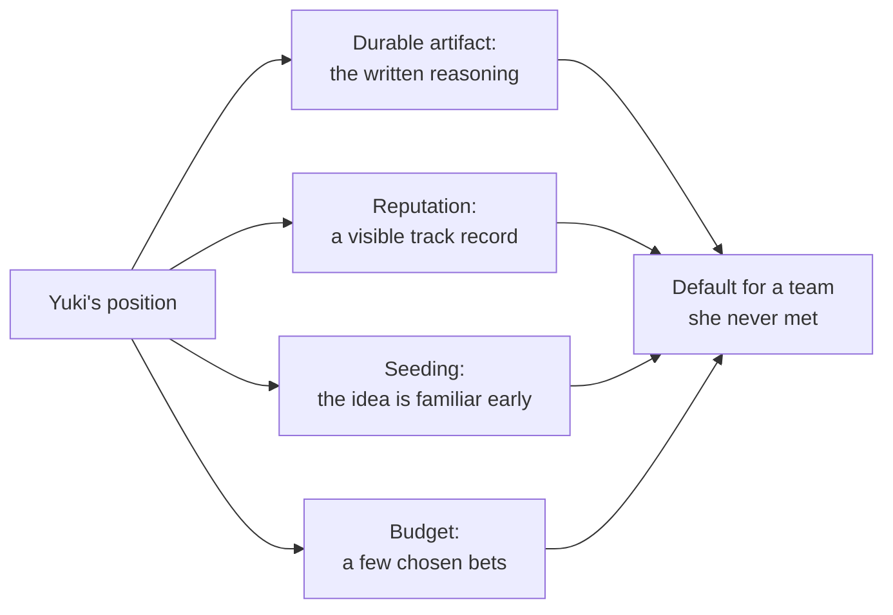

import Scenario from "../../../components/Scenario.astro";
import LevelIntro from "../../../components/LevelIntro.astro";
import PracticeCheck from "../../../components/PracticeCheck.astro";

export const unit = {
  track: "business-communication",
  unitSlug: "org-level-influence",
};

<Scenario label="No meeting. No vote. Fourteen teams, deciding on their own schedule.">
  <Fragment slot="facts">
    

      

        

          Teams Yuki manages
          0 of 14
        

        

          

        

      

      
🧩 <strong>14 teams</strong>, each with its own tech lead and roadmap

      
📈 Company grew from <strong>40 to 190</strong> engineers in two years

      
📅 <strong>No single decision meeting</strong>: it gets decided team by team over the next year

    

  </Fragment>

Yuki is a principal engineer at Solstice Health. In two years the company
grew from 40 engineers to 190, and the boundaries between services still
follow whichever team wrote the first version of some code, not the shape of
the business. Services call each other in tangled ways, the same logic lives
in three places, and about every other month one team's "small" change
silently breaks two others.

Yuki is convinced new services should be drawn around real business domains.
But nobody has asked her for a recommendation, there is no steering
committee, and no meeting on the calendar where this gets decided. It will
get decided fourteen separate times, by fourteen tech leads, whenever each
one starts or restructures a service.

**If there is no meeting to win and no single person to convince, what does
"getting this to happen" even mean?**

</Scenario>

That is a different problem from winning one room on one day. A single
decision is a sprint with a deadline. Shaping company-wide direction is
closer to setting a policy that has to survive dozens of decisions you will
not be present for.

<LevelIntro
  items={[
    "Single-decision vs. org-level influence",
    "The four tools that work at this scale",
    "Why weighing in on everything backfires",
  ]}
/>

## Is this the same kind of problem as winning a meeting?

**Would a great fifteen-minute pitch at the architecture review settle it?**
It would raise awareness, but the decisions happen later, team by team, when
a tech lead is heads-down designing a service and Yuki is not there.

|                           | Single-decision influence            | Org-level influence                                        |
| ------------------------- | ------------------------------------ | ---------------------------------------------------------- |
| Shape of the decision     | One moment, one room, one outcome    | Many small decisions over months, mostly without you there |
| What "winning" looks like | The room agrees on the day           | Your position becomes the default people reach for         |
| Main tool                 | A coalition built before the meeting | Written artifacts, reputation, and where attention goes    |
| Time horizon              | Days to weeks                        | Months to years                                            |
| Where you show up         | In the room, at the moment it counts | In writing, cited by people who never spoke to you         |

- **Org-level influence** means shaping many future decisions you will not be
  present for, by making your position the default.
- `informal-authority` covers the single-decision case. This unit covers what
  to do when there is no such moment.

<PracticeCheck
  track={unit.track}
  unitSlug={unit.unitSlug}
  topicId="influence-shapes"
/>

## What are the tools that work at this scale?

**If Yuki cannot be in the room, what can be?** Four things can.

| Term             | Simple meaning                                                                   |
| ---------------- | -------------------------------------------------------------------------------- |
| Durable artifact | A written RFC, design doc, or ADR that keeps making the case after the talk ends |
| Reputation       | Trust earned by being visibly right over time, not by one strong argument        |
| Seeding          | Introducing an idea before it is needed, so it is already familiar               |
| Influence budget | The finite time and credibility a person has to spend being heard                |
| Company-wide bet | A chosen direction worth real budget, as opposed to every disagreement           |

<PracticeCheck
  track={unit.track}
  unitSlug={unit.unitSlug}
  topicId="four-tools"
/>

## Why not weigh in on everything?

**Yuki has opinions on naming, test frameworks, and API style too. Why not
spend influence on all of them?** Because hours and credibility are both
finite. Spreading them across every disagreement leaves too little for the
few bets that actually matter, and people stop reading what she writes.

The rest of this unit works out how each tool operates, and how Yuki picks
which few bets deserve her limited budget.
