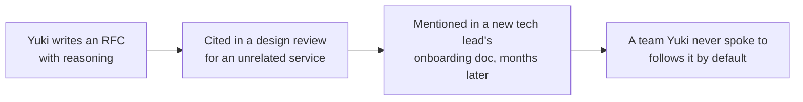
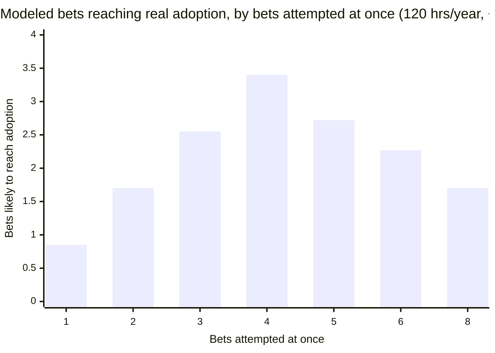

import LevelIntro from "../../../components/LevelIntro.astro";
import Checkpoint from "../../../components/Checkpoint.astro";
import PracticeCheck from "../../../components/PracticeCheck.astro";

export const unit = {
  track: "business-communication",
  unitSlug: "org-level-influence",
};

L1 named four tools Yuki can use when no meeting will decide anything:
durable artifacts, reputation, seeding, and a finite influence budget spent
on chosen bets. L2 works out the mechanism behind each, starting with what
makes an artifact durable rather than just written down.

<LevelIntro
  items={[
    "What makes an artifact durable",
    "How reputation compounds and gets spent",
    "Seeding early, and why budget has a threshold",
  ]}
/>

## Why would an RFC do anything a Slack message would not?

**Yuki could message each of the 14 tech leads her opinion. What does a
written RFC add?** A message lives in one thread, seen once by whoever was
in the channel that week. A durable artifact is built to be found later by
someone who was never part of the conversation, at the moment they need it.

| Property                           | Slack message or hallway chat             | Durable artifact (RFC, design doc, ADR)          |
| ---------------------------------- | ----------------------------------------- | ------------------------------------------------ |
| Findable later?                    | No, buried in scrollback within days      | Yes, linked, searchable, mentioned in onboarding |
| Citable by a stranger?             | No, "Yuki told me once" carries no weight | Yes, "see RFC-014" works whoever is asking       |
| Survives Yuki being unavailable?   | No                                        | Yes, the reasoning stands on its own             |
| Shows reasoning, not just verdict? | Rarely                                    | Should always, including rejected alternatives   |

Its job is not to announce a decision. It is to carry the **reasoning** far
enough that someone who never met Yuki can apply it correctly to a case she
never anticipated. A verdict with no "why" gets followed only when a case
looks exactly like the example.

Yuki appears at no step after the first. That is the point.

<Checkpoint question="Yuki publishes two paragraphs: 'new services should own their own data, no shared databases.' No reasoning, no examples. Six months later a tech lead shares a database 'because the doc didn't cover this case.' What did the doc fail to do?">

It stated a verdict without carrying the reasoning, so nobody could extend
it to a case it did not name. A rule without a "why" only covers situations
that look exactly like its example; anything slightly different is treated as
out of scope even when the principle clearly applies. The fix is not a
stricter rule but a clearer explanation of why, including when it does not
apply, so a stranger can reason about cases Yuki never wrote down.

</Checkpoint>

<PracticeCheck
  track={unit.track}
  unitSlug={unit.unitSlug}
  topicId="durable-artifacts"
/>

## If Yuki is right, why isn't that enough?

**Shouldn't the evidence speak for itself?** Being right is not the same as
being trusted to be right. Trust comes from a visible track record, and no
single piece of evidence shortcuts it. Each time a past call of hers proves
correct, the next thing she says gets a little more benefit of the doubt
before anyone checks it.

It compounds, but it is also spent. Every miss, and every confident opinion
on something outside her expertise, draws down the same account her
architecture opinions rely on.

| Event                                              | Effect on the account                          |
| -------------------------------------------------- | ---------------------------------------------- |
| A warning she raised proves accurate               | Deposit: next claim gets more benefit of doubt |
| A design she pushed for holds up in production     | Deposit, and a citable example                 |
| A confident opinion on a topic she never worked in | Withdrawal, with no matching expertise         |
| A public miss she defends past the evidence        | Larger withdrawal than the miss itself         |

<Checkpoint question="Yuki has a strong record on service boundaries. A tech lead asks which frontend framework to adopt, a field she has never worked in. Should she answer with the same confidence, because her reputation is strong?">

No. Reputation behaves more like topic-specific credibility than a general
reservoir of authority. A confident answer outside the area where the record
was built risks being wrong in public on something nobody expected her to
have standing on, and that spends the trust her boundary opinions rely on.
Saying plainly that this is outside her experience protects the account for
the bets she actually chose.

</Checkpoint>

<PracticeCheck
  track={unit.track}
  unitSlug={unit.unitSlug}
  topicId="reputation"
/>

## Why not make the case when the team is deciding?

**Why seed an idea months early instead of pitching it when a tech lead
starts designing?** By then they are under time pressure with a half-formed
design, and a brand-new idea looks like a costly detour. Seeding makes the
idea familiar before it is needed: a comment on someone else's review, a
five-minute aside in a sync, a line in an unrelated doc. None ask for a
decision. When the real decision arrives, it feels like confirming something
half-remembered, not adopting a stranger's agenda.

| Introduced...                             | What happens                                                             |
| ----------------------------------------- | ------------------------------------------------------------------------ |
| While the design is already being decided | Reads as a detour from a plan already in motion                          |
| Months earlier, in a low-stakes comment   | Familiar by the time it matters, so it feels like confirming             |
| Repeated in several contexts over time    | Several people recall it independently, which reads as consensus forming |

<PracticeCheck track={unit.track} unitSlug={unit.unitSlug} topicId="seeding" />

## Why does a finite budget have a tipping point?

**If more bets means more chances, why not back as many as possible?**
Every RFC, review comment, and cross-team conversation draws on the same
pool of hours and credibility. The model below assumes about 120 spendable
hours a year and about 30 sustained hours for a bet to become a durable,
cited default. Below that threshold a bet mostly fizzles.

This is a teaching model with an assumed 85% success rate for a fully funded
bet, not a measurement. The shape is what matters: total landed bets rise
until about four, then fall, because each bet gets too thin a slice of hours
to cross the threshold. Past that point, backing more things produces
**fewer** wins. The interactive demo for this unit lets you drag the number of bets yourself.

<Checkpoint question="At 120 hours a year and about 30 hours needed per bet, Yuki is tempted to run eight bets 'to increase her odds.' Using the shape of the model, why does that backfire?">

Eight bets leave only 15 hours each, half of what a bet needs to become a
durable default. Most never cross the threshold, so the modeled total falls
to about 1.7 landed bets, below what four fully funded bets would give.
More attempts only help while each one still gets enough sustained
attention. Beyond that, spreading thinner trades real wins for the feeling
of activity.

</Checkpoint>

<PracticeCheck
  track={unit.track}
  unitSlug={unit.unitSlug}
  topicId="budget-threshold"
/>

L3 follows Yuki through eighteen months: which few bets she picks, what she
declines, and how the four tools work together.
