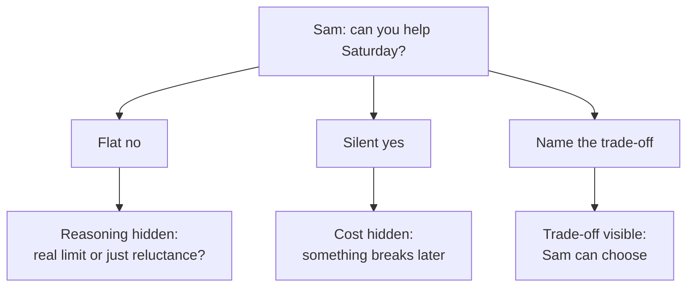

import Scenario from "../../../components/Scenario.astro";
import LevelIntro from "../../../components/LevelIntro.astro";
import PracticeCheck from "../../../components/PracticeCheck.astro";

export const unit = {
  track: "business-communication",
  unitSlug: "pushback-frameworks",
};

<Scenario label="A favor on an already full Saturday">
  <Fragment slot="facts">
    

      
📥 <strong>The ask</strong> — Sam: "Can you help me move apartments this Saturday?"

      
🎨 <strong>Already promised</strong> — helping Maya's sister paint, 9 to 3

      
📚 <strong>Also coming</strong> — a test on Monday, so Sunday is for studying

      
😬 <strong>Two easy answers</strong> — a bare "no" feels cold, a quiet "yes" guarantees something gives

    

  </Fragment>

Sam asks Maya to help move apartments this Saturday. Maya has already
promised to help her sister paint that day, and she has a test on Monday.
Saying "no" outright feels cold. Saying "sure" and hoping it works out
guarantees that one of the two promises quietly breaks. **Is there a third
answer that is neither a flat refusal nor a silent overcommitment?**

</Scenario>

<LevelIntro
  items={[
    "What the two easy answers hide",
    "The third option: trade-off pushback",
    "What makes a constraint concrete",
  ]}
/>

## What do the two easy answers hide?

Maya has two obvious replies. Which one costs less?

| Reply        | What Sam learns                   | What stays hidden                            |
| ------------ | --------------------------------- | -------------------------------------------- |
| Flat "no"    | The answer, with no reasoning     | Whether the limit is real or just reluctance |
| Silent "yes" | Maya is available, apparently     | The promise that will quietly break          |
| Pushback     | The real conflict and the choices | Nothing important                            |

Neither easy answer is dishonest in intent. Both keep the **real trade-off**
out of view, so the person who owns the priority cannot weigh it. A bare "no"
is still fine when there is nothing to trade, for instance a request you would
never take on. The failure is hiding a negotiable constraint behind it.

<PracticeCheck
  track={unit.track}
  unitSlug={unit.unitSlug}
  topicId="two-bad-answers"
/>

## What is the third option?

**Trade-off pushback** means naming the real constraint and the concrete
choices it creates, then handing the decision back to the person who asked.
Maya might say: "I'm painting with my sister 9 to 3. I can come after three,
or help on Sunday morning. Which works better?"

- **Silent overcommitment**: agreeing without surfacing the cost, so it shows
  up later, unplanned and unagreed-to.
- **Informed trade-off**: a decision the requester makes with the real cost
  visible, rather than one they discover after something has broken.

<PracticeCheck
  track={unit.track}
  unitSlug={unit.unitSlug}
  topicId="pushback-definition"
/>

## What makes a constraint concrete?

"I'm swamped" and "I'm painting from 9 to 3 and studying Sunday" can both be
true. **Which one can Sam do something with?**

| Vague (a feeling)       | Concrete (a checkable fact)                 |
| ----------------------- | ------------------------------------------- |
| "I'm really busy."      | "Painting runs 9 to 3, and I study Sunday." |
| "Saturday is hectic."   | "I promised my sister Saturday morning."    |
| "I have a lot going on" | "Two tasks are already due Friday."         |

A concrete constraint is something the requester can check and trade against.
A vague one can only be believed or doubted.

<PracticeCheck
  track={unit.track}
  unitSlug={unit.unitSlug}
  topicId="concrete-constraint"
/>

## What the next levels cover

The same pattern shows up at work, for example a product manager asking for
something by Friday on top of a full sprint. L2 explains why each easy answer
damages trust at a different time, lays out the four steps of pushback, and
shows who should make the final call. L3 answers one workplace request three
ways so the difference is visible in the actual words. For the decision-role
side of trade-offs, connect this with
`business-communication/decision-making-frameworks`.
